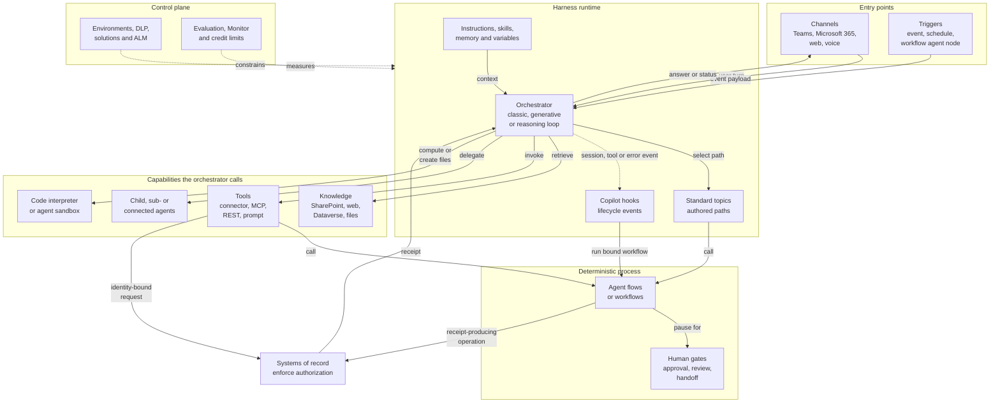
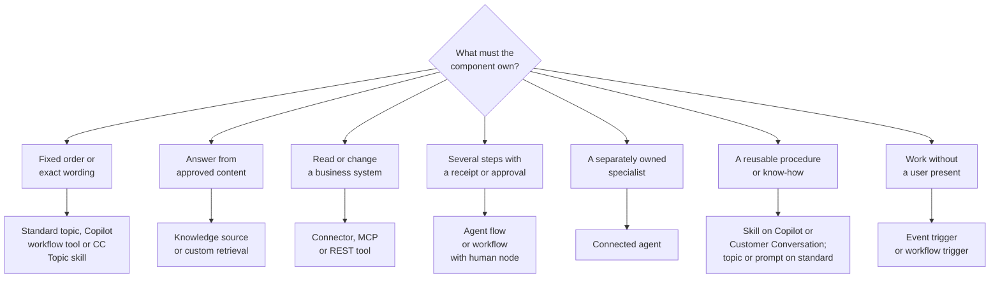

# Copilot Studio component guide

**As of 2026-11-27.** This guide explains which Copilot Studio building block to use for each responsibility in a pattern. Every [catalog](CATALOG.md) entry has a **Copilot Studio components** section that links back here. The [Copilot Credits guide](COPILOT-CREDITS.md) explains how those choices affect consumption.

Availability is taken from Microsoft Learn on the date above. Several Microsoft Copilot harness capabilities are preview, Frontier or still rolling out. Before you design around a feature, confirm its current status, region, channel and licensing.

## The harness is the first decision

A **harness** is the runtime between the model and what the maker configures. It decides when to call the model, what context to send, how to interpret the result and which tool to run. The harness determines which components are available and which billing model applies, so choose it before mapping components.

| Decision | Standard harness | Microsoft Copilot harness | Customer Conversation harness |
| --- | --- | --- | --- |
| Best fit | Rule-based agents, structured conversations, bounded tasks and agent flows | Long-running, multi-step and reasoning-heavy work across tools, files and outputs | Customer service over voice and chat, with escalation to a person |
| Who defines the path | The maker, through topics, tool descriptions, variables and flows | The orchestrator reasons from the latest state; workflows supply fixed paths | A primary agent and its sub-agents, each with an escalation path |
| Fixed-sequence component | Topics and agent flows | Workflows and hooks | Topic skills, events and workflows |
| Multi-agent composition | Child agents and connected agents | Connected agents | Sub-agents and connected agents |
| Billing | Rate per billed event, with Microsoft 365 Copilot inclusion for qualifying employee use | Usage-based from build time, covering tokens, tools and the harness | Usage-based, varying by conversation complexity and modality |

Choose the standard harness when consistency, explicit control, responsive interaction or established channels matter most. Choose the Microsoft Copilot harness when the agent must reason over large files, recover from failed steps, run for longer or own a multi-output process. Microsoft warns that a more capable harness can overwork a simple problem and add latency and credits without a better result. Treat migration between harnesses as re-architecture, not component conversion.

Sources: [Harnesses in Copilot Studio](https://learn.microsoft.com/en-us/microsoft-copilot-studio/harnesses-overview), [Compare Copilot Studio agent harnesses](https://learn.microsoft.com/en-us/microsoft-copilot-studio/guidance/choose-harness), [Understand orchestration patterns](https://learn.microsoft.com/en-us/microsoft-copilot-studio/guidance/understand-harnesses).

## Component map

**Reading the map:** The orchestrator decides *what* to do next. Knowledge, tools and agents do the work, and flows or workflows make consequential steps repeatable. A system of record, not the agent, enforces whether the caller may read or change a record. Skills, memory and instructions shape behavior but never grant permission.

## Choose a component by responsibility

## Component reference

Availability uses **Std** (standard harness), **Copilot** (Microsoft Copilot harness) and **CC** (Customer Conversation harness). "Not listed" means this guide found no documented support on the date above. It does not mean the feature is permanently unavailable.

### Orchestration modes

- **Availability:** Classic and generative orchestration in Std. Reasoning loop in Copilot. Multi-agent orchestration in CC.
- **Use for:** *Classic* when one topic matches one request and authored wording matters. *Generative* when a planner should combine topics, tools, knowledge and agents from their descriptions. *Reasoning loop* (think, act, observe, decide) when the agent must choose the next step from evidence.
- **Avoid:** Treating a planner's choice as authorization. Using a reasoning loop for short, bounded requests.
- **Source:** [Understand orchestration patterns](https://learn.microsoft.com/en-us/microsoft-copilot-studio/guidance/understand-harnesses), [Generative orchestration](https://learn.microsoft.com/en-us/microsoft-copilot-studio/advanced-generative-actions).

### Instructions

- **Availability:** Std, Copilot and CC. In CC, only the primary agent's instructions can include separate speech and chat guidance.
- **Use for:** Scope, tone, when to use each tool or agent, and how to handle event payloads. The model reads them on every turn, so keep them focused.
- **Avoid:** Long procedures (use a skill or topic), secrets, or rules that must be *enforced* (use a workflow, hook or backend check).
- **Source:** [Microsoft Copilot harness components](https://learn.microsoft.com/en-us/microsoft-copilot-studio/guidance/microsoft-copilot-harness-overview).

### Topics and system topics

- **Availability:** Std. In Copilot, intent-triggered and system-triggered topics are replaced by hooks and workflows. CC offers **Topic** skills alongside **Generative** skills.
- **Use for:** Ordered collection, confirmation and required wording. System topics include **Conversation Start**, **Escalate**, **Fallback** and **On Error**. Generative orchestration selects a topic from its description; classic orchestration selects it from trigger phrases.
- **Avoid:** Writing one topic for every combination of intents. Use generative orchestration for combinations.
- **Source:** [Create and edit topics](https://learn.microsoft.com/en-us/microsoft-copilot-studio/authoring-create-edit-topics), [System topics](https://learn.microsoft.com/en-us/microsoft-copilot-studio/authoring-system-topics).

### Topic nodes

- **Availability:** Std.
- **Use for:** **Message**, **Question** (typed slot filling), **Adaptive card**, **Condition**, **Set variable**, **Generative answers**, **HTTP request**, **Tool** (connector, flow or prompt), **Authenticate**, **Redirect**, **Transfer conversation** and **End conversation**. Use **Condition** and **Question** to keep a confirmation step before any write.
- **Avoid:** Calling private APIs from an **HTTP request** node with a shared secret when a connector with user authentication fits.
- **Source:** [HTTP request node](https://learn.microsoft.com/en-us/microsoft-copilot-studio/authoring-http-node), [Hand off to a live agent](https://learn.microsoft.com/en-us/microsoft-copilot-studio/advanced-hand-off).

### Knowledge sources

- **Availability:** Std and Copilot list websites, files, SharePoint, Graph connectors and Dataverse; only Std lists Azure AI Search. Use the [CC source list](https://learn.microsoft.com/en-us/microsoft-copilot-studio/agents-experience/knowledge-sources-overview-customer-conversation) separately. CC chat can use sign-in-dependent sources such as SharePoint; CC speech cannot.
- **Use for:** Cited answers from approved, owned content. On the Copilot harness, retrieval can load whole files into the sandbox and cache them for follow-up questions.
- **Avoid:** Treating a retrieved document as a ledger of live status. Use a tool for live records.
- **Source:** [Microsoft Copilot harness components](https://learn.microsoft.com/en-us/microsoft-copilot-studio/guidance/microsoft-copilot-harness-overview), [feature comparison](https://learn.microsoft.com/en-us/microsoft-copilot-studio/agents-experience/overview#comparison-of-features-standard-vs-microsoft-copilot-harnesses).

### Connector tools

- **Availability:** Std, Copilot and CC. Prebuilt and custom Power Platform connectors.
- **Use for:** Narrow, named business operations with typed inputs and bounded outputs. Select **User authentication** when the caller's own permissions must apply.
- **Avoid:** Broad read-write operations behind a vague description. Avoid maker or author credentials for per-user data.
- **Source:** [Available tools (Microsoft Copilot)](https://learn.microsoft.com/en-us/microsoft-copilot-studio/agents-experience/tools-available).

### REST API tool (preview)

- **Availability:** Std and [CC](https://learn.microsoft.com/en-us/microsoft-copilot-studio/agents-experience/tools-available-customer-conversation) list direct REST API tools (preview). On Copilot, use a connector or MCP tool.
- **Use for:** Prototyping a small set of operations from an OpenAPI description before you invest in a connector.
- **Avoid:** Production reuse across agents. Promote proven operations to a custom connector.
- **Source:** see [Prototype an agent-local REST tool](technical-patterns/direct-rest-tool.md).

### MCP servers

- **Availability:** Std, Copilot and CC support MCP, but connection options differ by harness. Do not equate any MCP server with [Work IQ](technical-patterns/work-iq-context.md), the unified Microsoft 365 tool on the Microsoft Copilot harness. [Microsoft IQ](https://learn.microsoft.com/en-us/microsoft-iq/) names a family of capabilities; confirm the integration surface for each one.
- **Use for:** A tool catalog that its owner maintains centrally and several agents consume.
- **Avoid:** Assuming that everything the server advertises is approved for this agent. Restrict the enabled tools.
- **Source:** [Available tools (Microsoft Copilot)](https://learn.microsoft.com/en-us/microsoft-copilot-studio/agents-experience/tools-available).

### Prompt tools

- **Availability:** Std supports prompt tools and optional code interpreter. [CC lists AI Builder prompts](https://learn.microsoft.com/en-us/microsoft-copilot-studio/agents-experience/tools-available-customer-conversation). Copilot does not list prompt tools; use a skill or a workflow agent node instead.
- **Use for:** A reusable model instruction with typed inputs and outputs, such as extraction or classification inside a topic.
- **Avoid:** Calculating governed figures. Let the system of record or semantic model compute them.
- **Source:** [Prompt node](https://learn.microsoft.com/en-us/microsoft-copilot-studio/nlu-prompt-node), [Code interpreter](https://learn.microsoft.com/en-us/microsoft-copilot-studio/code-interpreter-for-prompts).

### Computer use

- **Availability:** Std. Listed as planned for Copilot.
- **Use for:** Operating a website or desktop application that has no usable API, under a dedicated, monitored identity.
- **Avoid:** Using it when an API or connector exists. The Microsoft 365 Copilot license does not include computer-use usage.
- **Source:** [Computer use](https://learn.microsoft.com/en-us/microsoft-copilot-studio/computer-use).

### Agent flows

- **Availability:** Std. Workflows are the Copilot harness equivalent.
- **Use for:** A typed, deterministic operation that the agent calls through **When an agent calls the flow** and **Respond to the agent**. A real-time response must return within the documented 100-second limit.
- **Avoid:** Long-running work behind a synchronous response. Return an accepted job reference instead.
- **Source:** [Agent flows overview](https://learn.microsoft.com/en-us/microsoft-copilot-studio/flows-overview).

### Power Automate cloud and desktop flows

- **Availability:** Outside the harness. The flow itself uses Power Automate licensing. An AI Builder action inside it can still consume credits; see [billing by workload](COPILOT-CREDITS.md#1-find-which-billing-model-applies).
- **Use for:** Existing enterprise automation, record-triggered intake, scheduled processing and desktop automation on a managed machine.
- **Avoid:** Assuming that a cloud flow's licensing covers the agent flow it calls.
- **Source:** [Licensing for the standard harness](https://learn.microsoft.com/en-us/microsoft-copilot-studio/billing-licensing).

### Workflows

- **Availability:** Copilot, CC (as a tool) and as standalone automation. They are built in the Copilot Studio workflow designer.
- **Use for:** A trigger plus actions whose order must be predictable: approvals, data transformations, policy checks and posting. A workflow that an agent calls starts with **When an agent calls the flow** and ends with **Respond to the agent**. Connector actions in that workflow run with the invoking user's connections.
- **Avoid:** Prompt-style AI steps (use an inline agent node) or unbounded loops.
- **Source:** [Workflows overview](https://learn.microsoft.com/en-us/microsoft-copilot-studio/workflows-experience/flows-overview), [Add a workflow as a tool](https://learn.microsoft.com/en-us/microsoft-copilot-studio/agents-experience/tools-add-workflow).

### Workflow nodes

- **Availability:** Copilot workflows.
- **Use for:**
  - **Triggers:** schedule, connector event, HTTP request, manual and agent call.
  - **AI nodes:** agent node (inline or published agent), Copilot node (Analyst or Researcher), classification node and extract node.
  - **Human input:** request for information, approvals and AI human assistance.
  - **Flow control:** condition, switch, loop, scope and terminate.
  - **Data:** variables, Power Fx, data and time operations, HTTP, connectors, child workflows and Adaptive Cards.
- **Avoid:** Inline agents for steps that need independent governance, direct users or reuse. Use a published agent node instead.
- **Source:** [Deterministic and AI-powered steps](https://learn.microsoft.com/en-us/microsoft-copilot-studio/guidance/workflows-deterministic-ai-powered), [Inline vs. referenced agents](https://learn.microsoft.com/en-us/microsoft-copilot-studio/guidance/workflows-inline-referenced-agents), [Extract node](https://learn.microsoft.com/en-us/microsoft-copilot-studio/workflows-experience/extract-node-workflow), [Classification node](https://learn.microsoft.com/en-us/microsoft-copilot-studio/workflows-experience/classify-node-workflow).

### Triggers and autonomous agents

- **Availability:** Std event triggers. Copilot agent triggers (preview), or a workflow trigger followed by an agent node.
- **Use for:** Starting bounded work from a business event, an email or a schedule without a chat. The trigger supplies event details. Instructions and tools determine the response.
- **Avoid:** Treating event content as instructions or as a signed-in user's authority. Documented standard event triggers run with maker credentials. Autonomous runs are charged even when users hold Microsoft 365 Copilot licenses.
- **Source:** [Event triggers (standard)](https://learn.microsoft.com/en-us/microsoft-copilot-studio/authoring-triggers-about), [Add triggers (Microsoft Copilot)](https://learn.microsoft.com/en-us/microsoft-copilot-studio/agents-experience/authoring-add-event-trigger).

### Hooks (preview)

- **Availability:** Copilot.
- **Use for:** Running a workflow *every time* a lifecycle event occurs, such as session start, before or after a tool runs, or on an error. Uses include adding context, blocking a tool call that breaks a rule, redacting results, writing audit records and controlling failure messages.
- **Avoid:** Using a tool when a rule must always apply. A tool runs only when the agent judges it relevant.
- **Source:** [Hooks](https://learn.microsoft.com/en-us/microsoft-copilot-studio/agents-experience/hooks-overview).

### Skills

- **Availability:** Copilot and CC (Generative and Topic skills). Std uses topics or prompt tools instead.
- **Use for:** On Copilot, package a reusable procedure in `SKILL.md` with optional scripts, references and assets. On CC, author a **Generative** skill for Markdown guidance or a **Topic** skill for a deterministic sequence; the [CC authoring steps](https://learn.microsoft.com/en-us/microsoft-copilot-studio/agents-experience/skills-create-customer-conversation) differ from package upload.
- **Avoid:** Relying on generative instructions to enforce order. Use a workflow or a CC Topic skill for a fixed sequence. Neither kind of skill grants access.
- **Source:** [Skills overview](https://learn.microsoft.com/en-us/microsoft-copilot-studio/agents-experience/skills-overview), [When to use skills](https://learn.microsoft.com/en-us/microsoft-copilot-studio/guidance/skills-when-to-use).

### Memory

- **Availability:** The Copilot [memory guide](https://learn.microsoft.com/en-us/microsoft-copilot-studio/agents-experience/memory-overview) documents per-user memory and its regional rollout. The [CC overview](https://learn.microsoft.com/en-us/microsoft-copilot-studio/agents-experience/overview-customer-conversation) also lists memory; do not assume the same identity, retention or end-user controls for an anonymous chat or phone call.
- **Use for:** Per-user preferences, corrections, ongoing goals and references to where information lives. Users can view and delete their memories.
- **Avoid:** Using memory as a source of authority, permission, approval or current status. Memory can be stale, and Microsoft's agents verify it before acting.
- **Source:** [Memory overview](https://learn.microsoft.com/en-us/microsoft-copilot-studio/agents-experience/memory-overview).

### Variables and conversation state

- **Availability:** Std topic, global and system variables. Copilot workflows use variables and Power Fx; the orchestrator holds conversation context.
- **Use for:** Typed slots, correlation IDs, selected record keys and the state of a handoff or job.
- **Avoid:** Storing data whose lifetime or sharing exceeds the conversation. Persist it in Dataverse or the system of record.
- **Source:** [Work with variables](https://learn.microsoft.com/en-us/microsoft-copilot-studio/authoring-variables).

### Code interpreter and agent sandbox

- **Availability:** Std code interpreter is opt-in for prompts. On Copilot it is native: an isolated Linux and Python workspace that creates and edits Word, Excel, PowerPoint and PDF files.
- **Use for:** Calculations over retrieved data, file generation and comparison of large files.
- **Avoid:** Treating sandbox calculations as governed measures, or assuming outbound internet access.
- **Source:** [Microsoft Copilot harness components](https://learn.microsoft.com/en-us/microsoft-copilot-studio/guidance/microsoft-copilot-harness-overview).

### Child agents and sub-agents

- **Availability:** Child agents in Std. Sub-agents in CC. Copilot composes with connected agents.
- **Use for:** Grouping one task's instructions, tools and knowledge inside the same agent and release.
- **Avoid:** Using a child agent as a security boundary. It shares the parent's lifecycle and identity configuration.
- **Source:** [Sub-agents overview (Customer Conversation)](https://learn.microsoft.com/en-us/microsoft-copilot-studio/agents-experience/sub-agents-overview-customer-conversation), [Child agent pattern](technical-patterns/child-agent.md).

### Connected agents

- **Availability:** Match the **target type** to the host harness. Std and Copilot list same-environment Copilot Studio agents, Foundry, A2A and Microsoft 365 Agents SDK agents. The [Fabric data agent connection (preview)](https://learn.microsoft.com/en-us/microsoft-copilot-studio/add-agent-fabric-data-agent) is documented for Std. The [CC connection guide](https://learn.microsoft.com/en-us/microsoft-copilot-studio/agents-experience/add-agent-connected-customer-conversation) documents a Foundry agent with an Activity endpoint. These target lists are not interchangeable.
- **Use for:** A specialist with an independent owner, release or reuse across front doors. On the Copilot harness, sharing the parent agent lets it invoke a connected Copilot Studio agent for those users. The connected agent's tool connections still govern data access.
- **Avoid:** Designing a chain of specialists on Copilot: connected-agent delegation is one level deep. Avoid author-authenticated tools when results must be trimmed to the caller.
- **Source:** [Connected agents overview](https://learn.microsoft.com/en-us/microsoft-copilot-studio/agents-experience/authoring-add-other-agents), [Add a connected Copilot Studio agent](https://learn.microsoft.com/en-us/microsoft-copilot-studio/agents-experience/add-agent-connected).

### Authentication and tool credentials

- **Availability:** Std and Copilot list Entra ID and anonymous access; only Std lists manual authentication in that comparison. On CC, [agent sign-in and voice verification](https://learn.microsoft.com/en-us/microsoft-copilot-studio/agents-experience/settings-details-security-customer-conversation#configure-security) are separate settings. Verifying a phone caller does not give the call a delegated Entra session.
- **Use for:** Separating *who is chatting* (agent sign-in) from *whose authority a tool uses* (the connection).
- **Avoid:** Treating channel tokens, booking references or event payloads as proof of identity.
- **Source:** [Configure user authentication](https://learn.microsoft.com/en-us/microsoft-copilot-studio/configuration-end-user-authentication).

### Channels

- **Availability:** Std and Copilot both list Microsoft 365, Teams and website. SharePoint, WhatsApp and Dynamics 365 Contact Center are listed for Std only. CC deploys to speech and chat.
- **Use for:** Matching the channel to the identity it can carry and the UI it can render.
- **Avoid:** Choosing a harness before you confirm that the required channel is listed for it.
- **Source:** [Feature comparison](https://learn.microsoft.com/en-us/microsoft-copilot-studio/agents-experience/overview#comparison-of-features-standard-vs-microsoft-copilot-harnesses).

### Escalation and handoff

- **Availability:** Std **Escalate** system topic and **Transfer conversation** node. CC **Escalate** tool to Teams Phone, email or a live representative.
- **Use for:** Moving a session to a staffed destination with context, and recording the outcome of the handoff.
- **Avoid:** Presenting an escalation message as a connected representative when no hub or queue accepted the session.
- **Source:** [Hand off to a live agent](https://learn.microsoft.com/en-us/microsoft-copilot-studio/advanced-hand-off), [Customer Conversation overview](https://learn.microsoft.com/en-us/microsoft-copilot-studio/agents-experience/overview-customer-conversation).

### Human-in-the-loop gates

- **Availability:** Std uses Power Automate approvals and topics. Copilot workflows use a request for information, Teams approvals, Adaptive Cards, email with options and AI human assistance.
- **Use for:** Placing a gate *by design* (a human node) before a consequential step. Use a gate *by judgment* (an agent requests assistance) when a step is uncertain.
- **Avoid:** Letting the AI step choose its own approver.
- **Source:** [Human-in-the-loop in workflows](https://learn.microsoft.com/en-us/microsoft-copilot-studio/guidance/workflows-human-in-the-loop), [Request information](https://learn.microsoft.com/en-us/microsoft-copilot-studio/workflows-experience/flows-request-for-information).

### Evaluation

- **Availability:** Std, Copilot and CC.
- **Use for:** Test sets with expected answers and actions, run before every release. On usage-based harnesses, generating and running evaluations consumes credits.
- **Avoid:** Judging actions by the agent's claim instead of a backend receipt.
- **Source:** see [Evaluation gate](technical-patterns/evaluation-gate.md).

### Monitor and analytics

- **Availability:** Std analytics, transcripts and Application Insights. The Copilot and CC **Monitor** tab covers sessions, runs and consumed credits.
- **Use for:** Linking conversation telemetry to business outcomes and credit consumption.
- **Avoid:** Treating response rate as task completion.
- **Source:** [Monitor agent performance](https://learn.microsoft.com/en-us/microsoft-copilot-studio/analytics-overview).

### Solutions and ALM

- **Availability:** Std, Copilot and CC.
- **Use for:** Promoting one tested artifact, with environment variables and connection references bound per environment.
- **Avoid:** Re-authoring in production or embedding secrets.
- **Source:** see [Solution promotion](technical-patterns/solution-promotion.md).

### Environments and data policies

- **Availability:** All harnesses. Includes Power Platform environments, data loss prevention (DLP) policies, credit allocation and agent limits.
- **Use for:** Containing experimentation, separating risk zones and funding production.
- **Avoid:** Assuming that a connector policy grants or restricts record-level access.
- **Source:** see [Zoned governance](technical-patterns/zoned-governance.md) and [Govern Copilot Credit consumption](https://learn.microsoft.com/en-us/microsoft-copilot-studio/guidance/govern-credit-consumption).

### Agent account (Frontier)

- **Availability:** Copilot, Frontier preview program. Requires early-release environments, admin activation and per-agent licenses.
- **Use for:** An agent that needs its own Entra ID, mailbox and Microsoft 365 presence to own a process. Agents with an account use shared memory, not per-user memory.
- **Avoid:** Using it for production designs that cannot accept Frontier preview terms.
- **Source:** [Give your agent an account](https://learn.microsoft.com/en-us/microsoft-copilot-studio/agents-experience/authoring-agent-account).

## Moving a design between harnesses

| Standard harness component | Microsoft Copilot harness equivalent | Note |
| --- | --- | --- |
| Topic with trigger phrases | Instructions, a skill or a workflow tool | Use a workflow if the order is mandatory. |
| System topic (for example, Conversation Start or On Error) | Hook bound to a workflow | Hooks are preview. |
| Prompt tool | Skill, or a workflow agent node | Prompts are listed as not supported on Copilot. |
| Agent flow | Workflow | Both are billed per action at the same rate. |
| Child agent | Connected agent | Copilot composes through connected agents only. |
| Event trigger | Agent trigger (preview) or workflow trigger and agent node | Autonomous runs consume credits. |
| Global and user variables | Memory for preferences; system of record for state | Memory is not authority. |
| Native Azure AI Search index | Direct index picker not listed. Use a [Foundry IQ tool](technical-patterns/foundry-iq-knowledge-base.md) for a knowledge base, or an authorized search tool for a custom index query. | A knowledge base is not the index picker. Verify which identity reaches each source. |
| SharePoint, WhatsApp or Dynamics 365 Contact Center channel | Not listed. Stay on Std or use CC for contact centers. | Validate channels first. |
| Manual authentication | Not listed. Use Entra ID or no authentication. | Re-plan identity. |

## Pattern component matrix

The matrix shows the primary components used in each pattern's recommended build. **●** marks a core component and **○** an optional or alternative one. It is a summary; the component table in each file explains the role.

<!-- component-matrix:start -->

Harness: **Std** = standard, **Copilot** = Microsoft Copilot, **CC** = Customer Conversation. A blank means the category isn't needed for the build shown. A component available only in a different harness is an alternative, not a feature of the recommended harness.

### Reference architectures

| Pattern | Harness | Topics or hooks | Knowledge | Tools | Flows or workflows | Triggers | Skills | Memory | Agents | Human gate or handoff |
| --- | --- | :---: | :---: | :---: | :---: | :---: | :---: | :---: | :---: | :---: |
| [Extract service-quality signals from conversation transcripts](reference-architectures/conversation-transcripts.md) | Std + Power Automate |  |  | ● | ● |  |  |  |  |  |
| [Analyst-reviewed reporting over a Fabric semantic model](reference-architectures/fabric-analytics.md) | Copilot |  |  | ● | ○ |  | ● | ○ |  | ● |
| [Route HR requests to domain-specific agents](reference-architectures/hr-specialists.md) | Std |  | ● | ● | ● |  |  |  | ● | ● |
| [Preview and migrate an organizer's meetings in place](reference-architectures/meeting-migration.md) | Std | ● |  |  | ● |  |  |  |  |  |
| [Request an agent recommendation from a model-driven form](reference-architectures/model-driven-form.md) | Std | ● |  | ○ |  |  |  |  |  |  |
| [Multilingual IT self-service across identity providers](reference-architectures/multilingual-it-service.md) | Std | ● | ● | ● |  |  |  |  |  | ○ |
| [Regulatory applications with separate applicant and assessor workspaces](reference-architectures/regulatory-applications.md) | Std |  | ● |  | ● |  |  |  |  |  |
| [Match supplier acknowledgments to SAP purchase orders](reference-architectures/sap-order-acknowledgments.md) | Std |  |  | ● | ● | ● |  |  | ● | ● |
| [Link recruitment conversations and touchpoints to enrollment](reference-architectures/student-recruitment.md) | Std |  | ● | ○ |  |  |  |  |  |  |

### Solution ideas

| Pattern | Harness | Topics or hooks | Knowledge | Tools | Flows or workflows | Triggers | Skills | Memory | Agents | Human gate or handoff |
| --- | --- | :---: | :---: | :---: | :---: | :---: | :---: | :---: | :---: | :---: |
| [Separate bug intake from follow-up correspondence](solution-ideas/bug-intake.md) | Std |  | ● | ● | ● | ● |  |  |  |  |
| [Clinician-reviewed cardiology intake and scheduling](solution-ideas/cardiology-intake.md) | Std | ● |  | ● | ● |  |  |  |  | ● |
| [Add Copilot Studio to an existing third-party contact center](solution-ideas/custom-contact-center.md) | Std |  | ● | ● |  |  |  |  |  | ● |
| [Resolve customer questions or transfer them into a Dynamics workstream](solution-ideas/customer-support.md) | Std | ● | ● | ● |  |  |  |  |  | ● |
| [Donor inquiry intake, approvals and finance reconciliation](solution-ideas/donor-management.md) | Std |  |  | ● | ● |  |  |  |  | ● |
| [Coordinate new-hire tasks across HR and learning systems](solution-ideas/new-hire-onboarding.md) | Std |  | ● | ● | ● | ○ |  | ○ |  |  |
| [Patient portal for administrative support](solution-ideas/patient-support.md) | Std | ● | ● |  | ● |  |  |  |  | ● |
| [Rental discovery with a separate reservation and payment path](solution-ideas/rental-search-checkout.md) | Std | ● |  | ● |  |  |  |  |  |  |
| [Detect spend anomalies in Fabric and investigate them in chat](solution-ideas/spend-anomalies.md) | Std |  |  | ● | ● |  |  |  | ● | ● |
| [Assisted and email-driven refunds on a shared legacy workflow](solution-ideas/ticket-refunds.md) | Std | ● |  |  | ● | ● |  |  |  | ● |
| [Travel concierge with public guidance and private booking lookup](solution-ideas/travel-concierge.md) | Std | ● | ● | ● |  |  |  |  |  | ● |

### Architecture decision patterns

| Pattern | Harness | Topics or hooks | Knowledge | Tools | Flows or workflows | Triggers | Skills | Memory | Agents | Human gate or handoff |
| --- | --- | :---: | :---: | :---: | :---: | :---: | :---: | :---: | :---: | :---: |
| [Handoff 2: Copilot Studio in front (Bot-in-the-Loop)](decision-patterns/bot-front-handoff.md) | Std | ● |  |  |  |  |  |  |  |  |
| [Standard harness: classic topic routing](decision-patterns/classic-topics.md) | Std | ● | ○ |  | ● |  |  |  |  |  |
| [Microsoft Copilot harness: reason, act and inspect results](decision-patterns/copilot-reasoning-loop.md) | Copilot |  |  | ● | ● |  | ● | ○ |  | ● |
| [Fabric 2: Delegate analytics to a connected Fabric data agent](decision-patterns/fabric-connected.md) | Std |  |  |  |  |  |  |  | ● |  |
| [Fabric 4: Query the model from the Microsoft Copilot harness](decision-patterns/fabric-copilot-harness.md) | Copilot | ○ |  | ● |  |  | ● |  |  |  |
| [Fabric 1: Publish a Fabric data agent directly](decision-patterns/fabric-direct.md) | Fabric only |  |  |  |  |  |  |  |  |  |
| [Fabric 3: Query the model directly from the standard harness](decision-patterns/fabric-standard-harness.md) | Std | ○ |  | ● |  |  |  |  |  |  |
| [Standard harness: generative orchestration over topics, tools and knowledge](decision-patterns/generative-planning.md) | Std | ● | ● | ● |  |  |  |  | ○ |  |
| [Handoff 1: Engagement hub in front (Bot-as-an-Agent)](decision-patterns/hub-front-handoff.md) | Std | ● |  |  |  |  |  |  |  | ● |

### Technical patterns

| Pattern | Harness | Topics or hooks | Knowledge | Tools | Flows or workflows | Triggers | Skills | Memory | Agents | Human gate or handoff |
| --- | --- | :---: | :---: | :---: | :---: | :---: | :---: | :---: | :---: | :---: |
| [Let a workflow own approvals and an agent own the draft](technical-patterns/approval-workflow.md) | Copilot or Std |  |  | ● | ● |  |  |  |  | ● |
| [Publish selected REST operations as MCP tools](technical-patterns/apim-rest-to-mcp.md) | Std |  |  | ● |  |  |  |  |  |  |
| [Ground a support answer in one hybrid search index](technical-patterns/azure-search-hybrid-rag.md) | Std | ● | ○ | ● | ○ |  |  |  |  |  |
| [Combine policy, Microsoft Graph and Azure inventory](technical-patterns/change-window-evidence.md) | Std | ● | ● | ● |  |  |  |  |  | ● |
| [Group one specialist task inside a parent agent](technical-patterns/child-agent.md) | Std |  | ● | ● |  |  |  |  | ● |  |
| [Delegate to an independently published specialist](technical-patterns/connected-agent.md) | Std or Copilot |  |  | ● |  |  |  |  | ● |  |
| [Expose a narrow business operation through a connector](technical-patterns/connector-action.md) | Any |  |  | ● |  |  |  |  |  |  |
| [Bring authorized search results to a generative answers node](technical-patterns/custom-retrieval.md) | Std | ● | ○ |  |  |  |  |  |  |  |
| [Design distinct voice and chat paths for one customer service](technical-patterns/customer-voice-chat.md) | CC |  | ● | ● |  |  | ○ |  | ● | ● |
| [Prototype an agent-local REST tool from OpenAPI](technical-patterns/direct-rest-tool.md) | Std |  |  | ● |  |  |  |  |  |  |
| [Gate changes on expected answers and observable actions](technical-patterns/evaluation-gate.md) | Any |  |  |  |  |  |  |  |  |  |
| [Start a bounded agent task from a business event](technical-patterns/event-worker.md) | Std | ○ |  | ● | ● | ● |  |  |  |  |
| [Trace an affected order through a Fabric IQ ontology](technical-patterns/fabric-iq-ontology.md) | Std |  |  | ● |  |  |  |  |  |  |
| [Delegate release compatibility to a Foundry agent](technical-patterns/foundry-agent-specialist.md) | Copilot |  |  | ● |  |  |  |  | ● |  |
| [Answer cross-source questions with a Foundry IQ knowledge base](technical-patterns/foundry-iq-knowledge-base.md) | Copilot |  |  | ● |  |  |  |  |  |  |
| [Retrieve cited Microsoft 365 text without copying the library](technical-patterns/m365-retrieval-api.md) | Std |  |  | ● |  |  |  |  |  |  |
| [Discover centrally managed tools from an MCP server](technical-patterns/mcp-tools.md) | Any | ○ |  | ● |  |  |  |  |  |  |
| [Monitor completed tasks, tool health and consumption together](technical-patterns/operational-monitoring.md) | Any |  |  |  |  |  |  |  |  |  |
| [Use partner-held Jira evidence in a release review](technical-patterns/partner-iq-provider.md) | Std | ● |  | ● |  |  |  |  |  | ● |
| [Delegate to a remote A2A specialist](technical-patterns/remote-a2a-specialist.md) | Copilot |  |  |  |  |  |  |  | ● |  |
| [Public self-service from a bounded website corpus](technical-patterns/public-knowledge.md) | Std | ● | ● |  |  |  |  |  |  |  |
| [Keep a native Azure AI Search knowledge source current](technical-patterns/search-index-lifecycle.md) | Std |  | ● |  |  |  |  |  |  |  |
| [Embed a web client without exposing channel credentials](technical-patterns/secured-web-client.md) | Std |  |  | ● |  |  |  |  |  |  |
| [Share a governed metric contract between agents and reports](technical-patterns/semantic-model-contract.md) | Any |  |  | ● |  |  | ● |  |  |  |
| [Permission-trimmed answers from SharePoint](technical-patterns/sharepoint-grounding.md) | Std or Copilot | ○ | ● |  |  |  |  |  |  |  |
| [Package reusable procedures as skills](technical-patterns/skill-package.md) | Copilot |  |  | ● |  |  | ● | ○ |  |  |
| [Promote one tested solution with environment-specific bindings](technical-patterns/solution-promotion.md) | Any |  |  |  |  |  |  |  |  |  |
| [Return a typed result from an agent flow](technical-patterns/synchronous-agent-flow.md) | Std |  |  | ● | ● |  |  |  |  |  |
| [Carry the user's authority to a downstream tool](technical-patterns/tool-identity.md) | Any |  |  | ● | ● |  |  |  |  |  |
| [Verify a grant deadline with Microsoft Web IQ](technical-patterns/web-iq-research.md) | Std | ● |  | ● |  |  |  |  |  | ● |
| [Prepare a private meeting brief with Work IQ](technical-patterns/work-iq-context.md) | Copilot |  |  | ● |  |  |  |  |  |  |
| [Reconcile an uncertain write before retrying](technical-patterns/write-reconciliation.md) | Std |  |  | ● |  |  |  |  |  | ● |
| [Match environment controls to agent risk](technical-patterns/zoned-governance.md) | Any |  |  |  |  |  |  |  |  |  |

<!-- component-matrix:end -->
