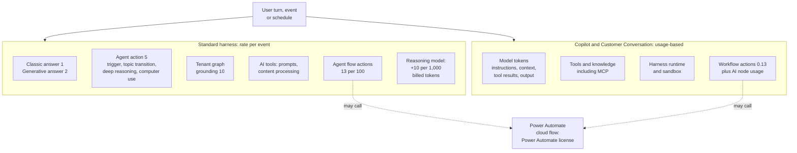

# Copilot Credits guidance

**As of 2026-11-27.** This page explains how the components in this catalog consume Copilot Credits and how to design, estimate and govern that consumption. Rates, inclusions and enforcement rules change. Before committing a budget, confirm them in the [Copilot Credits Licensing Guide](https://aka.ms/CopilotCredits/LicensingGuide) and the Microsoft Learn pages cited below. The figures here are not a quotation, and the worked examples are illustrative.

Each pattern file has a **Copilot Credits drivers** line that names the billable events for its recommended build. The [pattern credit profile](#pattern-credit-profiles) at the end of this page summarizes them.

## 1. Find which billing model applies

The harness, not the channel, decides how an agent is billed.

| Harness or workload | How usage is measured | Starts billing | Microsoft 365 Copilot license effect |
| --- | --- | --- | --- |
| **Standard harness** agents | A rate per billed event: answers, agent actions, grounding, AI tools and agent flow actions | After the agent is published | Employee-facing use by an authenticated, licensed user is included, with exceptions (see section 3) |
| **Microsoft Copilot harness** agents, workflows and apps | Usage-based: LLM tokens, tools (including knowledge and MCP) and the harness itself | **While building**: describe-to-create, preview, testing and evaluations all consume credits | Not included, except a Copilot node's execution inside a workflow for a licensed user |
| **Customer Conversation harness** | Usage-based, varying by conversation complexity and modality (digital, GenAI voice or premium voice) | While building | Customer-facing; plan for every conversation to be billed |
| **Agent flows** (standard) and **workflows** (Copilot) | 0.13 credits per action (13 per 100 actions); AI nodes add usage-based charges | Per run | Agent flows called through **When an agent calls the flow** by a licensed user's interactive session are included |
| **Power Automate cloud and desktop flows** | Power Automate licensing | Not applicable | Not Copilot Credits, and not subject to Copilot Studio enforcement |

## 2. Standard harness rates

| Billed event | Rate in Copilot Credits | Typical source in a pattern |
| --- | ---: | --- |
| Classic answer | 1 | Authored topic message |
| Generative answer | 2 | Knowledge-grounded or generated response |
| Agent action | 5 | Steps on the activity map, such as triggers, deep reasoning and topic transitions; computer use is billed at this rate |
| Tenant graph grounding for messages | 10 | Retrieval-augmented generation over Microsoft Graph, including connector content |
| Agent flow actions | 13 per 100 actions | Each action, and each agent flow trigger execution |
| Text and generative AI tools, basic | 1 per 10 responses (0.1 per 1,000 tokens) | Prompt tool on a basic model |
| Text and generative AI tools, standard | 15 per 10 responses (1.5 per 1,000 tokens) | Prompt tool on a standard model |
| Text and generative AI tools, premium | 10 per 1,000 tokens | Prompt tool on a premium model, or a reasoning model |
| Content processing tools | 8 per page | Document extraction |
| Voice: classic orchestration | 10 per minute | Includes core agent activity |
| Voice: GenAI | 35 per minute | Includes core agent activity |
| Voice: premium GenAI | 75 per minute | Includes core agent activity |

**Reasoning models** add a second meter. The feature rate always applies. If a reasoning model orchestrates the agent (including its child agents), the premium rate also applies to billed tokens. Billed tokens include input, output and reasoning tokens, plus input written to the prompt cache. Tokens read from the prompt cache are not billed. A single message can therefore consume many credits when instructions are long, retrieval is broad or the conversation is long.

Prompt tools are measured in the units in [Licensing and Copilot Credits](https://learn.microsoft.com/en-us/ai-builder/message-management#copilot-credit-consumption-rates): tokens, characters, images or pages.

Source: [Billing rates and management](https://learn.microsoft.com/en-us/microsoft-copilot-studio/requirements-messages-management), [Licensing for the standard harness](https://learn.microsoft.com/en-us/microsoft-copilot-studio/billing-licensing).

## 3. Microsoft 365 Copilot inclusion

Employee-facing use of a standard-harness agent is included in the Microsoft 365 Copilot user license when **both** of the following hold: the user is licensed, and the agent operates with that authenticated user's identity. Design for the following exceptions:

- **Computer use** is not included.
- **Autonomous runs** are charged. If an event trigger or a Power Automate flow starts the agent, the agent flows it calls consume credits even if users are licensed.
- **Agent flows** are included only when they start through **When an agent calls the flow** during a licensed user's interaction.
- **Customer-facing and anonymous** conversations are not employee use.
- **Microsoft Copilot and Customer Conversation harness** usage is billed usage-based. For a licensed user, a Copilot node's execution inside a workflow is covered, but the node's 0.13-credit action charge still applies.

Source: [Billing rates and management](https://learn.microsoft.com/en-us/microsoft-copilot-studio/requirements-messages-management), [Workflow credit consumption](https://learn.microsoft.com/en-us/microsoft-copilot-studio/guidance/workflows-credit-consumption).

## 4. Usage-based billing on the Copilot and Customer Conversation harnesses

These harnesses charge for what the work consumes, not a fixed amount per message. The main cost drivers are:

| Driver | Why it matters | Design lever |
| --- | --- | --- |
| Model choice | Reasoning models cost more per task | Use the smallest model that meets the evaluation bar |
| Context size | Instructions, retrieved files, memory and tool results are resent on model calls | Keep instructions focused; use skills so detail loads only when relevant |
| Tool and payload size | Large tool results enlarge every later call | Return bounded fields from connectors, MCP tools and workflows |
| Runtime turns | Every reasoning-loop iteration and connected-agent hop adds calls | Set a stopping rule; delegate only for large subdomains |
| Inline agent instructions | Resent on every turn of the inline agent | Keep them limited to the step |
| Failed runs | Completed steps are still billed, and late failures cost more | Validate early in a workflow; fail fast |
| Build and test | Preview, tests and evaluations are billed | Separate exploration environments with their own limits |

Microsoft publishes estimated ranges by task complexity (Copilot harness) and by light, medium and heavy conversations per modality (Customer Conversation harness). Use them for orientation, not budgets.

Source: [Overview of usage-based billing](https://learn.microsoft.com/en-us/microsoft-copilot-studio/agents-experience/billing-credit-overview), [Workflow credit consumption](https://learn.microsoft.com/en-us/microsoft-copilot-studio/guidance/workflows-credit-consumption).

## 5. Estimate: measure, then multiply

1. **Model the volume.** Count conversations, events or runs per period. Separate licensed employee, unlicensed, autonomous and customer traffic, because their billing differs.
2. **Standard harness: compose from rates.** Count expected billed events per conversation, then use the [Copilot Studio agent usage estimator](https://microsoft.github.io/copilot-studio-estimator/). Learn's [estimator guidance](https://learn.microsoft.com/en-us/microsoft-copilot-studio/agent-usage-estimator) describes the inputs.
3. **Usage-based harnesses: benchmark.** Build a proof of concept that runs on representative data, volumes, tools and prompts. Run evaluations, then read consumption from the agent's **Monitor** page and the Power Platform admin center (**Licensing** > **Copilot Studio**). Multiply the benchmarked run by the expected volume. Do not estimate from the number of nodes on the canvas.
4. **Add the lifecycle.** Include build, test, evaluation and re-evaluation after each release, plus retries and failures.
5. **Re-benchmark** when the model, instructions, knowledge scope or tools change.

**Illustrative standard-harness estimate.** These are assumed numbers, not a price. A public support agent averages three generative answers, one topic transition and an eight-action agent flow per conversation:

`(3 × 2) + (1 × 5) + (8 × 0.13) = 12.04 credits per conversation`

At 1,000 conversations a day for 30 days, that is about **361,200 credits a month** before reasoning-model tokens or AI tools. Microsoft's own example is a support agent with four classic and two generative answers for 900 customers a day: `[(4 × 1) + (2 × 2)] × 900 = 7,200 credits per day`.

## 6. Govern consumption

| Layer | Controls |
| --- | --- |
| Tenant | Purchased capacity and who may allocate it |
| Environment | Prepaid allocation, permission to draw from unallocated tenant capacity, and pay-as-you-go billing |
| Agent | Monthly limit, notification threshold, usage-based hard stop and explicit stop state |
| Operating process | Cost owner, alert triage, exception approval and owner notification |

Classify each environment as **exploration and prototyping**, **test and validation**, or **funded production**, and give each class an approved capacity posture:

- **Exploration and prototyping:** A deliberate boundary. Allocate defined prepaid capacity, turn off tenant draw, and apply an organization-defined per-agent limit through a recurring process, because the admin center does not apply one automatically.
- **Test and validation:** Time-bound limits sized to the evaluation plan.
- **Funded production:** An accountable owner and intentional funding. Use pay-as-you-go for continuity where an outage would be worse than overage, with agent-level hard stops where the workload needs a stopping point.

Enforcement behavior to design for:

- **Standard harness:** Enforcement starts when the tenant reaches 125% of prepaid capacity. Blocked agents stop responding, including mid-conversation. Environments on pay-as-you-go are not blocked by running out of prepaid credits.
- **Usage-based harnesses:** When an environment has no credits, both end users and makers are blocked. Makers cannot author with natural language, preview, test or create evaluations.
- **Agent flows:** Agent flow enforcement is separate. New agent flow runs are rejected while the agent remains available, and runs already in progress complete. Standard-harness agent flow test runs from test chat or the designer do not consume agent flow capacity. Copilot workflow node tests and test runs do consume credits.
- **Limits:** An agent's monthly limit does not stop the agent flows it calls, and limits are not applied instantly, so set thresholds with margin. Azure budgets send alerts but do not stop consumption.

Find agents by harness in Power Platform inventory. Agents on the Microsoft Copilot harness can appear as **Process Agents** in the admin center licensing report.

Source: [Govern Copilot Credit consumption](https://learn.microsoft.com/en-us/microsoft-copilot-studio/guidance/govern-credit-consumption), [Enforcement policy (usage-based)](https://learn.microsoft.com/en-us/microsoft-copilot-studio/agents-experience/enforcement-policy-credits), [Manage Copilot Credits and capacity](https://learn.microsoft.com/en-us/power-platform/admin/manage-copilot-studio-copilot-credits-capacity), [Manage costs for the Microsoft Copilot harness](https://learn.microsoft.com/en-us/power-platform/admin/manage-usage-github-copilot-harness).

## 7. Credit-aware design rules

| Design choice | Lower-consumption option | When the higher-consumption option is justified |
| --- | --- | --- |
| Harness | Standard harness for short, bounded, high-traffic interactions | Multi-source, multi-output or file-heavy work with measurable value |
| Fixed answer | Authored topic message (classic answer) | Wording must adapt to the question |
| Grounding | Narrow knowledge sources | Tenant-wide Graph grounding is needed for relevance |
| Deterministic steps | Agent flow or workflow actions without AI | The input is ambiguous and an AI node replaces manual triage |
| Model | Non-reasoning model | Evaluations show a reasoning model materially improves outcomes |
| Multi-agent | Single agent, or a child agent in the same release | Independent ownership or reuse justifies a connected-agent hop |
| Legacy UI | API or connector | No API exists; computer use runs under monitored, separately funded capacity |
| Autonomous triggers | Upstream filtering and deduplication | Each event genuinely needs judgment |
| Conversation length | Start a new conversation per topic | Context continuity is part of the outcome |
| Reporting | Batch analysis outside the conversation | Users need interactive, on-demand analysis |

## Pattern credit profiles

The profile is a relative design indicator for each pattern's recommended build, not a measurement: **Low** means mostly authored or deterministic steps; **Medium** means generative answers, tools or agent flows per request; **High** means autonomous volume, multi-agent hops, reasoning loops, large files or voice; **None** means no Copilot Studio meter is in the request path. Benchmark before you budget.

<!-- credit-profile:start -->

| Pattern | Recommended harness | Profile | Main drivers |
| --- | --- | --- | --- |
| [Add Copilot Studio to an existing third-party contact center](solution-ideas/custom-contact-center.md) | Std | High | Customer volume and voice minutes |
| [Analyst-reviewed reporting over a Fabric semantic model](reference-architectures/fabric-analytics.md) | Copilot | High | Reasoning tokens, retries and file outputs |
| [Assisted and email-driven refunds on a shared legacy workflow](solution-ideas/ticket-refunds.md) | Std | High | Autonomous email runs; computer use if adopted |
| [Design distinct voice and chat paths for one customer service](technical-patterns/customer-voice-chat.md) | CC | High | Voice minutes and conversation complexity |
| [Fabric 4: Query the model from the Microsoft Copilot harness](decision-patterns/fabric-copilot-harness.md) | Copilot | High | Reasoning-loop tokens and query retries |
| [Match supplier acknowledgments to SAP purchase orders](reference-architectures/sap-order-acknowledgments.md) | Std | High | Autonomous volume, document pages and agent hops |
| [Microsoft Copilot harness: reason, act and inspect results](decision-patterns/copilot-reasoning-loop.md) | Copilot | High | Reasoning-loop tokens, tool results and evaluations |
| [Separate bug intake from follow-up correspondence](solution-ideas/bug-intake.md) | Std | High | Autonomous run per email |
| [Start a bounded agent task from a business event](technical-patterns/event-worker.md) | Std | High | Autonomous run per event |
| [Bring authorized search results to a generative answers node](technical-patterns/custom-retrieval.md) | Std | Medium | Generative answer and retrieval call |
| [Clinician-reviewed cardiology intake and scheduling](solution-ideas/cardiology-intake.md) | Std | Medium | Document pages and intake turns |
| [Coordinate new-hire tasks across HR and learning systems](solution-ideas/new-hire-onboarding.md) | Std | Medium | Unlicensed new-hire turns and event runs |
| [Delegate to an independently published specialist](technical-patterns/connected-agent.md) | Std or Copilot | Medium | Two agents per delegated request |
| [Detect spend anomalies in Fabric and investigate them in chat](solution-ideas/spend-anomalies.md) | Std | Medium | Scheduled flow actions and investigation turns |
| [Donor inquiry intake, approvals and finance reconciliation](solution-ideas/donor-management.md) | Std | Medium | Document extraction and staff turns |
| [Extract service-quality signals from conversation transcripts](reference-architectures/conversation-transcripts.md) | Std + Power Automate | Medium | Extraction per transcript |
| [Fabric 2: Delegate analytics to a connected Fabric data agent](decision-patterns/fabric-connected.md) | Std or Copilot | Medium | Outer agent turns plus Fabric capacity |
| [Fabric 3: Query the model directly from the standard harness](decision-patterns/fabric-standard-harness.md) | Std | Medium | Generative answers, agent actions and schema tokens |
| [Gate changes on expected answers and observable actions](technical-patterns/evaluation-gate.md) | Any | Medium | Evaluation runs per release |
| [Group one specialist task inside a parent agent](technical-patterns/child-agent.md) | Std | Medium | Extra planning step per delegated task |
| [Handoff 1: Engagement hub in front (Bot-as-an-Agent)](decision-patterns/hub-front-handoff.md) | Std | Medium | Self-service turns before transfer; voice minutes if used |
| [Handoff 2: Copilot Studio in front (Bot-in-the-Loop)](decision-patterns/bot-front-handoff.md) | Std | Medium | Self-service turns before handoff, plus any relayed turns |
| [Let a workflow own approvals and an agent own the draft](technical-patterns/approval-workflow.md) | Copilot or Std | Medium | Workflow actions plus one AI node |
| [Multilingual IT self-service across identity providers](reference-architectures/multilingual-it-service.md) | Std | Medium | Grounded answers and ITSM tool steps |
| [Package reusable procedures as skills](technical-patterns/skill-package.md) | Copilot or CC | Medium | Skill content when loaded |
| [Patient portal for administrative support](solution-ideas/patient-support.md) | Std | Medium | Public and authenticated patient turns |
| [Permission-trimmed answers from SharePoint](technical-patterns/sharepoint-grounding.md) | Std or Copilot | Medium | Grounded answers; tenant graph if enabled |
| [Preview and migrate an organizer's meetings in place](reference-architectures/meeting-migration.md) | Std | Medium | Agent flow actions per meeting |
| [Public self-service from a bounded website corpus](technical-patterns/public-knowledge.md) | Std | Medium | Public generative answers |
| [Regulatory applications with separate applicant and assessor workspaces](reference-architectures/regulatory-applications.md) | Std | Medium | Public generative answers |
| [Rental discovery with a separate reservation and payment path](solution-ideas/rental-search-checkout.md) | Std | Medium | Prompt and answer per search |
| [Resolve customer questions or transfer them into a Dynamics workstream](solution-ideas/customer-support.md) | Std | Medium | Self-service turns before transfer |
| [Route HR requests to domain-specific agents](reference-architectures/hr-specialists.md) | Std | Medium | Grounded answers and specialist hops |
| [Standard harness: generative orchestration over topics, tools and knowledge](decision-patterns/generative-planning.md) | Std | Medium | Several planned steps per combined request |
| [Travel concierge with public guidance and private booking lookup](solution-ideas/travel-concierge.md) | Std | Medium | Public answers and lookups |
| [Carry the user's authority to a downstream tool](technical-patterns/tool-identity.md) | Any | Low | No added consumption |
| [Discover centrally managed tools from an MCP server](technical-patterns/mcp-tools.md) | Any | Low | Tool calls and catalog size |
| [Embed a web client without exposing channel credentials](technical-patterns/secured-web-client.md) | Std | Low | No added consumption |
| [Expose a narrow business operation through a connector](technical-patterns/connector-action.md) | Any | Low | One tool step per request |
| [Link recruitment conversations and touchpoints to enrollment](reference-architectures/student-recruitment.md) | Std | Low | Recruiter summaries and drafts |
| [Match environment controls to agent risk](technical-patterns/zoned-governance.md) | Any | Low | Governs others |
| [Monitor completed tasks, tool health and consumption together](technical-patterns/operational-monitoring.md) | Any | Low | No added consumption |
| [Promote one tested solution with environment-specific bindings](technical-patterns/solution-promotion.md) | Any | Low | Test-environment runs |
| [Prototype an agent-local REST tool from OpenAPI](technical-patterns/direct-rest-tool.md) | Std | Low | Prototype tool steps |
| [Request an agent recommendation from a model-driven form](reference-architectures/model-driven-form.md) | Std | Low | One event and optional prompt per request |
| [Return a typed result from an agent flow](technical-patterns/synchronous-agent-flow.md) | Std | Low | Agent flow actions |
| [Share a governed metric contract between agents and reports](technical-patterns/semantic-model-contract.md) | Any | Low | Fewer retries |
| [Standard harness: classic topic routing](decision-patterns/classic-topics.md) | Std | Low | Classic answers, topic transitions and a short agent flow |
| [Fabric 1: Publish a Fabric data agent directly](decision-patterns/fabric-direct.md) | Fabric only | None | Fabric capacity only |

<!-- credit-profile:end -->
