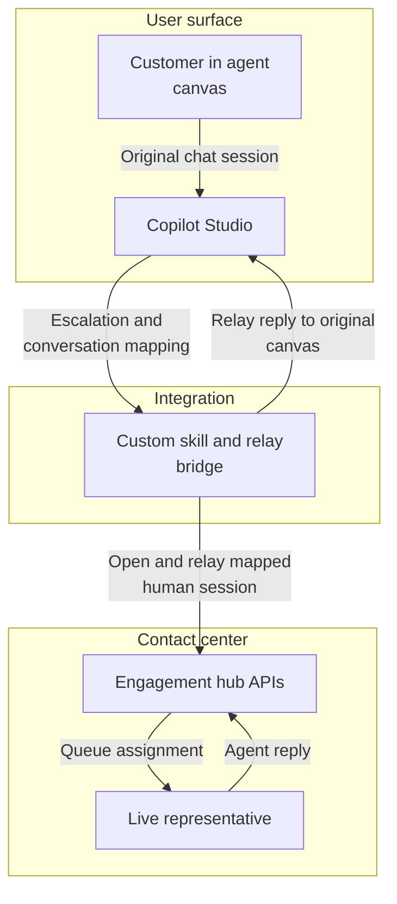
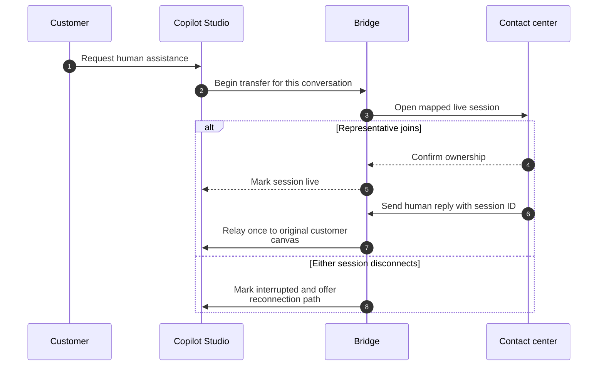

# Handoff 2: Copilot Studio in front (Bot-in-the-Loop)

**Class:** Microsoft implementation-guide pattern (handoff). **Intent:** Keep the user's existing agent canvas when a live representative is available only through a separate contact center.

## Architecture

**Review decision:** Keeping the agent canvas means operating a two-way bridge for the human leg. Decide who owns message correlation and recovery when either session disconnects.

## Technical flow

## Design notes

**Flow:** The customer chats with Copilot Studio. Escalation invokes a custom skill/bridge through Azure Bot Service. The bridge opens a corresponding conversation via the hub's APIs and relays messages in both directions. Keep a mapping of the two session IDs and an explicit state: automated, waiting, live or ended.

**Choose it when** the existing canvas is a requirement and the hub exposes suitable messaging APIs. The bridge can support features like translation, but introduces extra hops, engineering ownership and credit consumption during the human exchange. Prove that required supervisor functions still work; prefer [hub in front](hub-front-handoff.md) otherwise.

**Trust boundary:** Authenticate the bridge and limit it to the required queues. Separate employee-only notes from customer-visible messages. Do not assume a translated message or client-supplied label establishes identity.

**Failure handling:** Deduplicate relayed messages and detect loss of either session. Never silently resume generative replies in the middle of a human conversation. Test disconnect during a transfer and verify that neither side receives messages from a different conversation.

**Sources:** [Microsoft Learn: Channel and handoff guidance — pattern 2](https://learn.microsoft.com/en-us/microsoft-copilot-studio/guidance/channels) · [Microsoft public sample: skill-based handoff](https://github.com/microsoft/CopilotStudioSamples/tree/main/contact-center/skill-handoff).
