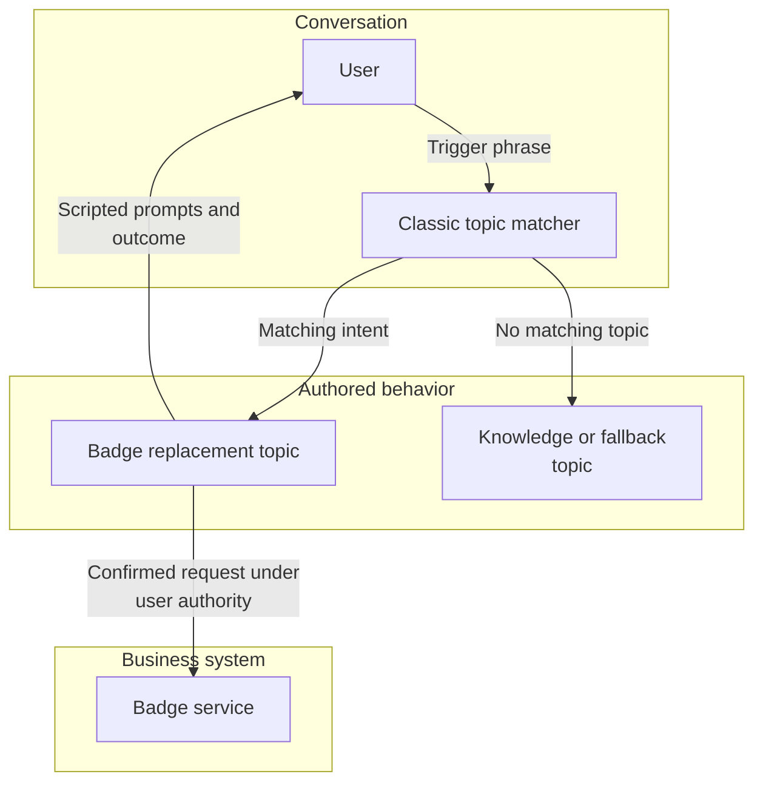
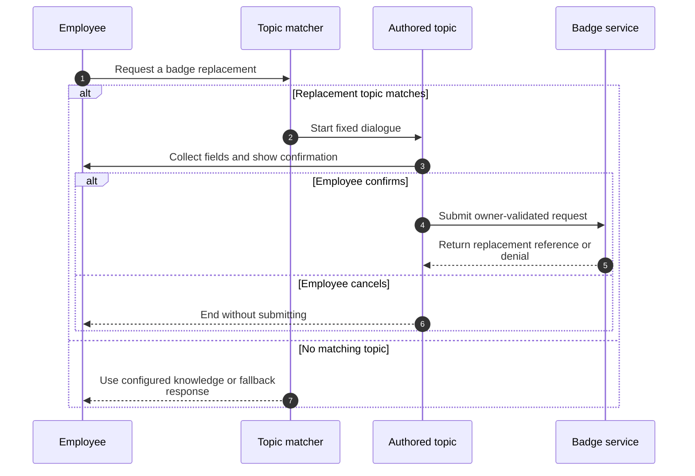

# Standard harness: classic topic routing

**Class:** Microsoft implementation-guide pattern (orchestration). **Intent:** Keep the order and wording of a bounded transaction under maker control.

## Architecture

**Review decision:** Use an authored topic when order and wording must be predictable. Topic matching selects a path, not permission to complete its transaction.

## Technical flow

## Copilot Studio components

**Recommended build ([harness](../COMPONENTS.md#the-harness-is-the-first-decision)):** Standard harness, classic orchestration. The Microsoft Copilot harness replaces intent-triggered topics. Use a workflow tool for the fixed sequence and hooks for system events.

| Component | Use in this pattern | Harness alternative |
| --- | --- | --- |
| [Orchestration](../COMPONENTS.md#orchestration-modes): Classic | Matches trigger phrases to exactly one topic. | Std: generative orchestration selects topics by description. |
| [Topics](../COMPONENTS.md#topics-and-system-topics): Badge replacement topic; Fallback system topic | Owns the ordered transaction and the no-match path. | Copilot: workflow tool; hooks for system events. |
| [Topic nodes](../COMPONENTS.md#topic-nodes): Question, Condition, Message, Tool | Collect and validate fields, show a confirmation, then call the badge operation explicitly. | Copilot: workflow nodes behind **When an agent calls the flow**. |
| [Agent flow](../COMPONENTS.md#agent-flows): Badge replacement flow | Executes the replacement with server-side checks and returns a receipt. | Copilot: workflow. |
| [Knowledge](../COMPONENTS.md#knowledge-sources): Knowledge fallback | Answers unmatched informational questions with citations before the Fallback topic. *(Optional.)* | Available in all harnesses. |

**Not the right component:** Generated knowledge answers for a required disclosure. Keep that wording in a **Message** node.

**Copilot Credits drivers (low):** Authored messages are classic answers (1 credit). Knowledge fallback answers are generative answers (2). Topic transitions on the activity map are agent actions (5), and agent flow actions are 13 per 100. This mode has the lowest consumption among the orchestration options. See [Copilot Credits guidance](../COPILOT-CREDITS.md).

## Design notes

**Flow:** A request matches a topic's trigger phrases. Authored nodes collect fields, validate them, show a confirmation and explicitly call a tool or flow. If no topic matches, the agent can use a configured knowledge fallback and then its Fallback system topic. For a required disclosure, keep that wording in an authored node, not in generated fallback content.

**Choose it when** the interaction has a small set of stable intents and required steps, for example replacing a damaged badge. New phrasings and topic collisions need ongoing maintenance. If the main need is flexible composition of several intents, compare [generative orchestration](generative-planning.md).

**Trust boundary:** Selecting a topic is not authorization. Validate the badge owner and allowed operation at the tool; refuse to submit without confirmed inputs.

**Failure handling:** On an ambiguous match, ask the user to select a task. On a connector timeout, reconcile the requested replacement before offering retry. Test paraphrases, cancellation at confirmation and an out-of-scope request that must not enter the transaction.

**Source:** [Microsoft Learn: Understand harnesses — standard harness classic orchestration](https://learn.microsoft.com/en-us/microsoft-copilot-studio/guidance/understand-harnesses#standard-harness-classic-orchestration).
