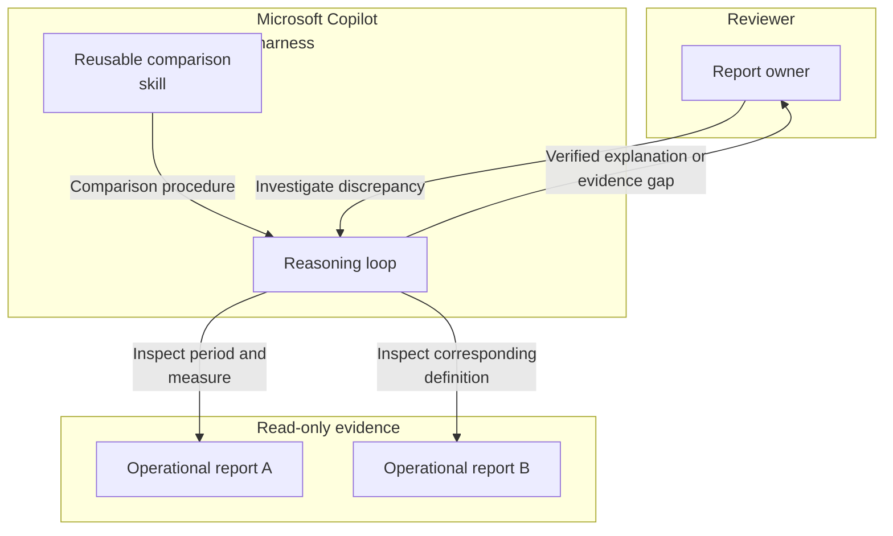
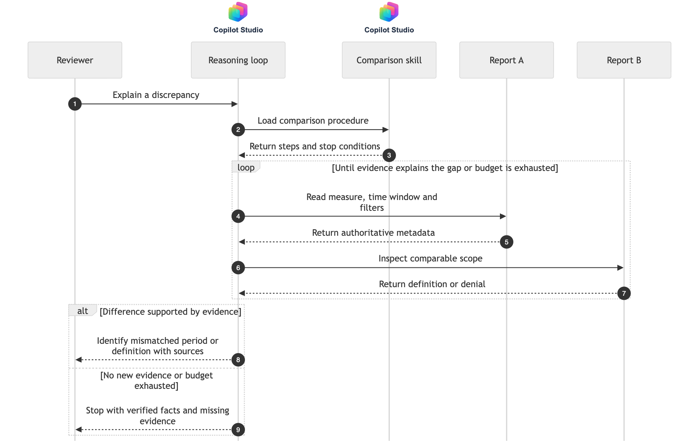
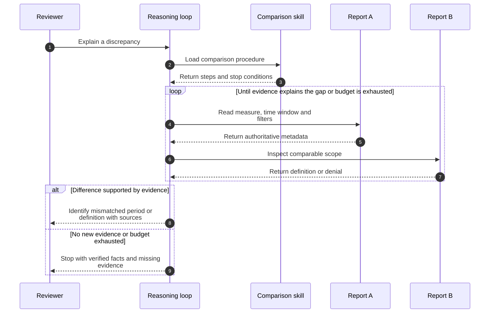

# Microsoft Copilot harness: reason, act and inspect results

**Class:** Microsoft implementation-guide pattern (orchestration). **Intent:** Let an agent choose the next step from evidence when the route to a result cannot be specified in advance.

## Architecture

**Review decision:** Give the reasoning loop a measurable stopping rule. Use a separate deterministic approval path for changes to either source report.

## Technical flow

Text and editable Mermaid sequence

## Copilot Studio components

**Recommended build ([harness](../COMPONENTS.md#the-harness-is-the-first-decision)):** Microsoft Copilot harness, reasoning loop. On the standard harness, generative orchestration with authored topics and agent flows can cover a known sequence, but the maker must design each path and context handoff.

| Component | Use in this pattern | Harness alternative |
| --- | --- | --- |
| [Orchestration](../COMPONENTS.md#orchestration-modes): Reasoning loop | Plans the next read, inspects the result, then continues, applies the skill or stops with insufficient evidence. | Std: generative orchestration with authored paths. |
| [Instructions](../COMPONENTS.md#instructions): Bounded goal and stopping rule | Define the question, the evidence threshold and the maximum scope. | All harnesses. |
| [Skill](../COMPONENTS.md#skills): Report comparison skill | Supplies the procedure for comparing periods and definitions. | Std: topic or prompt tool. |
| [Connector tool](../COMPONENTS.md#connector-tools): Read-only report tools | Retrieve report A and report B data under the reviewer's identity. | All harnesses; MCP is an alternative. |
| [Agent sandbox](../COMPONENTS.md#code-interpreter-and-agent-sandbox): Agent sandbox | Computes differences over retrieved files without changing either source. *(Optional.)* | Std: code interpreter on a prompt. |
| [Memory](../COMPONENTS.md#memory): Reviewer output preferences | Remembers how the reviewer likes comparisons laid out. It is never evidence for a figure. *(Optional.)* | Std: no memory; ask each time. |
| [Workflow](../COMPONENTS.md#workflows): Correction approval workflow | Carries a proposed correction to the report owner. The loop never edits a report. | Std: agent flow and Power Automate approval. |
| [Human gate](../COMPONENTS.md#human-in-the-loop-gates): Approvals node | Records the report owner's decision for the exact proposal. | Std: Power Automate approval. |

**Not the right component:** Memory as evidence of an earlier conclusion. Re-read both sources on every run.

**Copilot Credits drivers (high):** Usage-based from build time. Each loop iteration resends instructions, loaded skill content and tool results. Cap iterations, return bounded tool payloads and use a non-reasoning model if evaluations allow. The approval workflow adds 0.13 credits per action. See [Copilot Credits guidance](../COPILOT-CREDITS.md).

## Design notes

**Flow:** Give the agent a bounded goal, such as explaining why two approved operational reports disagree. It calls a read tool, inspects periods and definitions, then decides whether to inspect another source, run a reusable skill or report insufficient evidence. Use a deterministic workflow if any resulting change needs approval.

**Choose it when** intermediate results change what should happen next. A fixed sequence of two lookups rarely justifies iterative reasoning, additional latency or credit consumption. Unlike [standard generative orchestration](generative-planning.md), the loop can reassess and change its path after each observation.

**Trust boundary:** A skill encodes a procedure, not a grant. Restrict tools, records and outputs by identity; delegate only the context needed by a specialist. Require an independent authorization check for writes.

**Failure handling:** Set time, cost and call budgets in components you control. Detect repeated calls that yield no new evidence; stop with the verified facts and the missing source. Test inconsistent source dates and a permission denial, not only the successful example.

**Sources:** [Microsoft Learn: Copilot harness reasoning loop](https://learn.microsoft.com/en-us/microsoft-copilot-studio/guidance/understand-harnesses#copilot-harness-reasoning-loop) · [Build with the Microsoft Copilot harness](https://learn.microsoft.com/en-us/microsoft-copilot-studio/guidance/microsoft-copilot-harness-overview).
