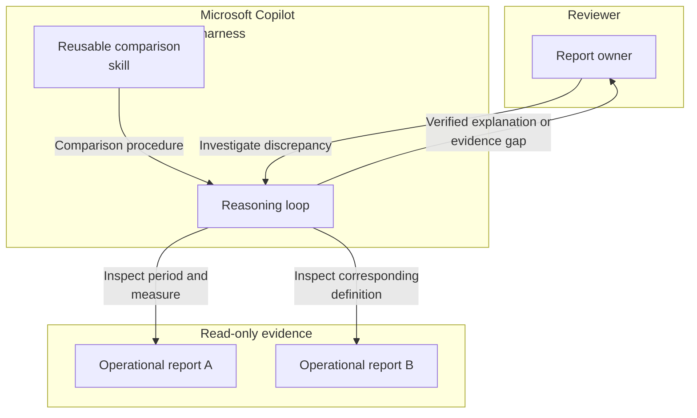
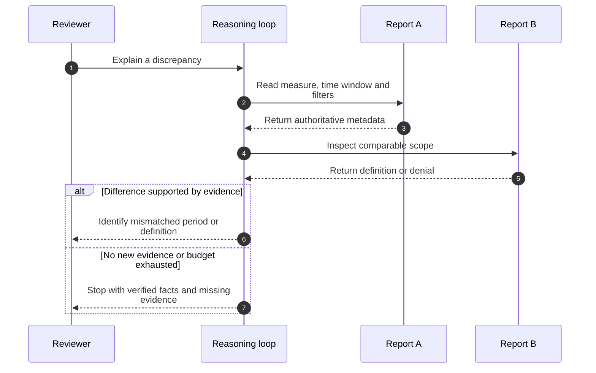

# Microsoft Copilot harness: reason, act and inspect results

**Class:** Microsoft implementation-guide pattern (orchestration). **Intent:** Let an agent choose the next step from evidence when the route to a result cannot be specified in advance.

## Architecture

**Review decision:** Give the reasoning loop a measurable stopping rule. Use a separate deterministic approval path for changes to either source report.

## Technical flow

## Design notes

**Flow:** Give the agent a bounded goal, such as explaining why two approved operational reports disagree. It calls a read tool, inspects periods and definitions, then decides whether to inspect another source, run a reusable skill or report insufficient evidence. Use a deterministic workflow if any resulting change needs approval.

**Choose it when** intermediate results change what should happen next. A fixed sequence of two lookups rarely justifies iterative reasoning, additional latency or credit consumption. Unlike [standard generative orchestration](generative-planning.md), the loop can reassess and change its path after each observation.

**Trust boundary:** A skill encodes a procedure, not a grant. Restrict tools, records and outputs by identity; delegate only the context needed by a specialist. Require an independent authorization check for writes.

**Failure handling:** Set time, cost and call budgets in components you control. Detect repeated calls that yield no new evidence; stop with the verified facts and the missing source. Test inconsistent source dates and a permission denial, not only the successful example.

**Sources:** [Microsoft Learn: Copilot harness reasoning loop](https://learn.microsoft.com/en-us/microsoft-copilot-studio/guidance/understand-harnesses#copilot-harness-reasoning-loop) · [Build with the Microsoft Copilot harness](https://learn.microsoft.com/en-us/microsoft-copilot-studio/guidance/microsoft-copilot-harness-overview).
