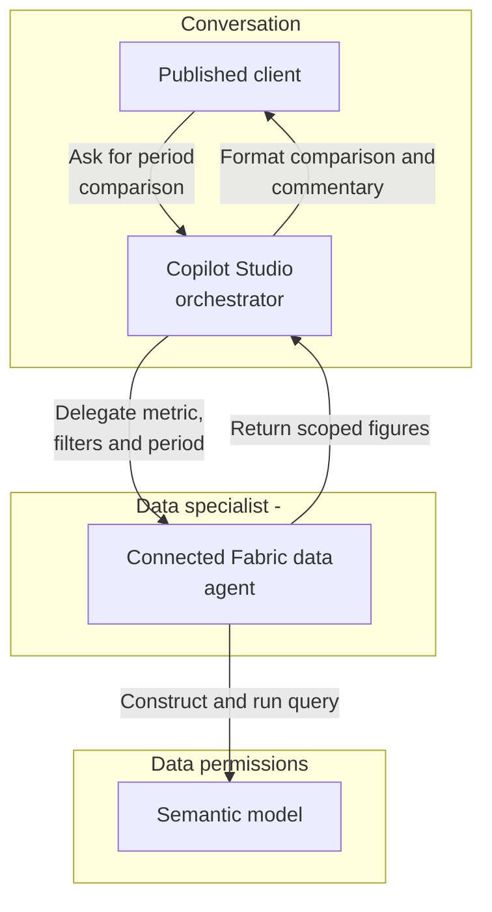
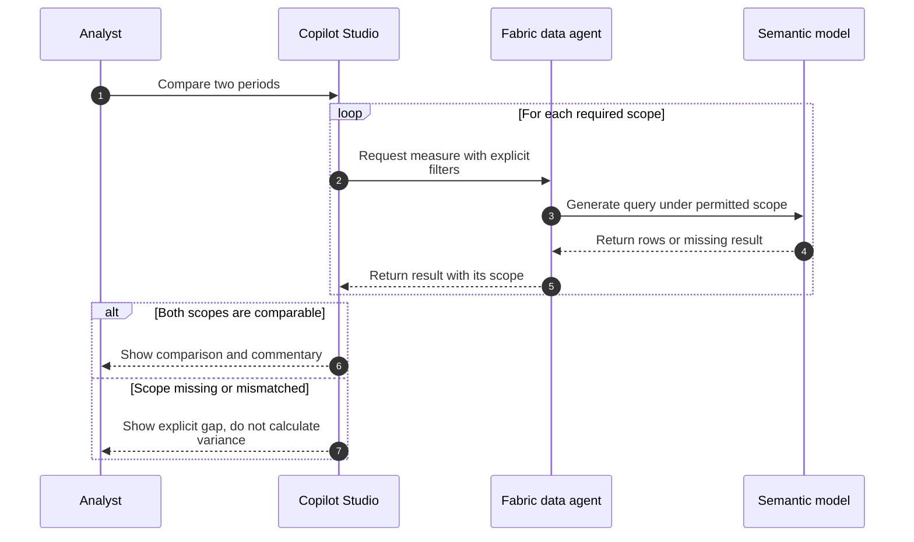

# Fabric 2: Delegate analytics to a connected Fabric data agent

**Class:** Microsoft decision-guide pattern (Fabric option 2 of 4). **Intent:** Keep query construction with the data team while Copilot Studio owns the conversation and the format of the answer.

## Architecture

**Review decision:** Approve the extra agent hop only if independent ownership of data queries is worth the latency, and both hops preserve the intended user's access.

## Technical flow

## Copilot Studio components

**Recommended build ([harness](../COMPONENTS.md#the-harness-is-the-first-decision)):** Standard harness with generative orchestration, or Microsoft Copilot harness. Either harness can connect a Fabric data agent. The connection to a Fabric data agent is preview. On the Microsoft Copilot harness, connected agents are the only multi-agent composition.

| Component | Use in this pattern | Harness alternative |
| --- | --- | --- |
| [Orchestration](../COMPONENTS.md#orchestration-modes): Generative orchestration or reasoning loop | Recognizes a data question and routes it to the data specialist. | Both harnesses. |
| [Connected agent](../COMPONENTS.md#connected-agents): Fabric data agent (preview) | Owns query construction against the semantic model and returns scoped values. | Both harnesses. |
| [Instructions](../COMPONENTS.md#instructions): Delegation rules | Send metric, period and filters, not the whole conversation, and keep each result tied to its scope. | Both harnesses. |
| [Authentication](../COMPONENTS.md#authentication-and-tool-credentials): End-user identity across both hops | Fabric must evaluate the end user's data permissions, not the maker's. | Confirm per harness and channel. |
| [Channel](../COMPONENTS.md#channels): Teams or Microsoft 365 | The outer agent owns the conversation and the answer format. | Both harnesses list these channels. |

**Not the right component:** A prompt or sandbox step that recomputes totals Fabric already returned.

**Copilot Credits drivers (medium):** On the Copilot Studio side, each turn uses generative answers and agent actions on the standard harness, or usage-based tokens on the Copilot harness. The Fabric data agent requires a paid Fabric capacity (F2 or higher) and draws on that capacity, not on Copilot Studio rates. Two hops add latency and two meters. See [Copilot Credits guidance](../COPILOT-CREDITS.md).

## Design notes

**Flow:** User → Copilot Studio orchestrator → connected Fabric data agent → governed semantic model. The outer agent asks a scoped question (metric, period and filters). Fabric owns the query and returns the result. The outer agent uses those values for its table and commentary, keeping each result associated with its scope.

**Choose it when** the model changes often or a specialist team can maintain the Fabric agent for several consumers. Each delegated question adds latency; measure a multi-period question in the published channel. Prefer [direct publication](fabric-direct.md) if users only need the underlying figures. Microsoft's connected-agents documentation labels the Fabric integration **preview**; verify lifecycle, harness and channel support before considering production use.

**Trust boundary:** Verify the identity used at *both* hops and access to the data agent as well as the model. The orchestrator's ability to see an answer during authoring is not evidence that a regional viewer may see it.

**Failure handling:** If one comparison fails, return the successful period with an explicit gap or decline the comparison. Never subtract values returned for different scopes. Replay the same question against the Fabric agent alone to distinguish a query error from an orchestration error.

**Sources:** [Microsoft Fabric architecture choice: pattern 2](https://learn.microsoft.com/en-us/power-platform/architecture/key-concepts/copilot-studio-fabric/#pattern-2-copilot-studio-agent-with-a-connected-fabric-data-agent) · [Connect a Fabric data agent](https://learn.microsoft.com/en-us/microsoft-copilot-studio/add-agent-fabric-data-agent) · [External-agent preview status](https://learn.microsoft.com/en-us/microsoft-copilot-studio/authoring-add-other-agents).
