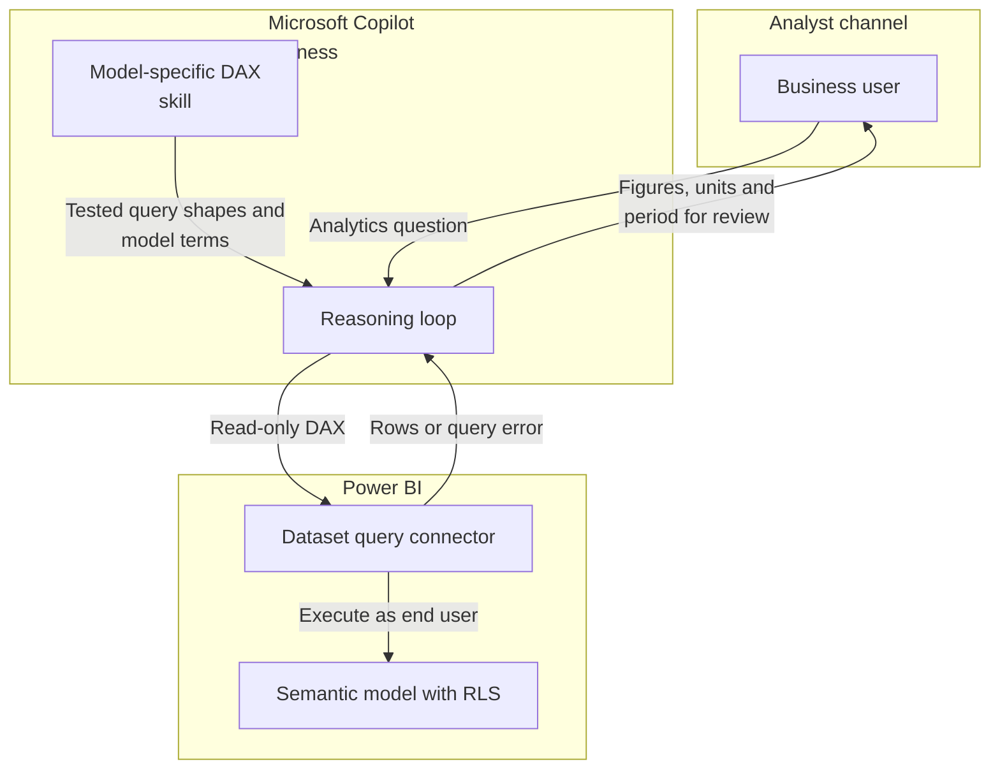
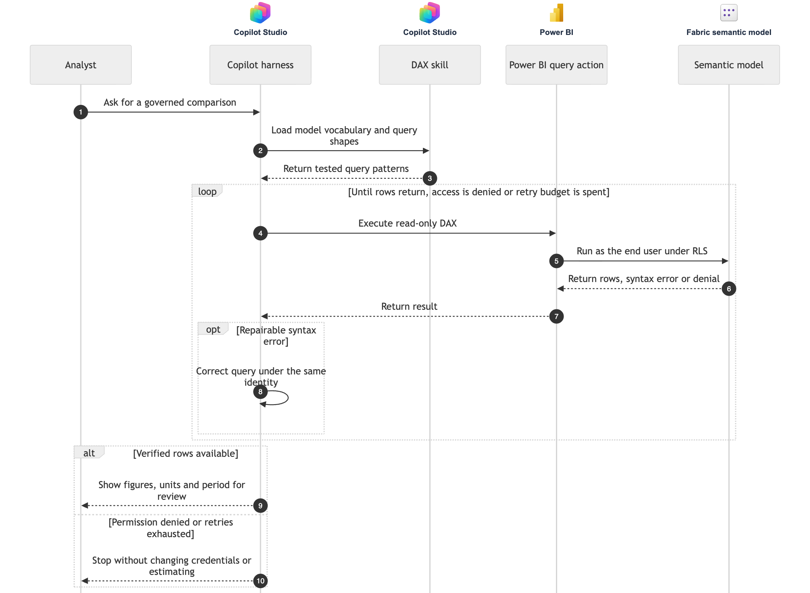
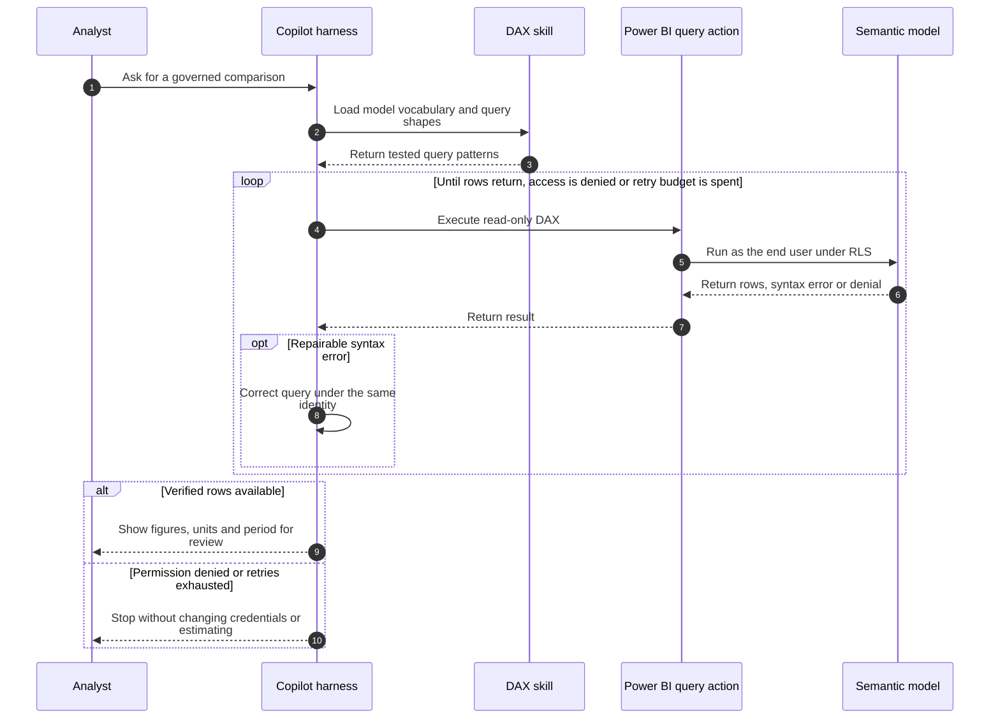

# Fabric 4: Query the model from the Microsoft Copilot harness

**Class:** Microsoft decision-guide pattern (Fabric option 4 of 4). **Intent:** Keep the fast, direct connector path while letting the agent load reusable model guidance and correct a failed query.

## Architecture

**Review decision:** Separate schema guidance from runtime permissions. A skill can repair syntax, but neither a skill nor a retry may widen access or certify a business measure.

## Technical flow

Text and editable Mermaid sequence

## Copilot Studio components

**Recommended build ([harness](../COMPONENTS.md#the-harness-is-the-first-decision)):** Microsoft Copilot harness, reasoning loop. Option 3 runs the same connector path on the standard harness, but schema guidance lives in instructions and the agent does not self-correct.

| Component | Use in this pattern | Harness alternative |
| --- | --- | --- |
| [Orchestration](../COMPONENTS.md#orchestration-modes): Reasoning loop | Builds a query, observes the rows or error, corrects the query within a retry limit, then answers. | Std: single-pass generative orchestration. |
| [Skill](../COMPONENTS.md#skills): Model-specific DAX skill | Supplies governed measure names, relationships, time conventions and tested query shapes. | Std: schema in instructions. |
| [Connector tool](../COMPONENTS.md#connector-tools): Power BI: Run a query against a dataset | Runs read-only `EVALUATE` queries under the user's identity and row-level security. | Std: same connector action. |
| [Hook](../COMPONENTS.md#hooks-preview): Pre tool use (preview) | Blocks a query that is not a read-only `EVALUATE` statement before it runs. *(Optional.)* | Std: validation in a topic or agent flow. |
| [Agent sandbox](../COMPONENTS.md#code-interpreter-and-agent-sandbox): Agent sandbox | Formats returned rows into a table, chart or workbook for review. *(Optional.)* | Std: code interpreter on a prompt. |

**Not the right component:** Memory for measure definitions. Keep definitions in the skill and the semantic model so that every user gets the same contract.

**Copilot Credits drivers (high):** Usage-based from build time. Each retry resends context and the failed result, and the skill body loads only when relevant. Limit retries, return only needed columns and benchmark typical questions before rollout. See [Copilot Credits guidance](../COPILOT-CREDITS.md).

## Design notes

**Flow:** A Copilot Studio agent on the Microsoft Copilot harness resolves the question. A skill supplies governed measure names, relationships, time conventions and tested DAX shapes. The agent calls the Power BI connector using a read-only query, observes the rows or error, and either corrects the query or returns an answer for review.

**Choose it when** a stable model and interactive response time matter and the team can maintain the skill alongside the model. This is the guide's recommended option for governed models, not a universal default. The [reference architecture](../reference-architectures/fabric-analytics.md) applies it to an entire analyst review process. Check harness, feature and channel availability for your tenant.

**Trust boundary:** Use each user's own connection. Microsoft's example pairs workspace Viewer with semantic-model Read and Build permissions; assess the additional reporting capability that Build grants. Elevated workspace roles can bypass RLS.

**Failure handling:** Repair syntax errors only within a bounded time and call budget; stop on access denial. A successful but semantically wrong query will not trigger self-correction. Compare figures, units and missing-period behavior against expected outputs after each skill, model or harness change.

**Sources:** [Microsoft Fabric architecture choice: pattern 4](https://learn.microsoft.com/en-us/power-platform/architecture/key-concepts/copilot-studio-fabric/#pattern-4-copilot-studio-agent-on-microsoft-copilot-harness-with-power-bi-connector-recommended) · [Analytical output contracts and golden prompts](https://learn.microsoft.com/en-us/power-platform/architecture/key-concepts/copilot-studio-fabric/evaluate-analytical-agents).
