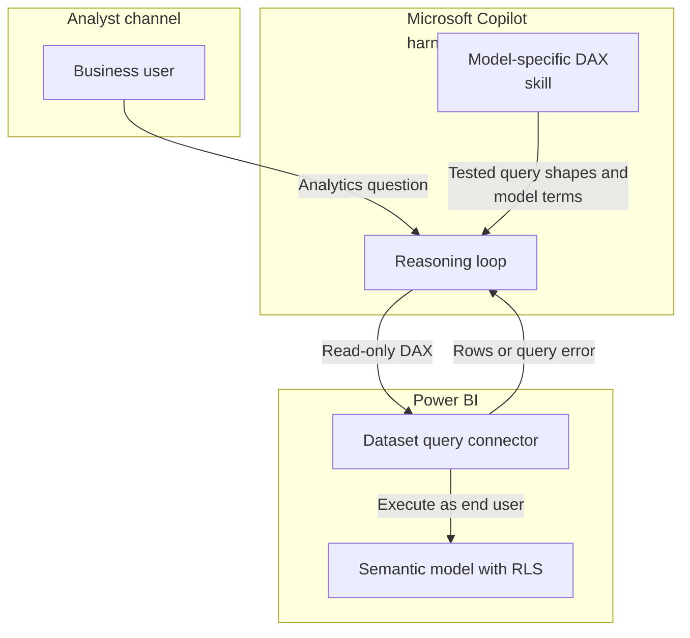
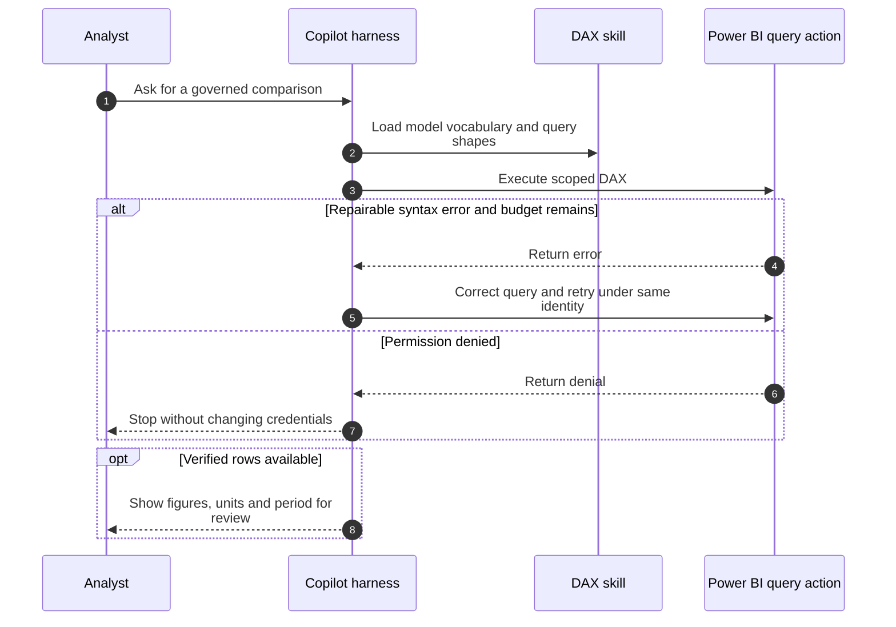

# Fabric 4: Query the model from the Microsoft Copilot harness

**Class:** Microsoft decision-guide pattern (Fabric option 4 of 4). **Intent:** Keep the fast, direct connector path while letting the agent load reusable model guidance and correct a failed query.

## Architecture

**Review decision:** Separate schema guidance from runtime permissions. A skill can repair syntax, but neither a skill nor a retry may widen access or certify a business measure.

## Technical flow

## Design notes

**Flow:** A Copilot Studio agent on the Microsoft Copilot harness resolves the question. A skill supplies governed measure names, relationships, time conventions and tested DAX shapes. The agent calls the Power BI connector using a read-only query, observes the rows or error, and either corrects the query or returns an answer for review.

**Choose it when** a stable model and interactive response time matter and the team can maintain the skill alongside the model. This is the guide's recommended option for governed models, not a universal default. The [reference architecture](../reference-architectures/fabric-analytics.md) applies it to an entire analyst review process. Check harness, feature and channel availability for your tenant.

**Trust boundary:** Use each user's own connection. Microsoft's example pairs workspace Viewer with semantic-model Read and Build permissions; assess the additional reporting capability that Build grants. Elevated workspace roles can bypass RLS.

**Failure handling:** Repair syntax errors only within a bounded time and call budget; stop on access denial. A successful but semantically wrong query will not trigger self-correction. Compare figures, units and missing-period behavior against expected outputs after each skill, model or harness change.

**Sources:** [Microsoft Fabric architecture choice: pattern 4](https://learn.microsoft.com/en-us/power-platform/architecture/key-concepts/copilot-studio-fabric/#pattern-4-copilot-studio-agent-on-microsoft-copilot-harness-with-power-bi-connector-recommended) · [Analytical output contracts and golden prompts](https://learn.microsoft.com/en-us/power-platform/architecture/key-concepts/copilot-studio-fabric/evaluate-analytical-agents).
