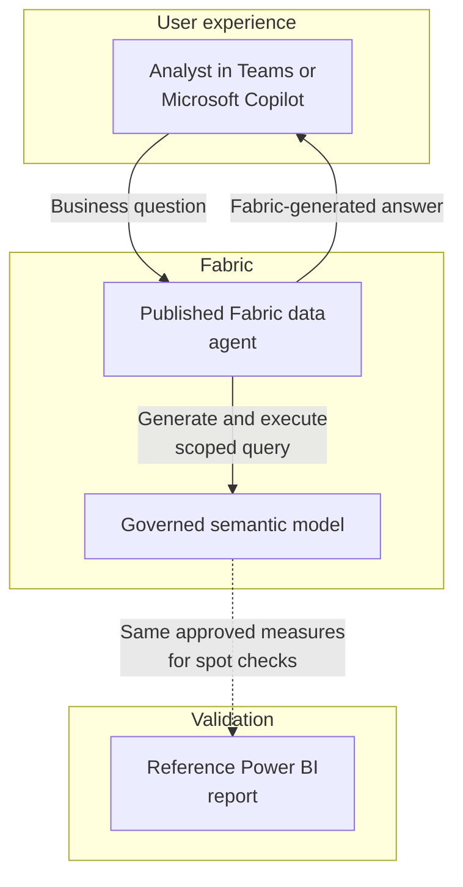
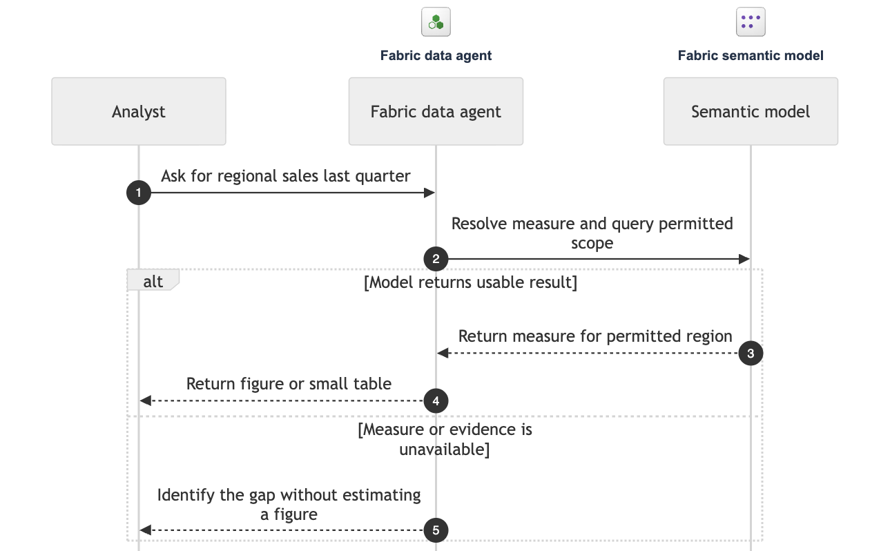
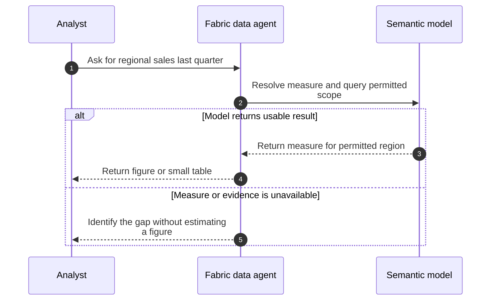

# Fabric 1: Publish a Fabric data agent directly

**Class:** Microsoft decision-guide pattern (Fabric option 1 of 4). **Intent:** Establish the simplest baseline for asking questions of a semantic model. **No Copilot Studio agent is in the request path.**

## Architecture

**Review decision:** Start here to test the data layer alone. If this path returns the wrong period or exposes the wrong region, adding a Copilot Studio orchestrator will not fix it.

## Technical flow

Text and editable Mermaid sequence

## Copilot Studio components

**Recommended build ([harness](../COMPONENTS.md#the-harness-is-the-first-decision)):** No Copilot Studio harness. The Fabric data agent is published directly to Microsoft Copilot or Teams. Add a Copilot Studio harness later through option 2 (connected agent), option 3 (standard) or option 4 (Microsoft Copilot).

| Component | Use in this pattern | Harness alternative |
| --- | --- | --- |
| [Channel](../COMPONENTS.md#channels): Microsoft Copilot or Teams through Fabric publishing | Delivers the data agent without a Copilot Studio agent in the request path. | Options 2 to 4 add a Copilot Studio channel. |
| [Evaluation](../COMPONENTS.md#evaluation): Reconciliation against the reference report | Prove the data layer returns the right period and region before you add an orchestrator. | Copilot Studio evaluations apply once an agent is added. |

**Not the right component:** Adding a Copilot Studio agent to fix wrong figures. Fix the semantic model or data agent first.

**Copilot Credits drivers (none):** There is no Copilot Studio agent to meter in this design. That is not a zero-cost estimate: budget paid F2+ or Fabric-enabled Power BI Premium P1+ capacity and check the [Microsoft Copilot publishing and user-license prerequisites](https://learn.microsoft.com/en-us/fabric/data-science/data-agent-microsoft-365-copilot). See [Copilot Credits guidance](../COPILOT-CREDITS.md).

## Design notes

**Flow:** User in a supported Microsoft Copilot or Teams experience → published Fabric data agent → semantic model → answer. The Fabric data agent interprets the request, constructs the query and presents the result. Give it business terms and known examples; leave measure definitions in the model.

**Choose it when** an analyst needs a figure or small table and the data team owns the experience. It also isolates the data layer for comparison with the other three options. Don't add a second agent unless you need more control over the conversation or answer format. The direct option offers less control over a fixed narrative.

**Trust boundary:** Sharing the agent and granting access to the underlying data are distinct decisions. Verify Fabric capacity, tenant settings and permissions for the actual channel. Test with two users permitted to see different regions.

**Failure handling:** Compare the answer to a report using identical filters. If this path returns the wrong period or measure, fix the model or the data agent before adding orchestration. A known missing measure should result in no figure, not an estimate.

**Sources:** [Microsoft Fabric architecture choice: pattern 1](https://learn.microsoft.com/en-us/power-platform/architecture/key-concepts/copilot-studio-fabric/#pattern-1-fabric-data-agent-published-directly) · [Fabric data agent prerequisites and execution](https://learn.microsoft.com/en-us/fabric/data-science/concept-data-agent).
