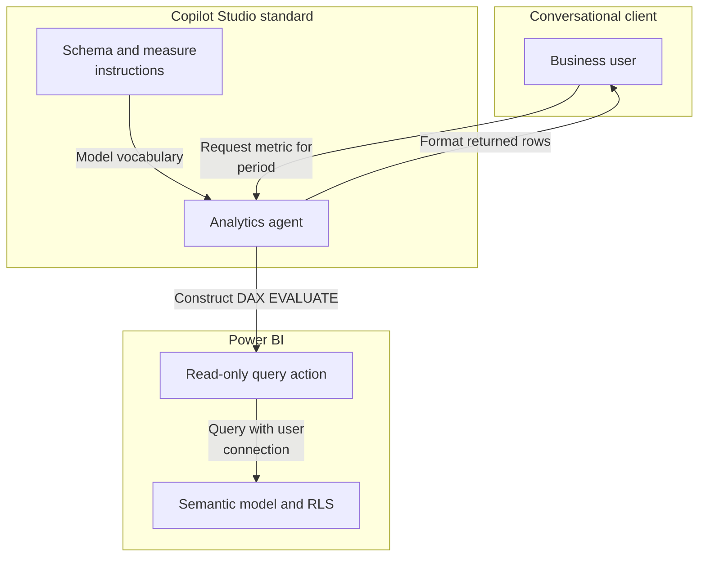
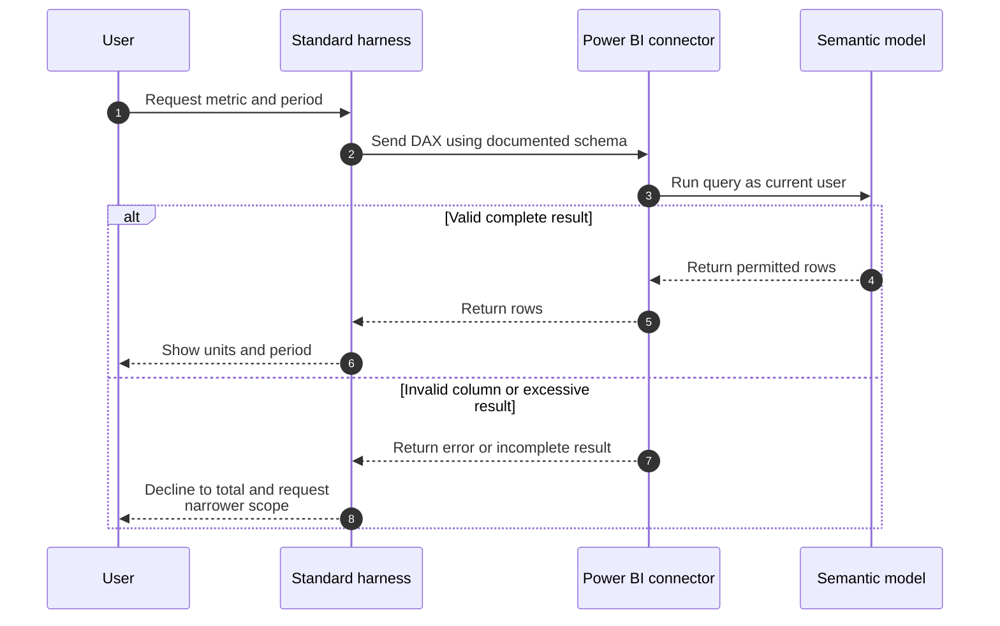

# Fabric 3: Query the model directly from the standard harness

**Class:** Microsoft decision-guide pattern (Fabric option 3 of 4). **Intent:** Return live figures without an intermediary data agent, on the standard Copilot Studio harness.

## Architecture

**Review decision:** The standard harness writes DAX itself. Choose it only if the schema fits its instructions and the team can handle invalid queries without assuming automatic correction.

## Technical flow

## Design notes

**Flow:** The agent resolves the user's metric and period, constructs a read-only DAX `EVALUATE` query and calls the Power BI connector's *Run a query against a dataset* action. Feed only the returned rows into an answer with explicit units. The semantic model owns totals and time intelligence; a prompt must not recreate them.

**Choose it when** the model is stable, the required schema guidance fits the standard harness instruction budget and the team can maintain DAX examples. The decision guide describes an 8,000-character instruction limit and no skills or automatic query-repair loop for this option. Unlike [option 4](fabric-copilot-harness.md), an error will not automatically trigger a corrected query.

**Trust boundary:** Configure the end user's Power BI connection and only the read-only query operation. Target the intended model in configuration. Test consumer permissions and RLS separately from the developer account; read-only does not imply access to every row.

**Failure handling:** Reject unknown measures and excessive result sets; ask for a narrower period rather than returning a truncated total. Re-run a fixed test pack on schema changes. Verify that a renamed column produces an explicit failure, not a number from the previous turn.

**Sources:** [Microsoft Fabric architecture choice: pattern 3](https://learn.microsoft.com/en-us/power-platform/architecture/key-concepts/copilot-studio-fabric/#pattern-3-copilot-studio-agent-on-the-standard-harness-with-power-bi-connector) · [Prepare a semantic model for AI agents](https://learn.microsoft.com/en-us/power-platform/architecture/key-concepts/copilot-studio-fabric/semantic-model-ai-agents).
