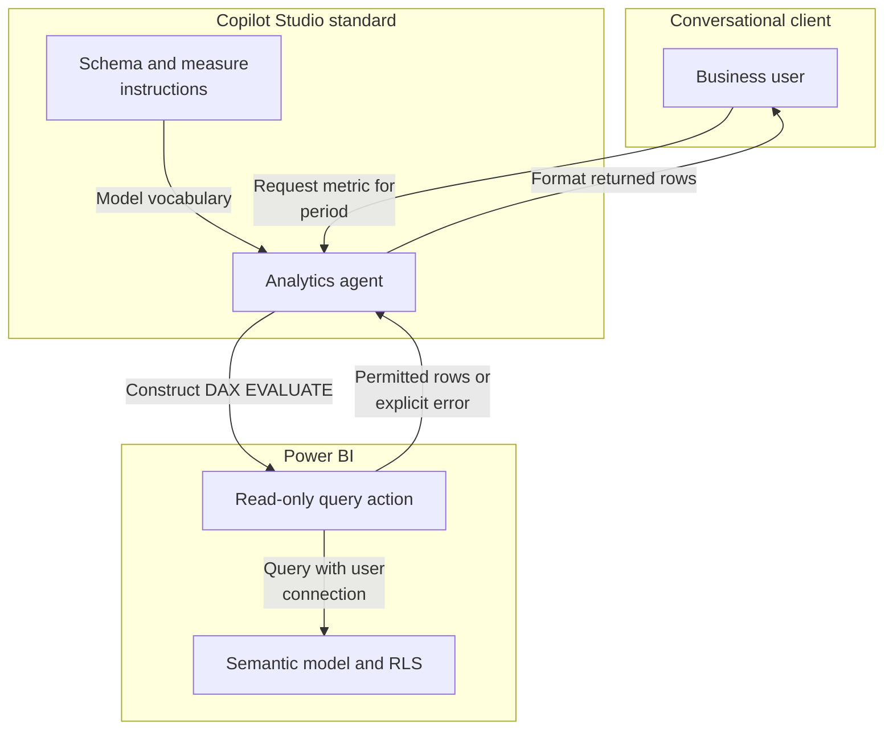
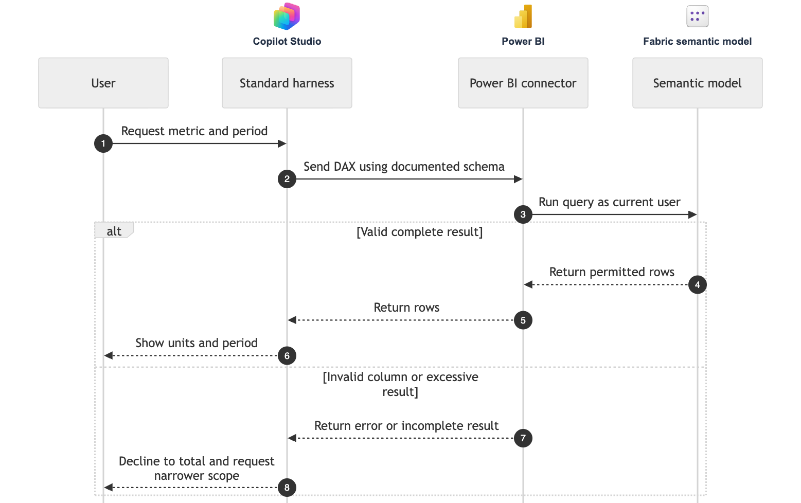
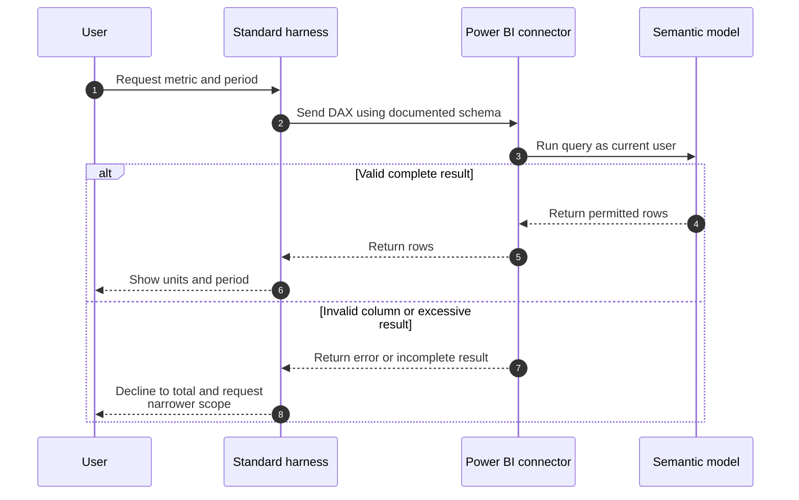

# Fabric 3: Query the model directly from the standard harness

**Class:** Microsoft decision-guide pattern (Fabric option 3 of 4). **Intent:** Return live figures without an intermediary data agent, on the standard Copilot Studio harness.

## Architecture

**Review decision:** The standard harness writes DAX itself. Choose it only if the schema fits its instructions and the team can handle invalid queries without assuming automatic correction.

## Technical flow

Text and editable Mermaid sequence

## Copilot Studio components

**Recommended build ([harness](../COMPONENTS.md#the-harness-is-the-first-decision)):** Standard harness, generative orchestration. Option 4 moves the schema into a skill and lets the Microsoft Copilot harness correct a failed query.

| Component | Use in this pattern | Harness alternative |
| --- | --- | --- |
| [Orchestration](../COMPONENTS.md#orchestration-modes): Generative orchestration | Resolves metric and period, then calls the query tool once per question. | Copilot: reasoning loop with retries. |
| [Instructions](../COMPONENTS.md#instructions): Schema and measure instructions | List exact measure names, the date table and units for the agent to cite. | Copilot: model-specific skill. |
| [Connector tool](../COMPONENTS.md#connector-tools): Power BI: Run a query against a dataset | Runs a read-only DAX `EVALUATE` query and returns rows only. | Copilot: same connector action. |
| [Topic nodes](../COMPONENTS.md#topic-nodes): Question node | Asks for a missing period or measure instead of choosing one silently. *(Optional.)* | Copilot: instructions ask for missing scope. |
| [Authentication](../COMPONENTS.md#authentication-and-tool-credentials): User authentication on the connector | Applies the user's row-level security in the semantic model. | All harnesses. |

**Not the right component:** A prompt tool or code interpreter that recalculates totals or time intelligence the model already defines.

**Copilot Credits drivers (medium):** Each answer is a generative answer (2), and planner steps on the activity map are agent actions (5). A reasoning model adds 10 credits per 1,000 billed tokens, and long schema instructions raise that token count. Employee use by licensed Microsoft 365 Copilot users with their own identity is included. See [Copilot Credits guidance](../COPILOT-CREDITS.md).

## Design notes

**Flow:** The agent resolves the user's metric and period, constructs a read-only DAX `EVALUATE` query and calls the Power BI connector's *Run a query against a dataset* action. Feed only the returned rows into an answer with explicit units. The semantic model owns totals and time intelligence; a prompt must not recreate them.

**Choose it when** the model is stable, the required schema guidance fits the standard harness instruction budget and the team can maintain DAX examples. The decision guide describes an 8,000-character instruction limit and no skills or automatic query-repair loop for this option. Unlike [option 4](fabric-copilot-harness.md), an error will not automatically trigger a corrected query.

**Trust boundary:** Pin the semantic model and use the end user's Power BI connection. [Execute Queries](https://learn.microsoft.com/en-us/rest/api/power-bi/datasets/execute-queries) requires the tenant setting and model Read and Build permissions. For workspace consumers, test with a Viewer assigned the intended model role: [RLS does not apply to Admins, Members or Contributors](https://learn.microsoft.com/en-us/fabric/security/service-admin-row-level-security). A read-only query issued by a developer is not a consumer access test.

**Failure handling:** Reject unknown measures and excessive result sets; ask for a narrower period rather than returning a truncated total. Re-run a fixed test pack on schema changes. Verify that a renamed column produces an explicit failure, not a number from the previous turn.

**Sources:** [Microsoft Fabric architecture choice: pattern 3](https://learn.microsoft.com/en-us/power-platform/architecture/key-concepts/copilot-studio-fabric/#pattern-3-copilot-studio-agent-on-the-standard-harness-with-power-bi-connector) · [Prepare a semantic model for AI agents](https://learn.microsoft.com/en-us/power-platform/architecture/key-concepts/copilot-studio-fabric/semantic-model-ai-agents).
