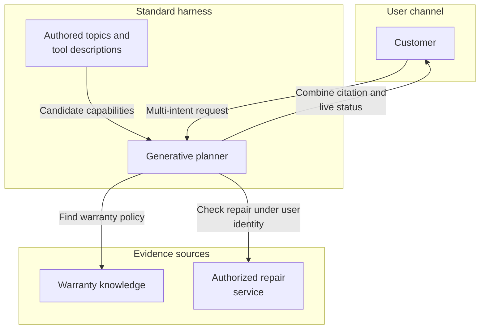
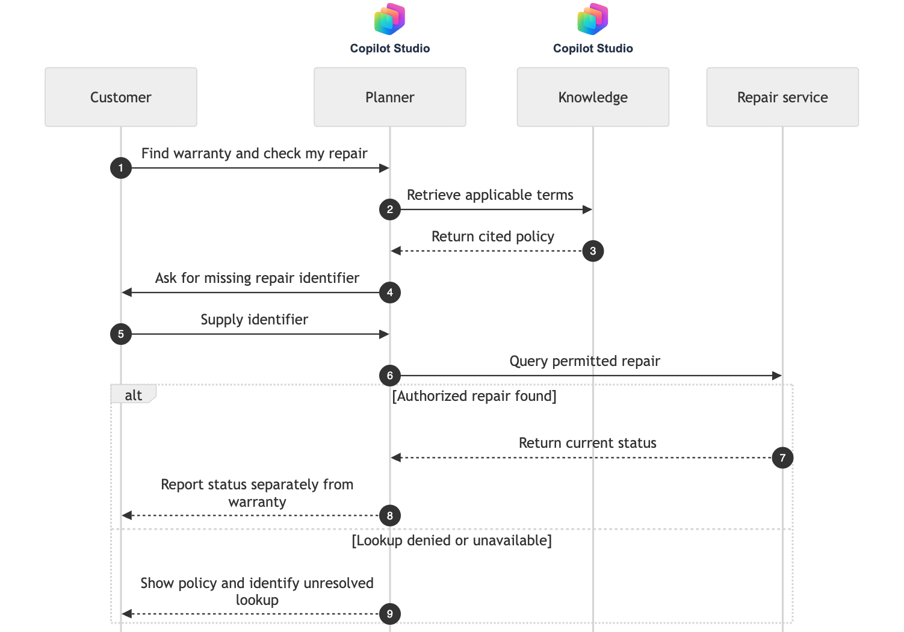
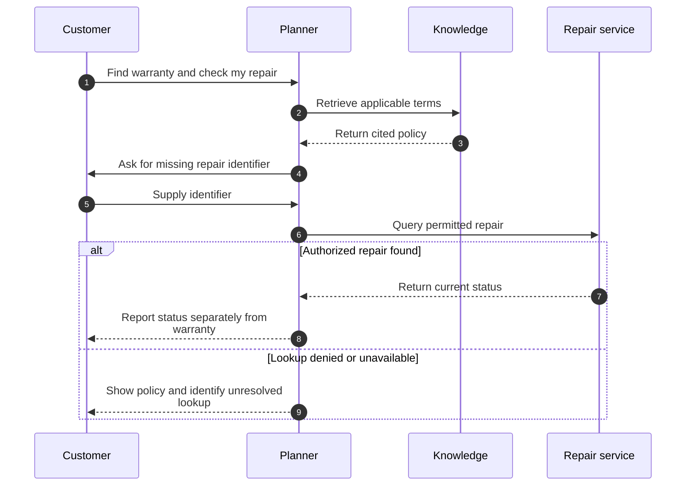

# Standard harness: generative orchestration over topics, tools and knowledge

**Class:** Microsoft implementation-guide pattern (orchestration). **Intent:** Handle requests that combine several familiar tasks without writing a topic for every possible sequence.

## Architecture

**Review decision:** Use the planner to combine intents, but keep the evidence for each result separate. A cited warranty answer says nothing about whether a private repair lookup succeeded.

## Technical flow

Text and editable Mermaid sequence

## Copilot Studio components

**Recommended build ([harness](../COMPONENTS.md#the-harness-is-the-first-decision)):** Standard harness, generative orchestration. On the Microsoft Copilot harness, the reasoning loop plans across tools and workflows. Use it when the request needs iterative evidence, not just two known tasks.

| Component | Use in this pattern | Harness alternative |
| --- | --- | --- |
| [Orchestration](../COMPONENTS.md#orchestration-modes): Generative orchestration | Selects topics, tools, knowledge and agents from their descriptions and fills missing inputs. | Copilot: reasoning loop. |
| [Topics](../COMPONENTS.md#topics-and-system-topics): Authored topics with distinct descriptions | Own any fixed confirmation sequence that the planner must not improvise. | Copilot: workflow tool. |
| [Knowledge](../COMPONENTS.md#knowledge-sources): Warranty documents | Return cited warranty text. | All harnesses. |
| [Connector tool](../COMPONENTS.md#connector-tools): Repair status tool with user authentication | Returns live repair status for the signed-in customer. | All harnesses. |
| [Connected agent](../COMPONENTS.md#connected-agents): Eligible specialist agents | Handle a subdomain that another team owns. *(Optional.)* | Copilot: connected agents. |

**Not the right component:** Relying on the planner to enforce a confirmation or authorization step. Put it in a topic or flow.

**Copilot Credits drivers (medium):** A combined request can bill several events in one turn: a generative answer (2) per grounded response and an agent action (5) for each planned step on the activity map. Clear tool descriptions avoid wasted steps. See [Copilot Credits guidance](../COPILOT-CREDITS.md).

## Design notes

**Flow:** A planner selects from descriptions of tools, knowledge, topics and eligible agents, gathers missing inputs and combines their outputs. For “find the warranty and check my repair,” keep the cited warranty text distinct from the repair system's live status. Use an authored topic or flow for any fixed confirmation sequence.

**Choose it when** users express multiple intents and the capabilities have distinct purposes. Broad or overlapping descriptions make routing less predictable. For a mandatory fixed dialogue use [classic topics](classic-topics.md); for iterative exploration compare the [Copilot harness loop](copilot-reasoning-loop.md).

**Trust boundary:** A tool description tells the planner *when* to call, not *who* is allowed to act. Backend permissions, validation and confirmation still apply. Do not let the content of a retrieved warranty instruct the agent to invoke a tool.

**Failure handling:** If one part fails, label its outcome independently; finding the warranty is not evidence the repair lookup succeeded. Evaluate ambiguous tool pairs, missing identifiers and interrupted multi-intent conversations in the published channel.

**Sources:** [Microsoft Learn: Standard harness generative orchestration](https://learn.microsoft.com/en-us/microsoft-copilot-studio/guidance/understand-harnesses#standard-harness-generative-orchestration) · [Orchestrate agent behavior with generative AI](https://learn.microsoft.com/en-us/microsoft-copilot-studio/advanced-generative-actions).
