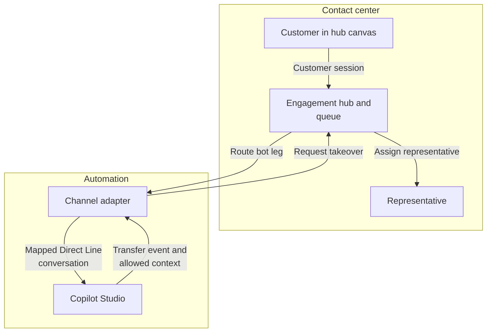
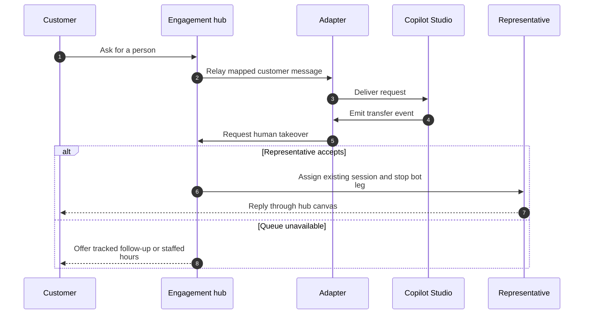

# Handoff 1: Engagement hub in front (Bot-as-an-Agent)

**Class:** Microsoft implementation-guide pattern (handoff). **Intent:** Let a contact center retain ownership of the session, routing and service levels while a bot handles the first part of the chat.

## Architecture

**Review decision:** The hub, not the bot, owns the customer session. Verify that takeover ends bot replies and that a queue failure cannot look like successful human acceptance.

## Technical flow

## Design notes

**Flow:** The customer opens the engagement hub's chat canvas. The hub maps that conversation through an adapter to Copilot Studio. On the configured transfer event the hub takes control, queues the conversation and assigns a representative. The customer stays in the same canvas. An Escalate topic without a working transfer node and hub is not a live transfer.

**Choose it when** the help desk already owns the customer experience and supervisor tools. It has fewer custom components than [bot-in-the-loop](bot-front-handoff.md), but customization of bot messages and access to subsequent human messages depend on the hub.

**Trust boundary:** The transfer can include conversation history and variables. Minimize data collected before transfer; map sessions using trusted identifiers, and let the hub enforce visibility of the receiving queue.

**Failure handling:** Distinguish transfer requested from representative joined. If the queue is unavailable, display staffed hours or a case reference. Test that the adapter stops relaying bot responses once the representative takes ownership, including on reconnect.

**Sources:** [Microsoft Learn: Channel and handoff guidance — pattern 1](https://learn.microsoft.com/en-us/microsoft-copilot-studio/guidance/channels) · [Configure handoff to a live agent](https://learn.microsoft.com/en-us/microsoft-copilot-studio/advanced-hand-off).
