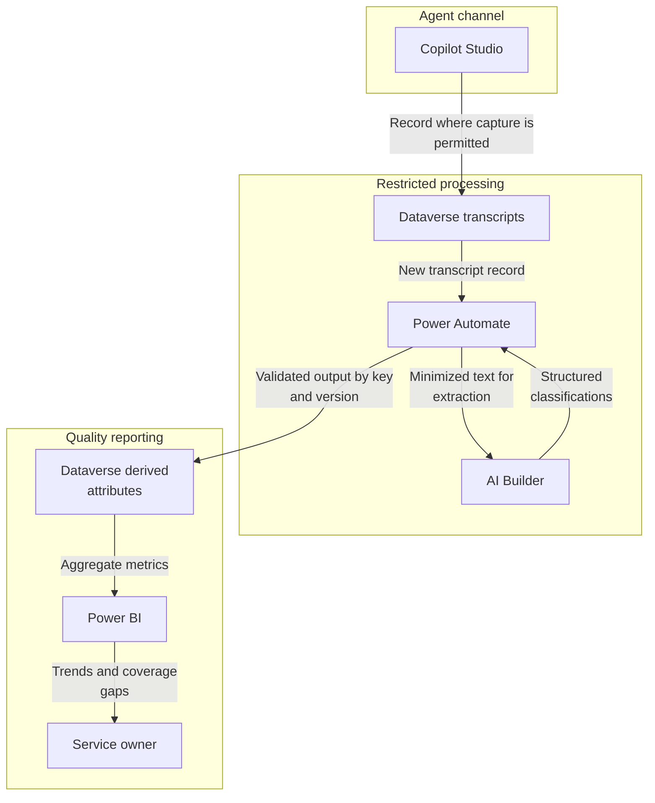
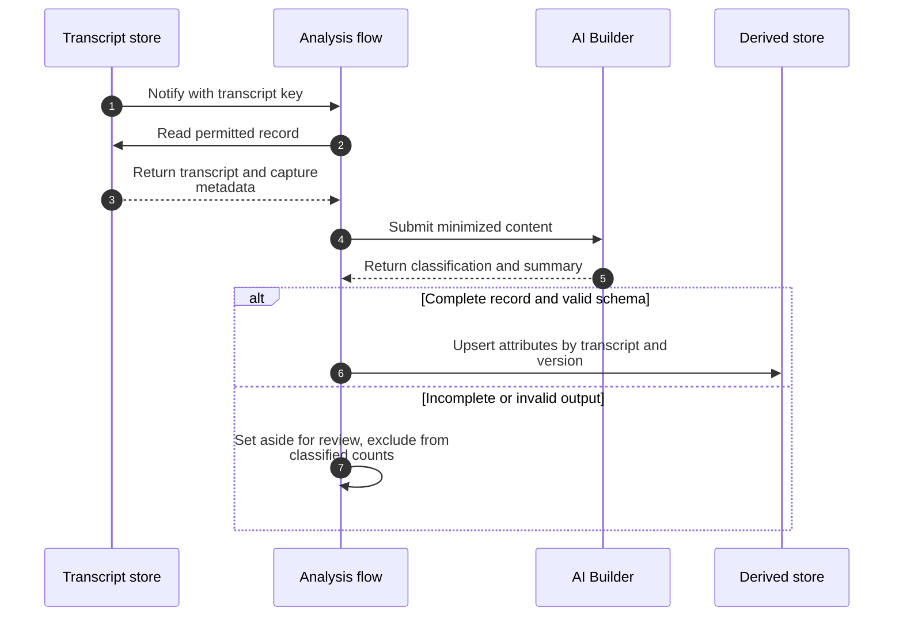

# Extract service-quality signals from conversation transcripts

**Class:** Microsoft reference architecture. **Intent:** Discover repeated unanswered questions without giving every dashboard reader access to raw conversations.

## Architecture

**Review decision:** Approve capture and retention for raw transcripts separately from derived summaries. Dashboard readers usually need trends, not access to either text store.

## Technical flow

## Components and flow

1. Where transcript capture is enabled and permitted, Copilot Studio records conversations in Dataverse's `ConversationTranscript` table. A Power Automate flow processes new transcript records outside the user conversation.
2. Pass only approved text to AI Builder for a structured extraction, such as topic, escalation indicator and short summary. Validate the output schema and associate the result with the transcript key and analysis version.
3. Store derived attributes separately in Dataverse. Power BI groups them by release, channel or topic; a service owner samples authorized examples before changing an answer or workflow.

**When to choose it:** Use when built-in analytics show a symptom, such as frequent escalation, but not the recurring question. Analysis costs and classification errors increase with volume; sampling may answer the question more economically.

**Trust boundary:** Raw dialogue, summaries and personal-data flags may all be sensitive. Minimize text *before* analysis, restrict who can inspect it, and specify retention for derived data as well as transcripts. Sentiment is not a reliable measure of an individual's performance.

**Failure handling and acceptance:** Quarantine incomplete records or malformed extractions instead of treating them as neutral. Reprocess by key and version without double-counting. Compare classifications against a reviewed sample and report how much traffic was not analyzed.

**Sources:** [Microsoft Learn: Extract and analyze agent conversation transcripts](https://learn.microsoft.com/en-us/power-platform/architecture/reference-architectures/analyze-agent-conversation-transcripts) · [Conversation Analyzer in Copilot Agent Kit](https://learn.microsoft.com/en-us/microsoft-copilot-studio/guidance/kit-conversation-analyzer).
