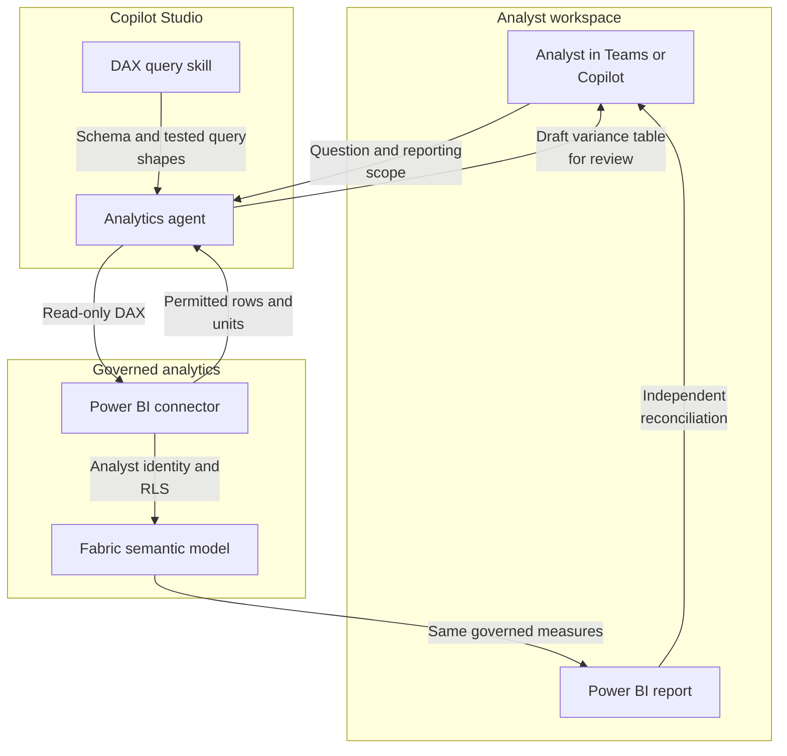
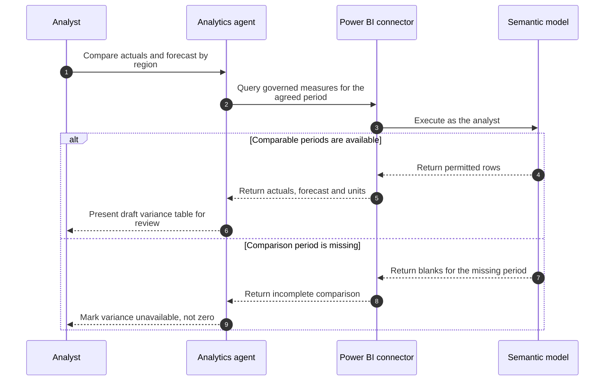

# Analyst-reviewed reporting over a Fabric semantic model

**Class:** Microsoft reference architecture. **Intent:** Let an analyst ask for a variance in Teams or Microsoft Copilot and get a table they can reconcile to the published Power BI report. The output is a draft, not an approved financial statement.

## Architecture

**Review decision:** Sign off the numbers against the published report under the same identity and filters. A successful DAX query is not evidence that the chosen measure was correct.

## Technical flow

## Copilot Studio components

**Recommended build ([harness](../COMPONENTS.md#the-harness-is-the-first-decision)):** Microsoft Copilot harness with a DAX skill, as in the reference. The Standard harness is the simpler alternative (Fabric option 3). Compare this harness with the four [Fabric integration options](../CATALOG.md#fabric-integration-options).

| Component | Use in this pattern | Harness alternative |
| --- | --- | --- |
| [Orchestration](../COMPONENTS.md#orchestration-modes): Reasoning loop | Resolves period, measure and comparison, then queries and inspects results. | Std: generative orchestration. |
| [Skill](../COMPONENTS.md#skills): DAX query skill | Holds the model schema and tested query patterns. | Std: instructions. |
| [Connector tool](../COMPONENTS.md#connector-tools): Power BI: Run a query against a dataset | Governed measures compute every figure under the analyst's identity. | Std: same action. |
| [Agent sandbox](../COMPONENTS.md#code-interpreter-and-agent-sandbox): Agent sandbox | Produces a table or workbook for the analyst to reconcile. *(Optional.)* | Std: code interpreter on a prompt. |
| [Memory](../COMPONENTS.md#memory): Analyst preferences | Recalls preferred layout and default comparison period, which the agent confirms before querying. *(Optional.)* | Std: no memory. |
| [Workflow](../COMPONENTS.md#workflows): Redistribution approval | Analyst approval before anything is shared. *(Optional.)* | Std: Power Automate approval. |
| [Channel](../COMPONENTS.md#channels): Teams or Microsoft 365 | Analyst workspace. | Both harnesses. |

**Not the right component:** Commentary that invents a cause, or a sandbox calculation that replaces a governed measure.

**Copilot Credits drivers (high):** Usage-based from build time and not covered by Microsoft 365 Copilot licenses. File generation and query retries add tokens and harness work. Benchmark a typical variance request, then multiply by analyst volume. See [Copilot Credits guidance](../COPILOT-CREDITS.md).

## Components and flow

1. The Copilot Studio agent resolves the reporting period, measure, comparison and organizational unit. It asks for missing scope rather than silently choosing a calendar or currency.
2. On the Microsoft Copilot harness, a skill supplies the model schema and tested DAX patterns. The agent calls the Power BI connector's *Run a query against a dataset* action. Governed measures, not the language model, calculate the figures.
3. The agent formats the returned rows with units, period and comparison basis. Commentary may describe which regions contributed to a change; it should not invent a cause. The analyst checks the result and approves any redistribution.

**When to choose it:** A stable model already powers a report, but analysts repeatedly extract the same comparisons. If definitions still vary by department, resolve that disagreement before adding chat. See [the underlying integration choice](../decision-patterns/fabric-copilot-harness.md) for what the harness adds.

**Trust boundary:** Use the analyst's connector identity. Test row-level security (RLS) using a consumer identity, not a workspace administrator. Permission to see an answer does not grant permission to share it.

**Failure handling and acceptance:** Correct a malformed query within a bounded retry budget. Never retry a denial with broader credentials. Return “comparison unavailable” for a missing prior period, not zero. Reconcile a known period, a missing period and a restricted region against the same report filters.

**Source:** [Microsoft Learn: Copilot Studio analytics agent over a Microsoft Fabric semantic model](https://learn.microsoft.com/en-us/power-platform/architecture/key-concepts/copilot-studio-fabric/copilot-studio-fabric-analytics-agent).
