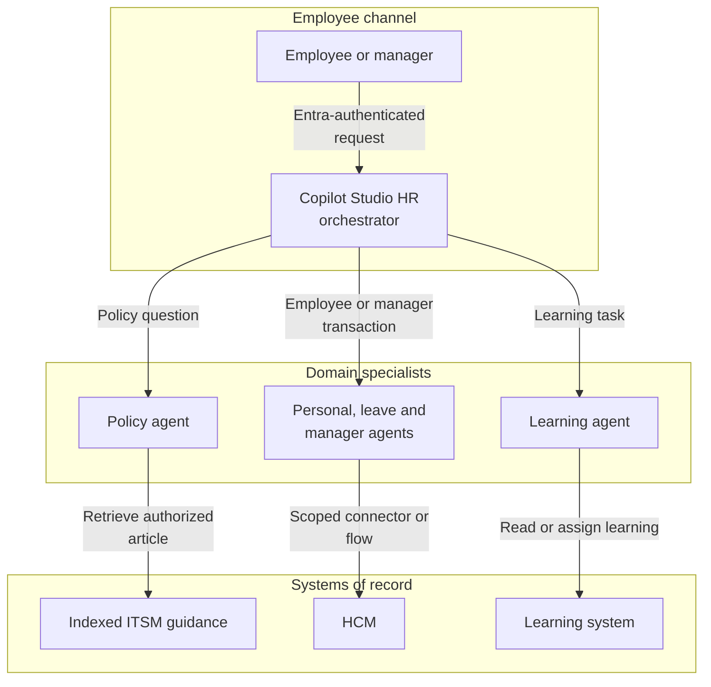
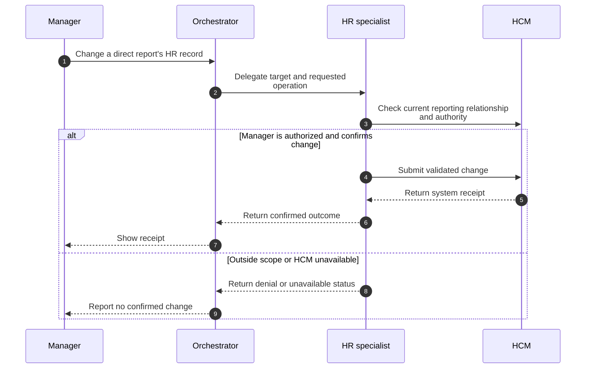

# Route HR requests to domain-specific agents

**Class:** Microsoft reference architecture. **Intent:** Give employees and managers one front door in Teams or Microsoft Copilot without putting policy search, personal records and manager-only operations behind one unrestricted tool.

## Architecture

**Review decision:** Choose a specialist boundary that matches the permission boundary. Being routed to a manager specialist does not establish a manager-to-employee relationship.

## Technical flow

## Components and flow

1. Entra ID signs in the user. A Copilot Studio orchestrator distinguishes personal data, time off, manager actions, learning and HR policy. It asks which task the user wants if a request crosses domains.
2. The policy specialist retrieves approved ITSM articles indexed through a Microsoft 365 Graph connector. Transaction specialists use custom connectors and Power Automate to read or update the human capital management (HCM) or learning system.
3. Return a policy citation for advice and a system receipt for a completed action. Route sensitive or unresolved requests to an HR case in the ITSM system rather than passing the full conversation among agents.

**When to choose it:** Choose specialists when domains have distinct owners, access rules or release cycles. For a handbook-only assistant, one knowledge agent is simpler and avoids extra routing latency.

**Trust boundary:** A manager's title in conversation is not permission. Recheck direct-report relationships in the HCM system for the requested operation. Avoid sending salary or profile fields to the policy agent.

**Failure handling and acceptance:** If HCM is unavailable, the agent can still explain policy but must not claim that leave was approved. Record the failed stage and a case reference. Test switching from a policy question to a manager action, including a target outside the manager's reporting line.

**Source:** [Microsoft Learn: Modernize employee HR support with a multi-agent solution](https://learn.microsoft.com/en-us/power-platform/architecture/reference-architectures/modernize-hr-support).
