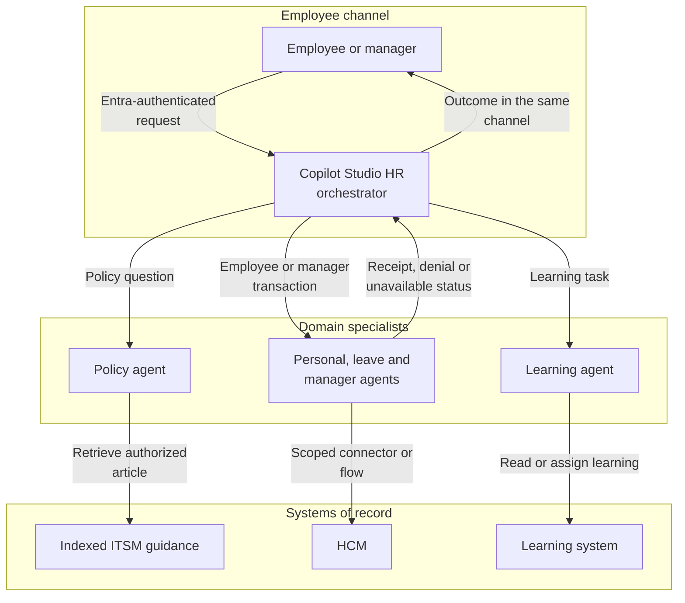
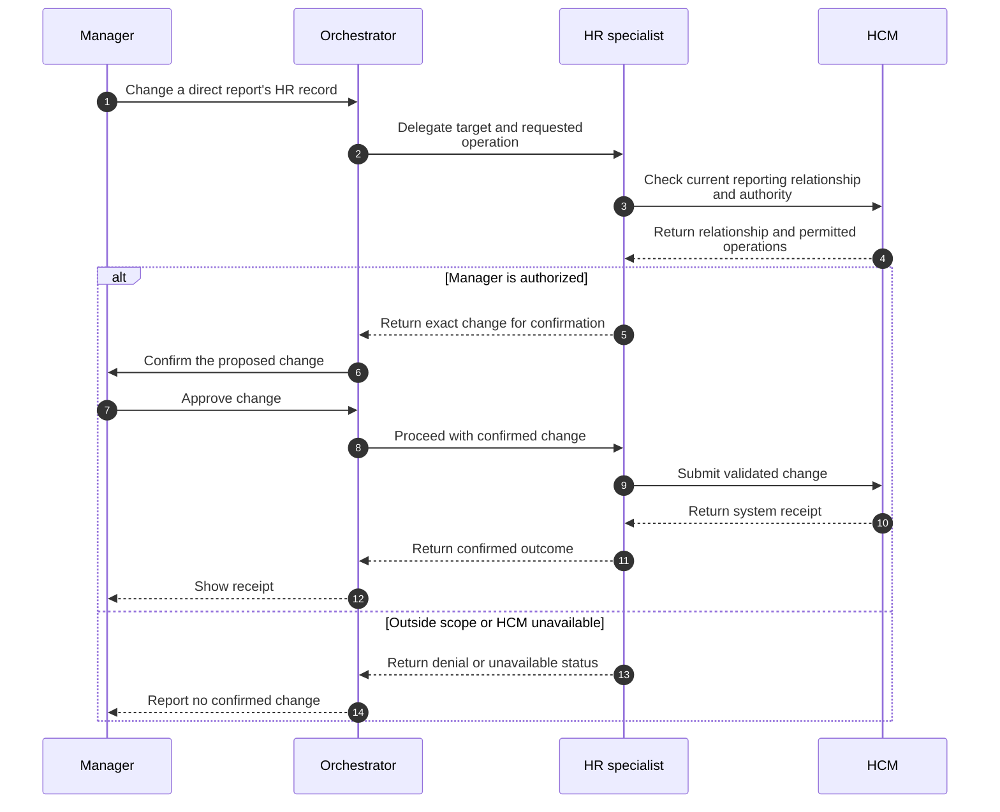

# Route HR requests to domain-specific agents

**Class:** Microsoft reference architecture. **Intent:** Give employees and managers one front door in Teams or Microsoft Copilot without putting policy search, personal records and manager-only operations behind one unrestricted tool.

## Architecture

**Review decision:** Choose a specialist boundary that matches the permission boundary. Being routed to a manager specialist does not establish a manager-to-employee relationship.

## Technical flow

## Copilot Studio components

**Recommended build ([harness](../COMPONENTS.md#the-harness-is-the-first-decision)):** Standard harness, generative orchestration with child or connected specialist agents. On the Microsoft Copilot harness, specialists become connected agents and transactions become workflows.

| Component | Use in this pattern | Harness alternative |
| --- | --- | --- |
| [Orchestration](../COMPONENTS.md#orchestration-modes): Generative orchestration | Distinguishes personal, leave, manager, learning and policy requests, and asks when a request crosses domains. | Copilot: reasoning loop. |
| [Connected agent](../COMPONENTS.md#connected-agents): Domain specialists | Use connected agents where another team owns a specialist; use child agents for tasks in the same release. | Copilot: connected agents only. |
| [Knowledge](../COMPONENTS.md#knowledge-sources): Microsoft Graph connector for ITSM articles | Grounds policy answers with citations. | Both harnesses list Graph connectors. |
| [Connector tool](../COMPONENTS.md#connector-tools): Custom connectors to HCM and the learning system | Read and update records with user authentication. | All harnesses. |
| [Agent flow](../COMPONENTS.md#agent-flows): Transaction flows | Perform updates and return a system receipt. | Copilot: workflows. |
| [Escalation and handoff](../COMPONENTS.md#escalation-and-handoff): HR case in ITSM | Routes sensitive or unresolved requests to a case rather than passing the conversation between agents. | All harnesses. |

**Not the right component:** One unrestricted tool or a shared maker connection for manager-only operations.

**Copilot Credits drivers (medium):** Employee use is included for licensed Microsoft 365 Copilot users with their own identity. Otherwise, Graph-connector grounding can bill as tenant graph grounding (10 per message), answers bill at 1 or 2, specialist hops bill as agent actions and agent flow actions bill at 13 per 100. See [Copilot Credits guidance](../COPILOT-CREDITS.md).

## Components and flow

1. Entra ID signs in the user. A Copilot Studio orchestrator distinguishes personal data, time off, manager actions, learning and HR policy. It asks which task the user wants if a request crosses domains.
2. The policy specialist retrieves approved ITSM articles indexed through a Microsoft 365 Graph connector. Transaction specialists use custom connectors and Power Automate to read or update the human capital management (HCM) or learning system.
3. Return a policy citation for advice and a system receipt for a completed action. Route sensitive or unresolved requests to an HR case in the ITSM system rather than passing the full conversation among agents.

**When to choose it:** Choose specialists when domains have distinct owners, access rules or release cycles. For a handbook-only assistant, one knowledge agent is simpler and avoids extra routing latency.

**Trust boundary:** A manager's title in conversation is not permission. Recheck direct-report relationships in the HCM system for the requested operation. Avoid sending salary or profile fields to the policy agent.

**Failure handling and acceptance:** If HCM is unavailable, the agent can still explain policy but must not claim that leave was approved. Record the failed stage and a case reference. Test switching from a policy question to a manager action, including a target outside the manager's reporting line.

**Source:** [Microsoft Learn: Modernize employee HR support with a multi-agent solution](https://learn.microsoft.com/en-us/power-platform/architecture/reference-architectures/modernize-hr-support).
