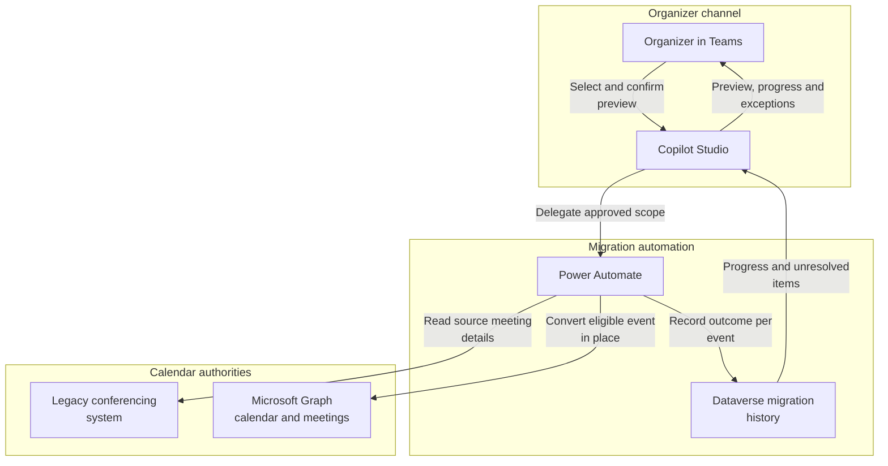
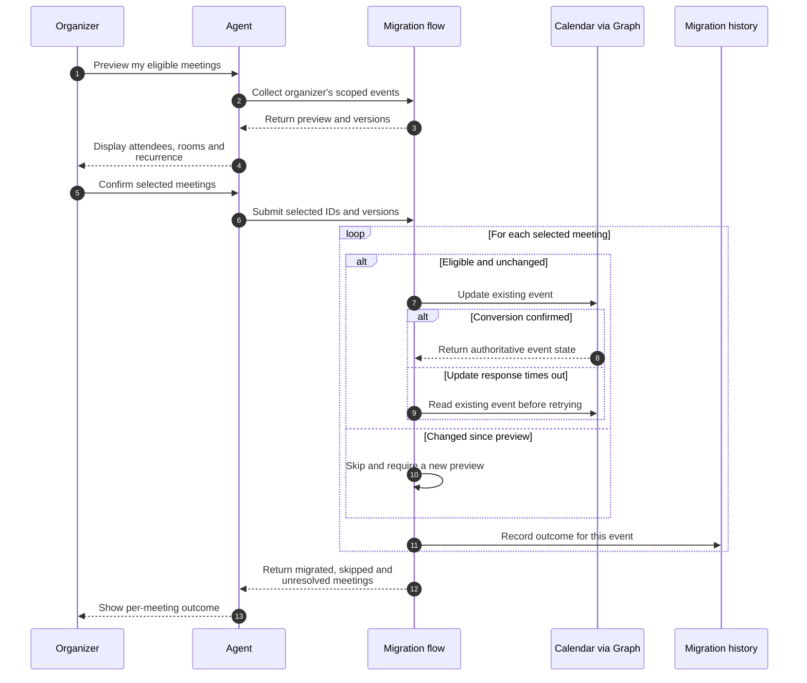

# Preview and migrate an organizer's meetings in place

**Class:** Microsoft reference architecture. **Intent:** Move conferencing details to Teams without making employees recreate their invitations or giving a migration operator standing access to every calendar.

## Architecture

**Review decision:** Approval is per organizer, meeting and previewed version. A timeout is a reason to check the original event, not to create a replacement invitation.

## Technical flow

## Components and flow

1. An organizer signs into the Copilot Studio agent in Teams. Delegated access lets the migration automation inspect eligible meetings. Show the proposed changes, including recurring series and room bookings, before requesting a selection.
2. On confirmation, Power Automate reads the source details and uses calendar/meeting operations through Microsoft Graph to convert supported events in place. Track the existing event identifier rather than canceling and reinviting by default.
3. Record per-event status and reason in Dataverse. Return separate lists for converted, skipped and unresolved events; Power BI can report aggregate progress without publishing attendee lists.

**When to choose it:** Suitable where the source calendar and its event types support a tested in-place conversion. Prove that attendee lists, series exceptions, invitations and room reservations survive. Route unsupported meeting types to manual migration.

**Trust boundary:** Authorization comes from the signed-in organizer's delegated permissions, not possession of an event ID. A preview is not perpetual consent: check whether the event changed before applying it.

**Failure handling and acceptance:** Re-read an event after a timeout; never create a second invite to “fix” an unknown outcome. Retry only unconverted eligible events. Test a partial batch and verify the employee can see precisely what still needs attention.

**Source:** [Microsoft Learn: Migrate legacy meetings to Microsoft Teams with a conversational agent](https://learn.microsoft.com/en-us/power-platform/architecture/reference-architectures/migrate-legacy-meetings).
