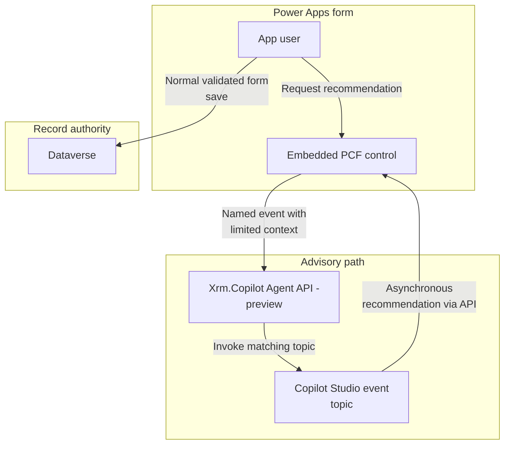
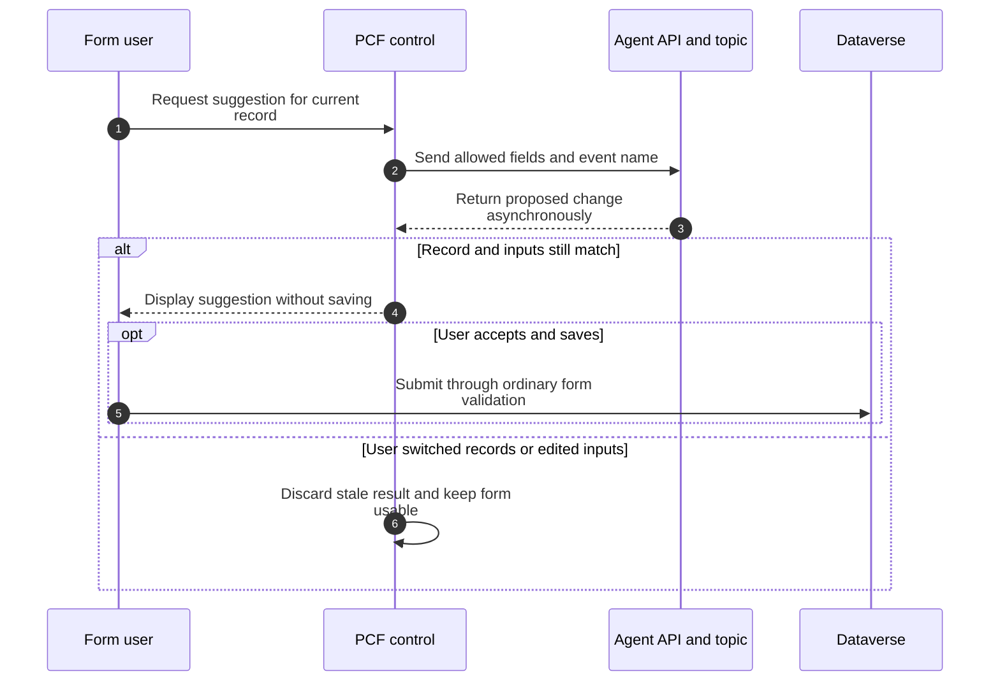

# Request an agent recommendation from a model-driven form

**Class:** Microsoft reference architecture. **Status:** The `Xrm.Copilot` Agent API used in the reference is **preview**, not intended for production. **Intent:** Offer the user advice about the record they are editing, without giving an agent control of the form.

## Architecture

**Review decision:** Keep the preview API off the form's critical path. A suggestion can be applied only to the same record and input version, and only by the user.

## Technical flow

## Components and flow

1. A Power Apps component framework (PCF) control captures a small set of authorized fields on the current form, for example a case category and selected service. On request it raises a named event with `Xrm.Copilot.executeEvent()`.
2. A matching Copilot Studio topic interprets the event and returns a structured suggestion. The control checks the response shape and asynchronously displays the suggestion next to the relevant field.
3. The user accepts or dismisses it. Apply accepted changes through normal form validation and Dataverse security; leave saving and concurrency checks intact.

**When to choose it:** Evaluate when record context makes a suggestion more useful than a separate chat. A business rule is cheaper and more predictable for a fixed field mapping. Keep the form functional without the preview API.

**Trust boundary:** Client-supplied record IDs and fields are hints, not permission to read additional data. Use the user's row and column access and minimize the payload. Do not automatically commit a recommendation.

**Failure handling and acceptance:** Discard a delayed suggestion if the user has switched records or edited its inputs. Show a nonblocking unavailable state on timeout. Test opening record B before record A's response returns; A's content must never appear on B.

**Sources:** [Microsoft Learn: Use Copilot Studio agents in model-driven apps](https://learn.microsoft.com/en-us/power-platform/architecture/reference-architectures/contextual-ai-model-driven-app) · [Power Apps Client API: Xrm.Copilot](https://learn.microsoft.com/en-us/power-apps/developer/model-driven-apps/clientapi/reference/xrm-copilot).
