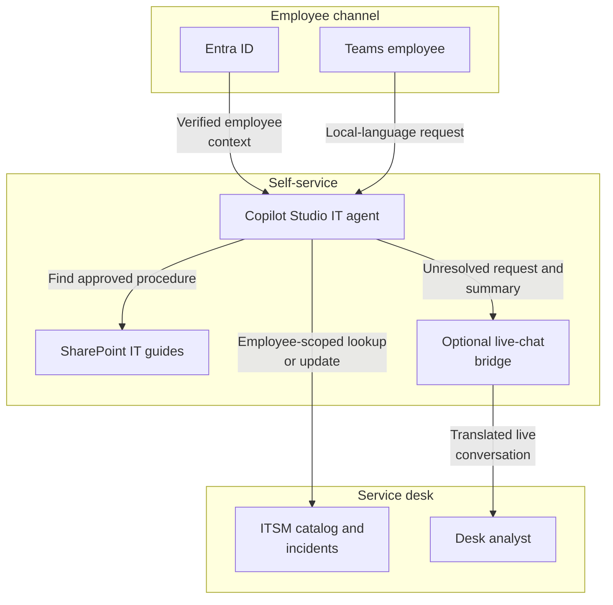
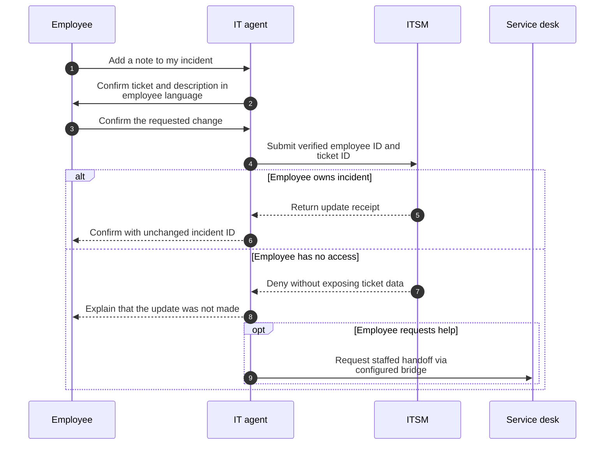

# Multilingual IT self-service across identity providers

**Class:** Microsoft reference architecture. **Intent:** Give employees one Teams entry point for IT guidance, catalog lookup and incident management without granting them access to anyone else's tickets.

## Architecture

**Review decision:** Approve incident updates only if ITSM can identify the employee and enforce ownership at its own boundary, including when a service connection is used.

## Technical flow

## Components and flow

1. Entra ID identifies the employee in Teams. Copilot Studio detects the conversation language and distinguishes “how do I request a laptop?” from “where is my request?”
2. For guidance, retrieve an approved SharePoint guide or IT service management (ITSM) article and link to it. For orders, return the actual catalog form. For incidents, collect a local category, show the description and send the confirmed request through an ITSM connector.
3. Offer the service desk when self-service fails. The reference uses an optional Microsoft 365 Agents SDK bridge for live chat, a conversation summary and two-way translation. Keep incident IDs and product codes unchanged across languages.

**When to choose it:** Best when employees already work in Teams but the service desk and its knowledge use another platform. Search and deep links are cheaper to maintain than live chat; build the bridge only if the desk can staff it.

**Trust boundary:** Prefer per-user ITSM access. If identity providers differ, a scoped integration account must bind a verified employee identifier to every request; the ITSM backend must enforce ownership and record the actor. A name supplied in chat is not that identifier.

**Failure handling and acceptance:** If a create times out, reconcile it before creating another incident. When no analyst is available, offer a tracked callback rather than announcing a transfer. Test the same incident lookup in two languages and with a second employee who must not see it.

**Source:** [Microsoft Learn: Build a multilingual IT self-service agent](https://learn.microsoft.com/en-us/power-platform/architecture/reference-architectures/multilingual-it-self-service-agent).
