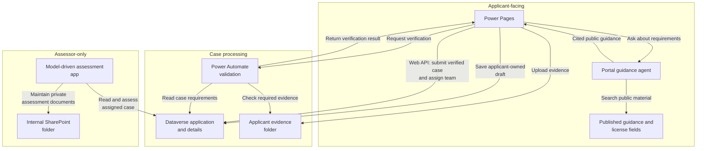
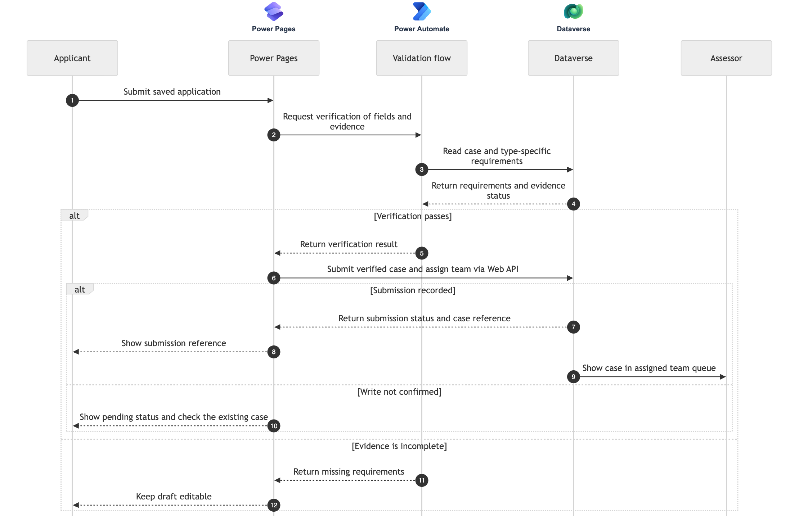
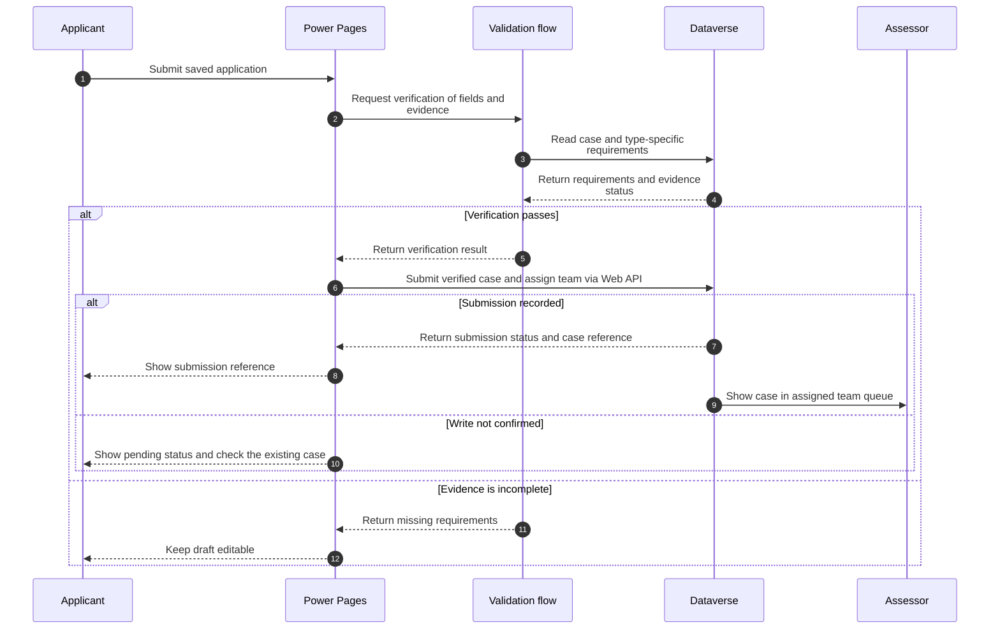

# Regulatory applications with separate applicant and assessor workspaces

**Class:** Microsoft reference architecture. **Intent:** Reuse one submission, assessment and licensing process across business areas without exposing internal deliberations to applicants.

## Architecture

**Review decision:** Keep public guidance, applicant evidence and internal assessments in separate access scopes. Only server-side verification should move a draft into assessment.

## Technical flow

Text and editable Mermaid sequence

## Copilot Studio components

**Recommended build ([harness](../COMPONENTS.md#the-harness-is-the-first-decision)):** Standard harness embedded in Power Pages, answering public guidance only. Validate the Power Pages embedding and channel before you use the Microsoft Copilot harness.

| Component | Use in this pattern | Harness alternative |
| --- | --- | --- |
| [Channel](../COMPONENTS.md#channels): Power Pages website | Provides the applicant-facing guidance agent. | Copilot lists a website channel; validate the portal embedding. |
| [Knowledge](../COMPONENTS.md#knowledge-sources): Published guidance and public license fields | Help applicants find the right application. The agent does not decide eligibility. | All harnesses. |
| [Power Automate flow](../COMPONENTS.md#power-automate-cloud-and-desktop-flows): Server-side verification | Checks fields and related records for the portal verification page. A separate flow creates the fee request after submission. Neither is an agent tool. | Keep these operations in the application if the guidance agent changes harness. |
| [Environments and data policies](../COMPONENTS.md#environments-and-data-policies): Separate access scopes | Keep applicant evidence and assessor documents in separate locations and security roles. | All harnesses. |

**Not the right component:** An agent tool that reads internal assessments or moves a draft into assessment.

**Copilot Credits drivers (medium):** Public applicants are not covered by Microsoft 365 Copilot licenses, so each generative answer bills 2 credits. Validation in a Power Automate cloud flow uses Power Automate licensing. See [Copilot Credits guidance](../COPILOT-CREDITS.md).

## Components and flow

1. An authenticated Power Pages applicant starts a Dataverse application. The common record holds owner, type and status; a linked type-specific detail record holds the fields that vary. The applicant saves a draft and uploads evidence to the portal-facing SharePoint location.
2. The Copilot Studio portal agent searches approved guidance and public license information; it does not decide eligibility. When an applicant submits, Power Automate checks the requirements for that application type on the server and returns the results to the portal verification page.
3. Only after verification succeeds does Power Pages use the Web API to mark the application submitted and assign it to the responsible team. A separate cloud flow creates the fee request. Assessors see assigned cases in the model-driven app and use separate internal documents and approval stages. Publish only the permitted status and decision to the applicant.

**When to choose it:** Useful where programs share case stages but require different detail and evidence. A single fixed form is simpler for one small program; multiple programs need owners for the shared schema and each rule set.

**Trust boundary:** Enforce Power Pages table permissions and separate internal and external document access. A record ID in a URL is not authorization. Limit the agent's public license search to explicitly published fields.

**Failure handling and acceptance:** Keep an invalid submission in draft with a list of missing requirements. If folder creation, routing or fee creation fails, retain the reference and resume that stage without charging twice. Test that an applicant cannot retrieve an internal assessment through either the portal or chat.

**Source:** [Microsoft Learn: Build a regulatory application management solution](https://learn.microsoft.com/en-us/power-platform/architecture/reference-architectures/regulatory-application-management).
