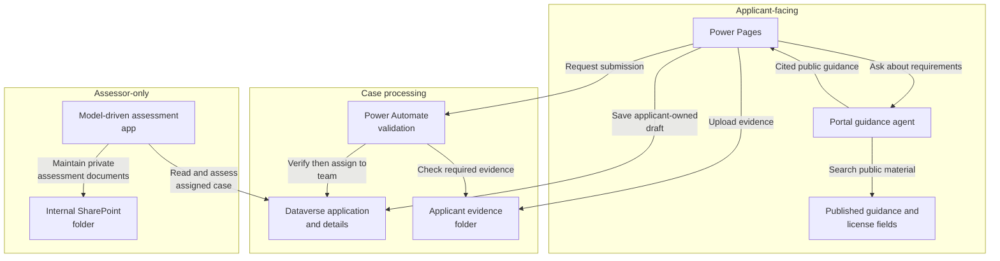
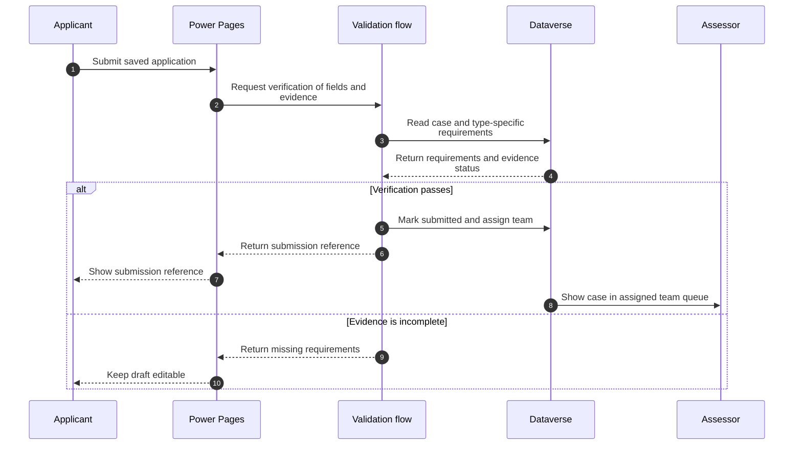

# Regulatory applications with separate applicant and assessor workspaces

**Class:** Microsoft reference architecture. **Intent:** Reuse one submission, assessment and licensing process across business areas without exposing internal deliberations to applicants.

## Architecture

**Review decision:** Keep public guidance, applicant evidence and internal assessments in separate access scopes. Only server-side verification should move a draft into assessment.

## Technical flow

## Components and flow

1. An authenticated Power Pages applicant starts a Dataverse application. The common record holds owner, type and status; a linked type-specific detail record holds the fields that vary. The applicant saves a draft and uploads evidence to the portal-facing SharePoint location.
2. The Copilot Studio portal agent searches approved guidance and public license information. It helps someone find the right application; it does not decide whether they qualify. On submission, Power Automate verifies requirements for that application type on the server and initiates the fee process.
3. A model-driven app assigns the submitted case to the responsible team. Assessors use separate internal documents and approval stages. Publish the decision and permitted status fields back to the applicant; use Power BI for aggregate oversight.

**When to choose it:** Useful where programs share case stages but require different detail and evidence. A single fixed form is simpler for one small program; multiple programs need owners for the shared schema and each rule set.

**Trust boundary:** Enforce Power Pages table permissions and separate internal and external document access. A record ID in a URL is not authorization. Limit the agent's public license search to explicitly published fields.

**Failure handling and acceptance:** Keep an invalid submission in draft with a list of missing requirements. If folder creation, routing or fee creation fails, retain the reference and resume that stage without charging twice. Test that an applicant cannot retrieve an internal assessment through either the portal or chat.

**Source:** [Microsoft Learn: Build a regulatory application management solution](https://learn.microsoft.com/en-us/power-platform/architecture/reference-architectures/regulatory-application-management).
