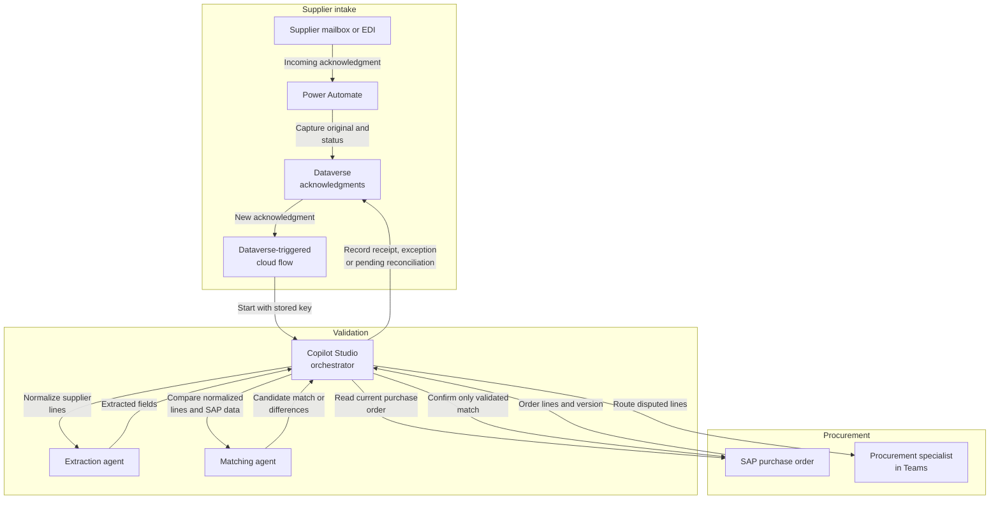
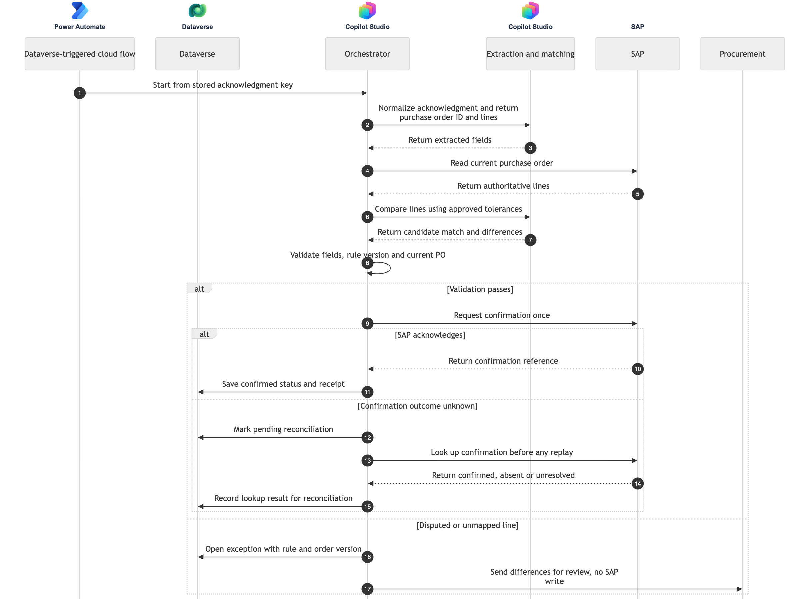
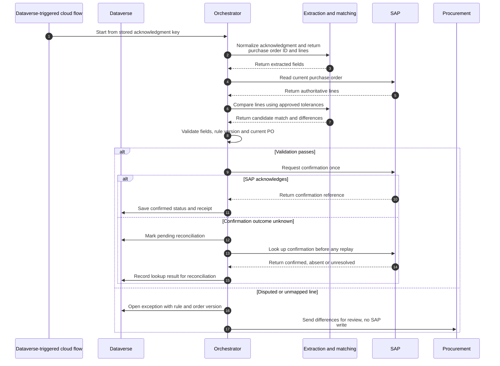

# Match supplier acknowledgments to SAP purchase orders

**Class:** Microsoft reference architecture. **Intent:** Confirm unambiguous supplier acknowledgments automatically, and give procurement staff the exact lines that need a decision.

## Architecture

**Review decision:** Agree the tolerance rules and which SAP operation can run unattended. A supplier document or an extraction result must never authorize its own exception.

## Technical flow

Text and editable Mermaid sequence

## Copilot Studio components

**Recommended build ([harness](../COMPONENTS.md#the-harness-is-the-first-decision)):** Standard harness: a flow-triggered orchestrator with extraction and matching agents. On the Microsoft Copilot harness, model the process as a workflow: connector trigger, extract node, published-agent node for matching, condition, SAP connector and a human input node for exceptions.

| Component | Use in this pattern | Harness alternative |
| --- | --- | --- |
| [Power Automate flow](../COMPONENTS.md#power-automate-cloud-and-desktop-flows): Mailbox or EDI capture | Stores the original acknowledgment in Dataverse with its status. | Copilot: workflow trigger. |
| [Power Automate flow](../COMPONENTS.md#power-automate-cloud-and-desktop-flows): Dataverse row trigger | A second cloud flow starts the orchestrator with the saved key. Do not also subscribe an agent trigger to the same row. | Copilot: a workflow trigger followed by an agent node can replace this start. |
| [Child agent](../COMPONENTS.md#child-agents-and-sub-agents): Extraction and matching agents | Normalize lines and compare them with the purchase order under tolerance rules. | Copilot: workflow extract node and agent node. |
| [Connector tool](../COMPONENTS.md#connector-tools): SAP connector | Reads the purchase order and runs the confirmation operation only after checks pass. | All harnesses. |
| [Agent flow](../COMPONENTS.md#agent-flows): Confirmation and exception flow | Confirms in SAP or creates a Dataverse exception. | Copilot: workflow. |
| [Human gate](../COMPONENTS.md#human-in-the-loop-gates): Dataverse exception and Teams notification | Notify the assigned specialist; hold the write until the authorized decision is recorded against the current order version. A delivered message is not an approval. | Copilot: use an approval for release; a request for information only collects evidence. |

**Not the right component:** Letting the extracted document or the extraction agent authorize an exception.

**Copilot Credits drivers (high):** Budget Power Automate licensing for intake and the Dataverse trigger, not a second Copilot agent-trigger fee for the same event. The autonomous agent's metered actions and agent flows are not included under an employee license. Count pages only if using content processing; for prompt-based extraction use the prompt's meter. Deduplicate before starting the agent. See [Copilot Credits guidance](../COPILOT-CREDITS.md).

## Components and flow

1. A Power Automate flow captures a mailbox or EDI acknowledgment in Dataverse. Keep the original, its supplier reference and processing status together.
2. A Dataverse-triggered flow starts the Copilot Studio orchestrator. An extraction agent normalizes line identifiers, quantities, units, prices and dates. The orchestrator reads the current purchase order from SAP; a matching agent compares corresponding lines using procurement's tolerance rules.
3. Permit the SAP confirmation operation only after required fields and tolerance checks pass. Otherwise create an exception in Dataverse and notify the responsible specialist in Teams with the mismatched values and a link to the source.

**When to choose it:** Useful for high document volume and stable purchasing rules. For one structured EDI format, a deterministic integration may suffice. Keep supplier-specific extraction separate from centrally owned purchasing rules.

**Trust boundary:** Supplier documents are data, not authority to change prices or tolerances. Separate SAP read and confirmation privileges where practical. Record the rule version and acting integration or reviewer on each outcome.

**Failure handling and acceptance:** Quarantine ambiguous line mappings, missing units and changed purchase orders. On an uncertain SAP response, look up confirmation state before replay. Test an exact match, an out-of-tolerance line and delivery of the same acknowledgment twice; only one SAP confirmation should result.

**Source:** [Microsoft Learn: Automate procurement order acknowledgment matching with Copilot Studio and SAP](https://learn.microsoft.com/en-us/power-platform/architecture/reference-architectures/order-acknowledgment-validation).
