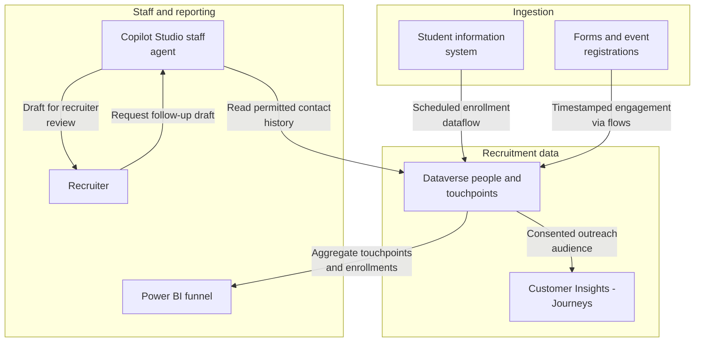
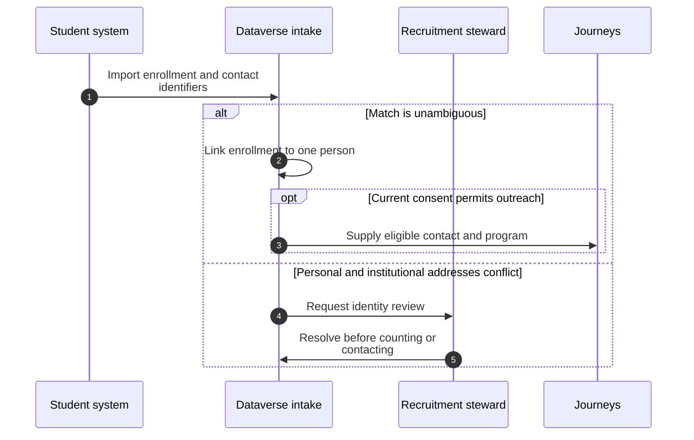

# Link recruitment conversations and touchpoints to enrollment

**Class:** Microsoft reference architecture. **Intent:** Help recruiters follow up on expressed interests and measure which outreach leads to enrollment, even when a student changes email address.

## Architecture

**Review decision:** Decide who can link contact addresses to a person and who can see individual touchpoints. Aggregate campaign attribution is not an admissions decision.

## Technical flow

## Copilot Studio components

**Recommended build ([harness](../COMPONENTS.md#the-harness-is-the-first-decision)):** Standard harness staff agent. Most of the solution is Dataverse, dataflows and Customer Insights - Journeys. The Microsoft Copilot harness adds value only if recruiters need multi-file preparation, such as an event briefing pack.

| Component | Use in this pattern | Harness alternative |
| --- | --- | --- |
| [Knowledge](../COMPONENTS.md#knowledge-sources): Dataverse touchpoints | Summarizes authorized activity under the recruiter's security role. | All harnesses. |
| [Prompt tool](../COMPONENTS.md#prompt-tools): Follow-up draft | Drafts a message that the recruiter edits and sends. *(Optional.)* | Copilot: skill. |
| [Authentication](../COMPONENTS.md#authentication-and-tool-credentials): Entra ID with Dataverse security roles | Restricts the people and touchpoints a recruiter can see. | All harnesses. |
| [Channel](../COMPONENTS.md#channels): Teams or Dynamics 365 | Recruiter workspace. | Validate per harness. |

**Not the right component:** An agent that merges contact identities. Keep that decision in a governed data process.

**Copilot Credits drivers (low):** Employee use by licensed Microsoft 365 Copilot users with their own identity is included. Otherwise, each summary is a generative answer and drafts use the AI tools rate. Dataflows and Customer Insights - Journeys are licensed separately. See [Copilot Credits guidance](../COPILOT-CREDITS.md).

## Components and flow

1. Scheduled dataflows import programs and enrollments from the student information system. In Dataverse, distinguish a person from their contact addresses, and a promoted program from the academic programs it represents.
2. Registration forms, events and imports create dated recruitment touchpoints. Customer Insights - Journeys uses these records for consented outreach. A Copilot Studio agent can summarize authorized activity for a recruiter and draft a follow-up.
3. Compare touchpoints and enrollments by program and period in Power BI. State the attribution rule: attendance before enrollment is an association, not proof the event caused enrollment.

**When to choose it:** Valuable when recruitment and enrollment live in different systems. For simple event registration, the cost of reconciling identities and maintaining program mappings may exceed the benefit.

**Trust boundary:** Separate staff access to individual histories from aggregate reporting and public program information. Verify consent for the specific channel before sending a draft. Do not use engagement data to make an admissions decision.

**Failure handling and acceptance:** Hold ambiguous identity matches for a steward. Deduplicate reimported attendance records and show the last enrollment refresh date. Test a student with personal and institutional addresses: their enrollment should count once and an opted-out address must not receive outreach.

**Source:** [Microsoft Learn: Build a student recruitment solution with Power Platform](https://learn.microsoft.com/en-us/power-platform/architecture/reference-architectures/student-recruitment-solution).
