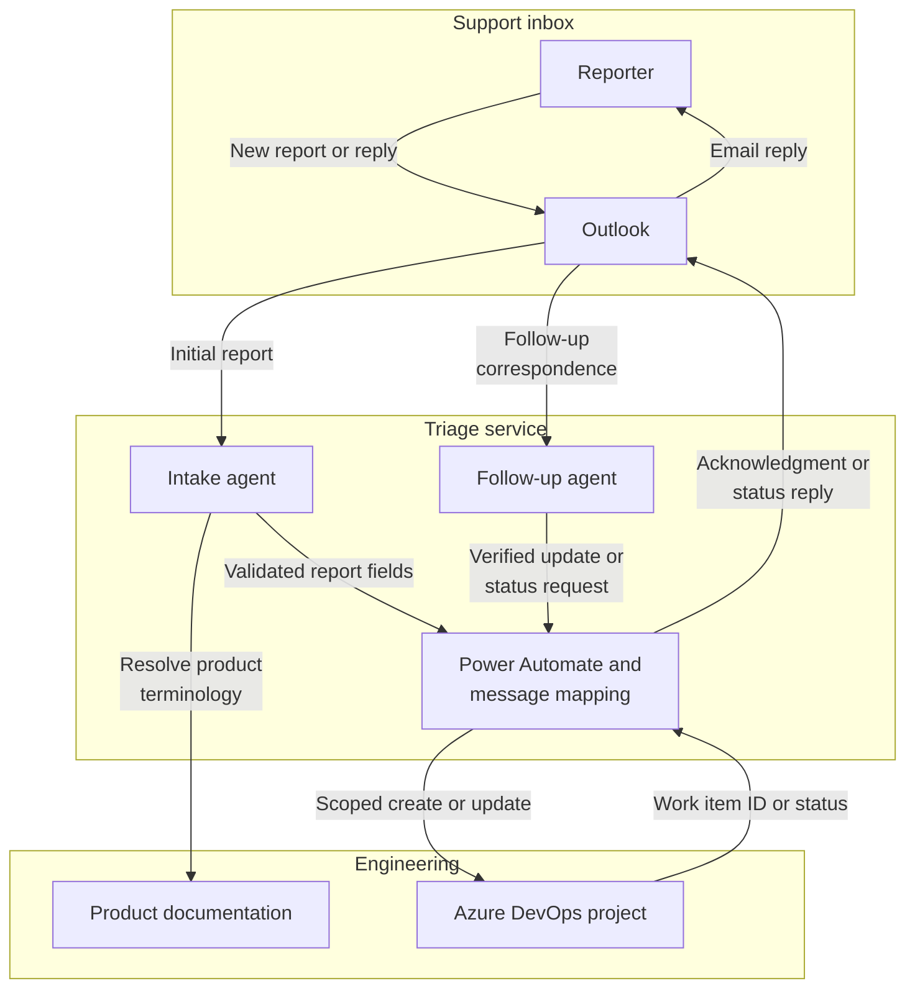
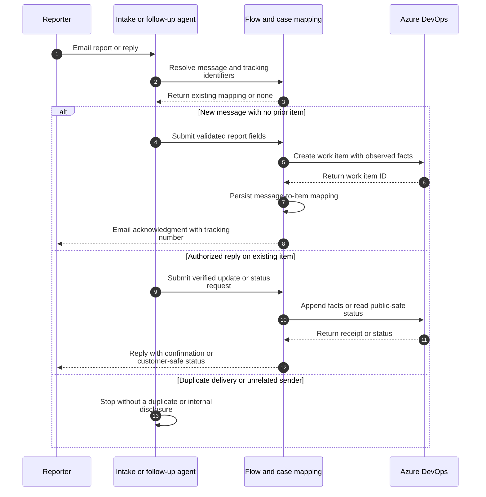

# Separate bug intake from follow-up correspondence

**Class:** Microsoft solution idea. **Intent:** Turn ordinary product-support email into useful Azure DevOps records while keeping new reports separate from requests for updates.

## Architecture

**Review decision:** A tracking number correlates a reply; it does not authorize access. Keep reporter-supplied observations separate from facts the agent still needs to confirm.

## Technical flow

## Copilot Studio components

**Recommended build ([harness](../COMPONENTS.md#the-harness-is-the-first-decision)):** Standard harness: two autonomous agents with Outlook triggers. On the Microsoft Copilot harness, one workflow can start on email, classify new reports versus follow-ups, run an extract node and call an agent node.

| Component | Use in this pattern | Harness alternative |
| --- | --- | --- |
| [Trigger](../COMPONENTS.md#triggers-and-autonomous-agents): Outlook new-email event | Starts intake or follow-up without a chat. Documented standard event triggers use maker credentials. | Copilot: workflow trigger or agent trigger (preview). |
| [Instructions](../COMPONENTS.md#instructions): Intake rules | Separate reporter observations from inferred context, and request missing facts. | All harnesses. |
| [Knowledge](../COMPONENTS.md#knowledge-sources): Product documentation | Normalizes product terminology. | All harnesses. |
| [Agent flow](../COMPONENTS.md#agent-flows): Create work item and mapping | Creates the Azure DevOps item and stores the message-to-item mapping. | Copilot: workflow with the Azure DevOps connector. |
| [Connector tool](../COMPONENTS.md#connector-tools): Azure DevOps | Appends follow-up details to the mapped item. | All harnesses. |
| [Trigger](../COMPONENTS.md#triggers-and-autonomous-agents): Second agent for follow-ups | Resolves replies against the mapping and returns a customer-safe status. | Copilot: classification node routes replies. |

**Not the right component:** Using the tracking number in an email as authorization to read the work item.

**Copilot Credits drivers (high):** Each email starts an autonomous run that is billed even for licensed users. It incurs a trigger (agent action), generative work and agent flow actions. Filter non-support mail and auto-replies before the trigger fires. See [Copilot Credits guidance](../COPILOT-CREDITS.md).

## Components and flow

1. An Outlook-triggered Copilot Studio intake agent extracts the affected product, observed symptom and reporter-provided steps. Consult product documentation for terminology; label inferred context separately and request missing facts rather than inventing observations.
2. A Power Automate action creates the work item in the permitted project. Persist the message-to-item mapping, then acknowledge the item number.
3. A second agent resolves replies against that mapping, validates the reporter, appends relevant changes and returns a customer-safe status. Internal engineering comments do not belong in the reply.

**When to choose it:** Useful for a high-volume shared inbox with predictable fields. A structured intake form is cheaper when the organization controls all submissions. Send sensitive reports to a restricted human intake path.

**Trust boundary:** Treat message bodies and attachments as untrusted evidence. Limit create/update rights to the support project; a work item number is a reference, not proof the sender may read or edit it.

**Failure handling and acceptance:** Deduplicate by message ID and handle an email-send failure separately from work-item creation. Test a forwarded thread from an unrelated sender and two deliveries of the same original email.

**Source:** [Microsoft Learn: Automate software bug reporting with Auto Triage AI Agent](https://learn.microsoft.com/en-us/power-platform/architecture/solution-ideas/auto-ai-triage).
