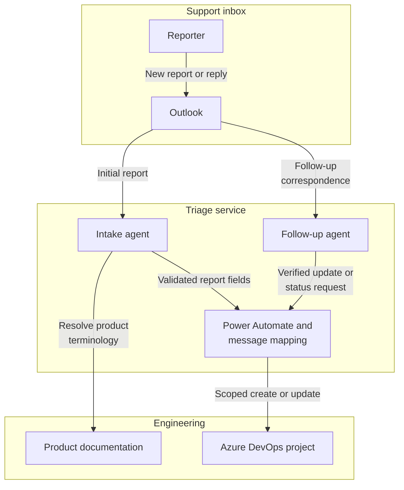
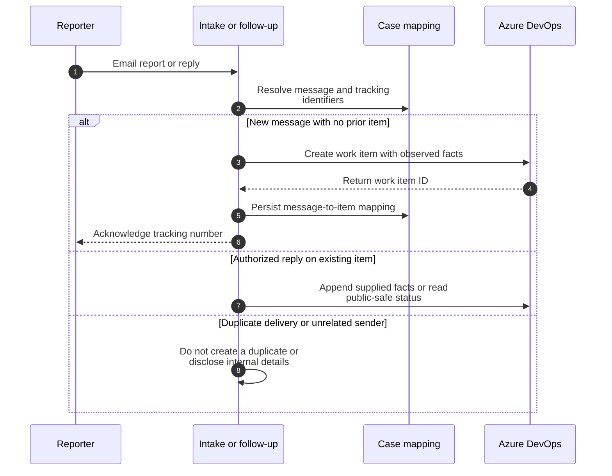

# Separate bug intake from follow-up correspondence

**Class:** Microsoft solution idea. **Intent:** Turn ordinary product-support email into useful Azure DevOps records while keeping new reports separate from requests for updates.

## Architecture

**Review decision:** A tracking number correlates a reply; it does not authorize access. Keep reporter-supplied observations separate from facts the agent still needs to confirm.

## Technical flow

## Components and flow

1. An Outlook-triggered Copilot Studio intake agent extracts the affected product, observed symptom and reporter-provided steps. Consult product documentation for terminology; label inferred context separately and request missing facts rather than inventing observations.
2. A Power Automate action creates the work item in the permitted project. Persist the message-to-item mapping, then acknowledge the item number.
3. A second agent resolves replies against that mapping, validates the reporter, appends relevant changes and returns a customer-safe status. Internal engineering comments do not belong in the reply.

**When to choose it:** Useful for a high-volume shared inbox with predictable fields. A structured intake form is cheaper when the organization controls all submissions. Send sensitive reports to a restricted human intake path.

**Trust boundary:** Treat message bodies and attachments as untrusted evidence. Limit create/update rights to the support project; a work item number is a reference, not proof the sender may read or edit it.

**Failure handling and acceptance:** Deduplicate by message ID and handle an email-send failure separately from work-item creation. Test a forwarded thread from an unrelated sender and two deliveries of the same original email.

**Source:** [Microsoft Learn: Automate software bug reporting with Auto Triage AI Agent](https://learn.microsoft.com/en-us/power-platform/architecture/solution-ideas/auto-ai-triage).
