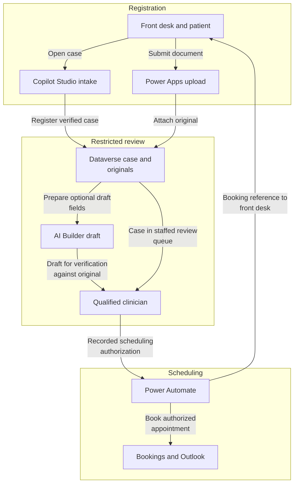
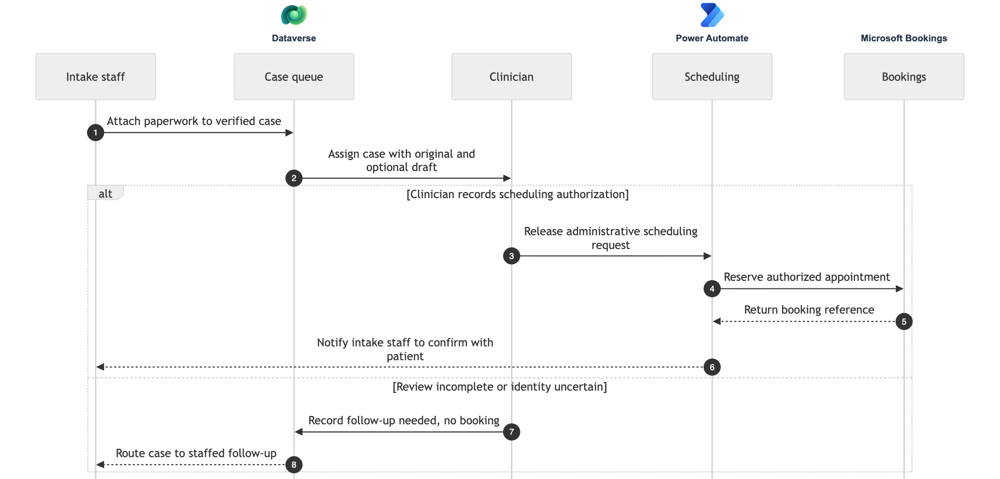
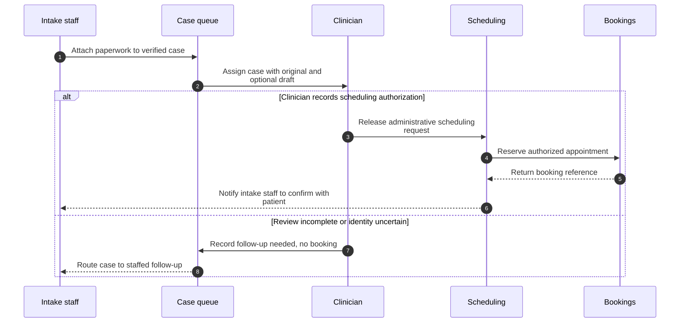

# Clinician-reviewed cardiology intake and scheduling

**Class:** Microsoft solution idea, adapted with a mandatory clinician review. **Intent:** Coordinate intake paperwork, assignment and scheduling; the agent neither decides urgency nor gives clinical advice.

## Architecture

**Review decision:** Approve scheduling only on a recorded clinician decision for the verified case. A completed upload or successful extraction must never release the booking step.

## Technical flow

Text and editable Mermaid sequence

## Copilot Studio components

**Recommended build ([harness](../COMPONENTS.md#the-harness-is-the-first-decision)):** Standard harness front-desk intake agent, with Power Apps, AI Builder and Power Automate around it. A Microsoft Copilot harness workflow with an extract node and a request-for-information node could coordinate the paperwork, but the clinician's decision must stay in the organization's clinical process.

| Component | Use in this pattern | Harness alternative |
| --- | --- | --- |
| [Topics](../COMPONENTS.md#topics-and-system-topics): Administrative intake topic | Collects administrative details and opens the case. It asks no clinical questions and gives no clinical advice. | Copilot: workflow tool. |
| [Connector tool](../COMPONENTS.md#connector-tools): Dataverse case | Creates the case and links original documents. | All harnesses. |
| AI Builder in the intake process: optional document processing | Drafts fields for clinician verification. If the team uses a [prompt](../COMPONENTS.md#prompt-tools) instead, estimate its own meter. | Copilot workflow: extract node. |
| [Power Automate flow](../COMPONENTS.md#power-automate-cloud-and-desktop-flows): Review routing and scheduling | Places the case in the restricted review queue, and books only after a recorded clinician decision. | Copilot: workflow. |
| [Human gate](../COMPONENTS.md#human-in-the-loop-gates): Qualified clinician decision | Releases the scheduling step for the verified case. | Copilot: approvals node; the decision remains clinical. |

**Not the right component:** Any AI step that assigns urgency or releases a booking.

**Copilot Credits drivers (medium):** Count intake answers separately from optional extraction. If billed in Copilot Credits, document processing costs 8 per page; a generative extraction prompt uses model units instead. Power Automate uses its own flow licensing, and AI Builder steps can draw on AI Builder credits before Copilot Credits. See [Copilot Credits guidance](../COPILOT-CREDITS.md).

## Components and flow

1. A front-desk Copilot Studio agent opens a Dataverse case. Staff or a patient submits documents through an approved Power Apps intake experience. Keep the original tied to the verified case.
2. AI Builder may prepare draft extracted fields. A Power Automate event puts the case, original document and draft in a restricted clinical review queue. A qualified clinician verifies the record and makes the disposition through the organization's established process.
3. Only a recorded, authorized scheduling instruction can start the Bookings/Outlook step. Send the patient a minimal administrative confirmation through the approved contact channel.

**When to choose it:** Useful when handoffs between registration, review and scheduling are the bottleneck. Do not substitute an automated queue for staffed clinical coverage or an emergency pathway. Extraction is optional if it slows review.

**Trust boundary:** Separate registration, reviewing clinician and scheduling roles. A scheduling worker needs the authorized appointment request, not the full report. Never send an unreviewed interpretation to a patient.

**Failure handling and acceptance:** Unreadable uploads, uncertain identity or missing approval remain assigned to staff; none imply a reassuring outcome. Monitor unacknowledged cases under the provider's existing fallback process. Test that a complete upload without clinician authorization cannot book, close or notify a clinical result.

**Source:** [Microsoft Learn: Intelligent cardiac triage and scheduling with Power Platform](https://learn.microsoft.com/en-us/power-platform/architecture/solution-ideas/cardio-triage-agent). This adaptation covers service orchestration only.
