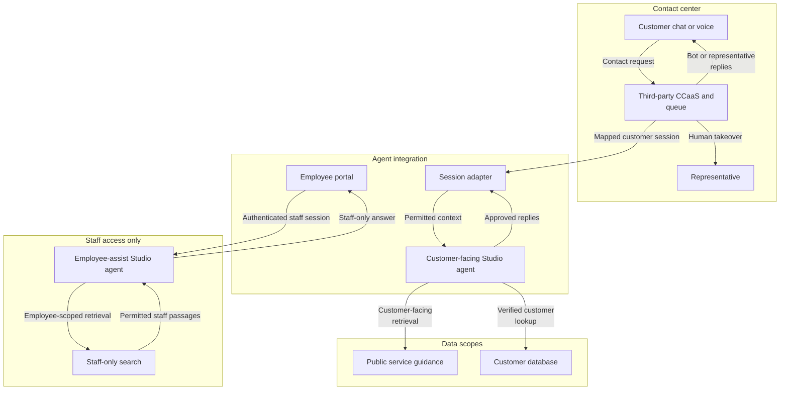
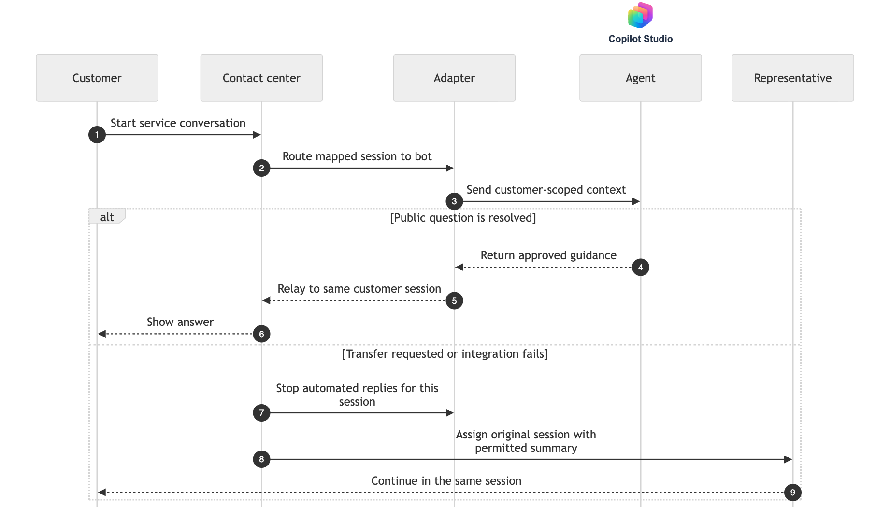
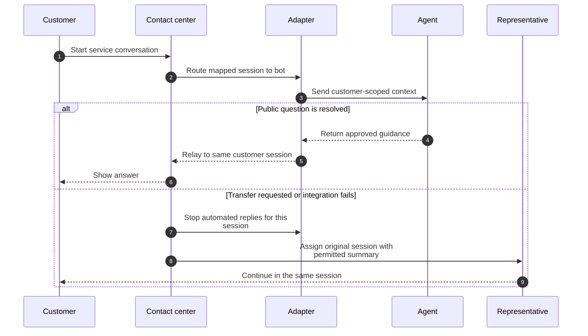

# Add Copilot Studio to an existing third-party contact center

**Class:** Microsoft solution idea. **Intent:** Preserve an existing contact center's queues, voice/chat channels and customer database while adding self-service and employee assistance.

## Architecture

**Review decision:** Keep queue ownership with the existing contact center. Approve public and staff knowledge paths separately; the adapter must not turn a customer session into an employee session.

## Technical flow

Text and editable Mermaid sequence

## Copilot Studio components

**Recommended build ([harness](../COMPONENTS.md#the-harness-is-the-first-decision)):** Standard harness, integrated with the third-party contact center through an adapter, plus a separate employee-assist agent. Azure AI Search knowledge is not listed for the Microsoft Copilot harness. The Customer Conversation harness is the contact-center alternative where its channels fit.

| Component | Use in this pattern | Harness alternative |
| --- | --- | --- |
| [Channel](../COMPONENTS.md#channels): Contact center integration adapter | The contact center owns the session and passes permitted context. | Customer Conversation: speech and chat. |
| [Knowledge](../COMPONENTS.md#knowledge-sources): Public service guidance | Answers customer questions. | All harnesses. |
| [Knowledge](../COMPONENTS.md#knowledge-sources): Azure AI Search for staff procedures | Restricted path in the employee agent only. | Copilot: not listed; use MCP or a search tool. |
| [Connector tool](../COMPONENTS.md#connector-tools): Customer database lookup | Returns live transactions after verification. | All harnesses. |
| [Escalation and handoff](../COMPONENTS.md#escalation-and-handoff): Return to the contact center with a correlation ID | Gives control back to the queue for unresolved cases. | Customer Conversation: **Escalate** tool. |
| [Monitor and analytics](../COMPONENTS.md#monitor-and-analytics): Restricted transcript retention | Retains transcripts for analysis only where authorized. *(Optional.)* | All harnesses. |

**Not the right component:** One agent serving both customers and employees. A customer session must not reach staff-only search.

**Copilot Credits drivers (high):** Count digital answers and agent actions for customer chat. Apply standard voice-minute rates only if Copilot Studio supplies the voice workload; those minutes already include core answers and agent actions. If the third-party platform handles telephony and sends text to the agent, budget its charges separately. Estimate employee-assist usage separately because licensed staff may qualify for inclusion. See [Copilot Credits guidance](../COPILOT-CREDITS.md).

## Components and flow

1. The contact-center-as-a-service platform owns the customer session. Its integration passes the permitted context into the agent experience. Separately, employees can consult an agent in their own portal.
2. Route public service questions to customer-facing guidance. Use a separate, restricted knowledge path for staff procedures; the reference includes Azure AI Search and Azure AI services for material outside native agent knowledge. Retrieve live customer transactions from the source database rather than a document answer.
3. For an unresolved case, return control to the contact center with a correlation ID. Use Dataverse for service metrics and, only where authorized, retain transcripts in a restricted data lake for analysis.

**When to choose it:** Use when replacing the contact center would disrupt existing routing or service levels. An adapter, session mapping and two support teams cost more to operate than a natively supported engagement hub.

**Trust boundary:** Agent access in an employee portal does not confer customer-channel access to employee procedures. Bind the contact-center identity to a verified customer before looking up an account.

**Failure handling and acceptance:** If the integration times out, keep the caller in the original queue and stop automated responses after a human takes over. Test a disconnected session and an employee-only article from the public channel.

**Sources:** [Microsoft Learn: Custom contact center solution](https://learn.microsoft.com/en-us/power-platform/architecture/solution-ideas/agent-custom-contact-center) · [Microsoft public sample: Genesys handoff](https://github.com/microsoft/CopilotStudioSamples/tree/main/contact-center/genesys-handoff) (one adapter example, not a requirement).
