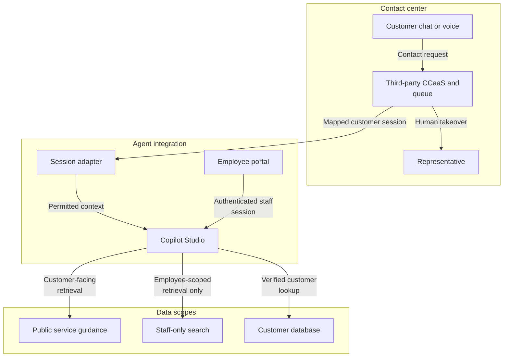
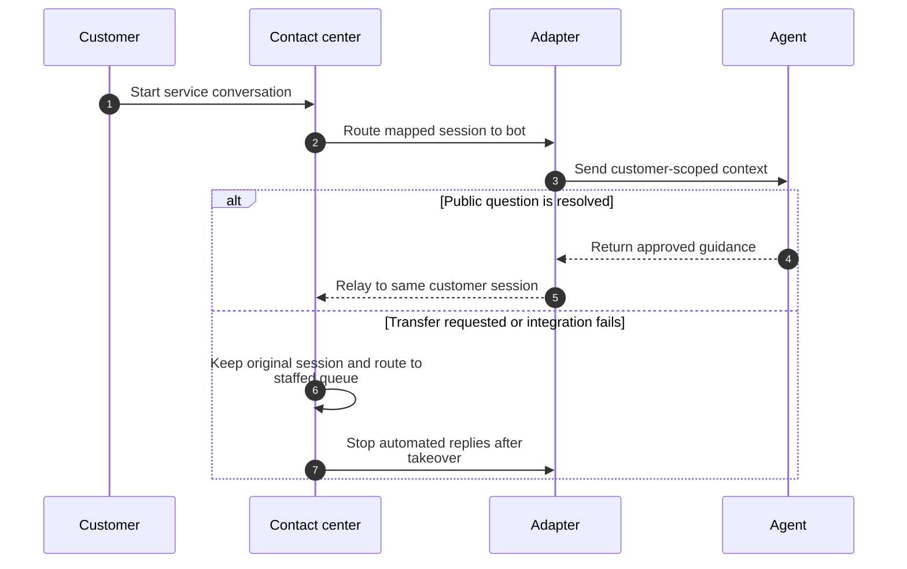

# Add Copilot Studio to an existing third-party contact center

**Class:** Microsoft solution idea. **Intent:** Preserve an existing contact center's queues, voice/chat channels and customer database while adding self-service and employee assistance.

## Architecture

**Review decision:** Keep queue ownership with the existing contact center. Approve public and staff knowledge paths separately; the adapter must not turn a customer session into an employee session.

## Technical flow

## Components and flow

1. The contact-center-as-a-service platform owns the customer session. Its integration passes the permitted context into the agent experience. Separately, employees can consult an agent in their own portal.
2. Route public service questions to customer-facing guidance. Use a separate, restricted knowledge path for staff procedures; the reference includes Azure AI Search and Azure AI services for material outside native agent knowledge. Retrieve live customer transactions from the source database rather than a document answer.
3. For an unresolved case, return control to the contact center with a correlation ID. Use Dataverse for service metrics and, only where authorized, retain transcripts in a restricted data lake for analysis.

**When to choose it:** Use when replacing the contact center would disrupt existing routing or service levels. An adapter, session mapping and two support teams cost more to operate than a natively supported engagement hub.

**Trust boundary:** Agent access in an employee portal does not confer customer-channel access to employee procedures. Bind the contact-center identity to a verified customer before looking up an account.

**Failure handling and acceptance:** If the integration times out, keep the caller in the original queue and stop automated responses after a human takes over. Test a disconnected session and an employee-only article from the public channel.

**Sources:** [Microsoft Learn: Custom contact center solution](https://learn.microsoft.com/en-us/power-platform/architecture/solution-ideas/agent-custom-contact-center) · [Microsoft public sample: Genesys handoff](https://github.com/microsoft/CopilotStudioSamples/tree/main/contact-center/genesys-handoff) (one adapter example, not a requirement).
