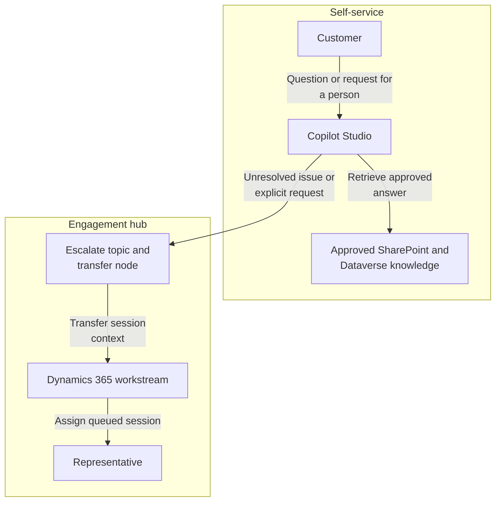
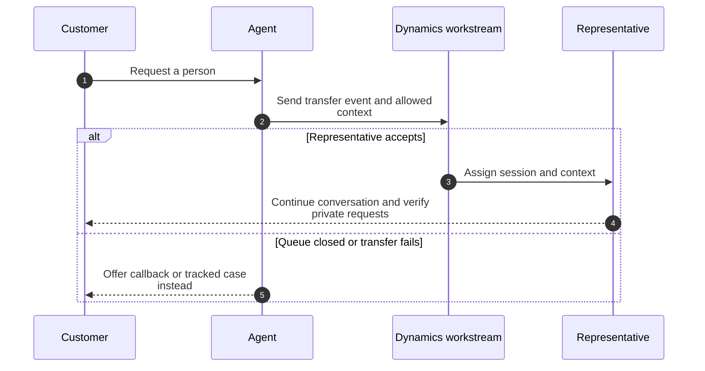

# Resolve customer questions or transfer them into a Dynamics workstream

**Class:** Microsoft solution idea. **Intent:** Let customers try self-service without making them start over when a representative is needed.

## Architecture

**Review decision:** Approve a live transfer only when a configured hub and staffed workstream can accept it. Otherwise promise a tracked follow-up, not a connected representative.

## Technical flow

## Components and flow

1. Copilot Studio separates product guidance from case-specific requests. Use approved SharePoint/Dataverse knowledge for a cited answer, or collect enough information for a follow-up ticket.
2. An explicit request for a person, a failed ticket operation or an unresolved issue reaches the Escalate system topic. Configure the **Transfer conversation** node and the engagement hub; a default escalation message alone does not connect a person.
3. Dynamics 365 routes the session to a workstream and queue. A representative picks it up in the service workspace with conversation context and verifies the customer before discussing private case details.

**When to choose it:** Useful when Dynamics already owns queues and case follow-up. For unstaffed channels, offer a tracked asynchronous ticket instead of advertising live chat. For an existing non-Microsoft hub, compare the [adapter-based solution](custom-contact-center.md).

**Trust boundary:** Handoff can transmit history and variables, not just an intent. Minimize sensitive data collected upstream and restrict access at the receiving queue. Do not treat possession of chat history as customer authentication.

**Failure handling and acceptance:** Distinguish requested, queued and accepted transfers. If no one accepts, offer a callback or case and display its reference. Test after-hours escalation and verify the bot does not keep responding over a human representative.

**Source:** [Microsoft Learn: Streamline customer service with a customer support assistance agent](https://learn.microsoft.com/en-us/power-platform/architecture/solution-ideas/customer-support-agent).
