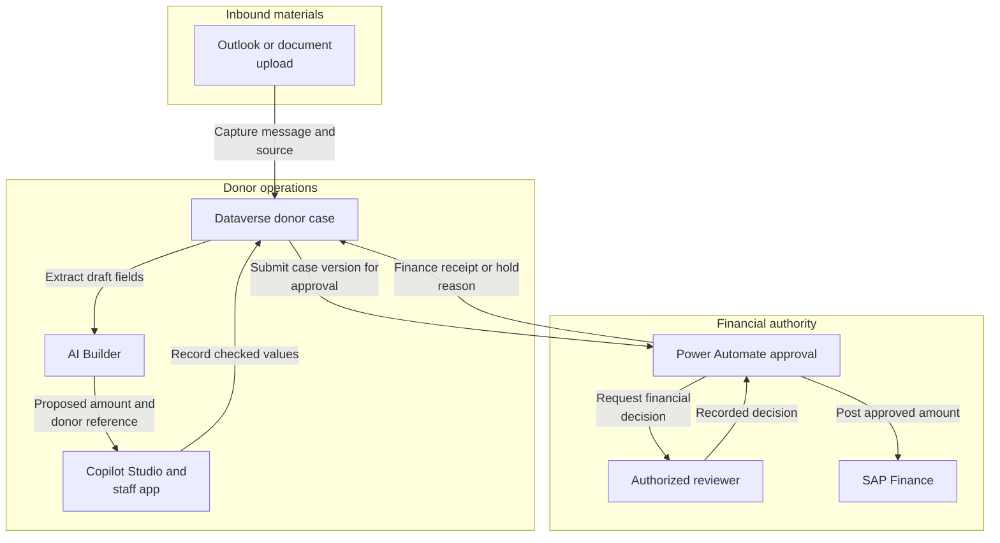
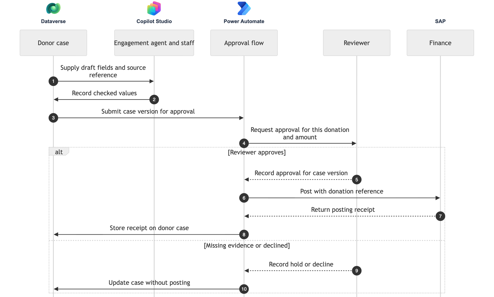
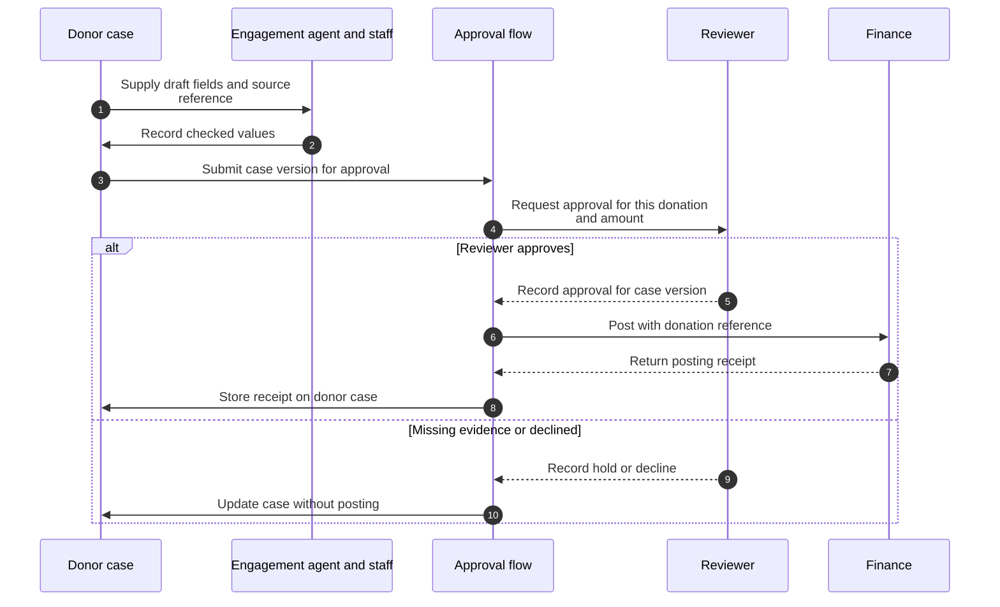

# Donor inquiry intake, approvals and finance reconciliation

**Class:** Microsoft solution idea. **Intent:** Give fundraising staff a traceable route from email or a donation form to the appropriate follow-up, approval and finance record.

## Architecture

**Review decision:** Approve the fundraising-to-finance handoff only when the reviewed amount and decision are traceable to the original form. A draft consent flag is not outreach authorization.

## Technical flow

Text and editable Mermaid sequence

## Copilot Studio components

**Recommended build ([harness](../COMPONENTS.md#the-harness-is-the-first-decision)):** Standard harness engagement agent, with Power Automate ingestion, AI Builder and approvals. On the Microsoft Copilot harness, a workflow with an extract node, an approvals node and the SAP connector can replace the flow chain.

| Component | Use in this pattern | Harness alternative |
| --- | --- | --- |
| [Power Automate flow](../COMPONENTS.md#power-automate-cloud-and-desktop-flows): Outlook and document ingestion | Creates the Dataverse case from permitted inputs. | Copilot: workflow trigger. |
| [Prompt tool](../COMPONENTS.md#prompt-tools): AI Builder extraction | Drafts amount and donor reference, with a source link. | Copilot workflow: extract node. |
| [Orchestration](../COMPONENTS.md#orchestration-modes): Generative orchestration | Proposes a follow-up task or asks for clarification. | Copilot: reasoning loop. |
| [Human gate](../COMPONENTS.md#human-in-the-loop-gates): Power Automate approval | Routes financial changes to an authorized reviewer. | Copilot: approvals node. |
| [Connector tool](../COMPONENTS.md#connector-tools): SAP Finance | Reconciles only after approval, and records the receipt. | All harnesses. |

**Not the right component:** Treating an extracted consent flag as authorization for outreach.

**Copilot Credits drivers (medium):** Estimate the extraction prompt by its model and token usage; use page counts only if it is replaced with a document-processing model. Power Automate licenses the approval flow, not the extraction. Eligible interactive standard-harness staff turns may be included. See [Copilot Credits guidance](../COPILOT-CREDITS.md).

## Components and flow

1. Ingest permitted Outlook messages and SharePoint or OneDrive documents into a Dataverse case. AI Builder extracts draft fields such as amount and donor reference; retain a link to the source for review.
2. The Copilot Studio engagement agent proposes a follow-up task or requests clarification. Staff inspect the case in a model-driven app. A consent flag extracted from a form must be checked against the actual authorization before outreach.
3. A Power Automate approval routes financial changes to an authorized reviewer. After approval, an integration may reconcile with SAP Finance. Record the finance receipt and communicate only the appropriate status in Teams.

**When to choose it:** Valuable when document-heavy donations cross fundraising and finance teams. A structured donation form can avoid extraction entirely. Sentiment can flag a message for review; it should not determine donor treatment.

**Trust boundary:** Separate fundraiser, approver and finance privileges. Keep donor details out of broad channels; use a link to the access-controlled case.

**Failure handling and acceptance:** Missing consent, conflicting amounts or an unidentified donor require a person. If finance times out, reconcile using the donation reference rather than initiating another posting. Test a duplicate form and an approval declined after extraction.

**Source:** [Microsoft Learn: AI-enabled donor management solution](https://learn.microsoft.com/en-us/power-platform/architecture/solution-ideas/agent-donor-management).
