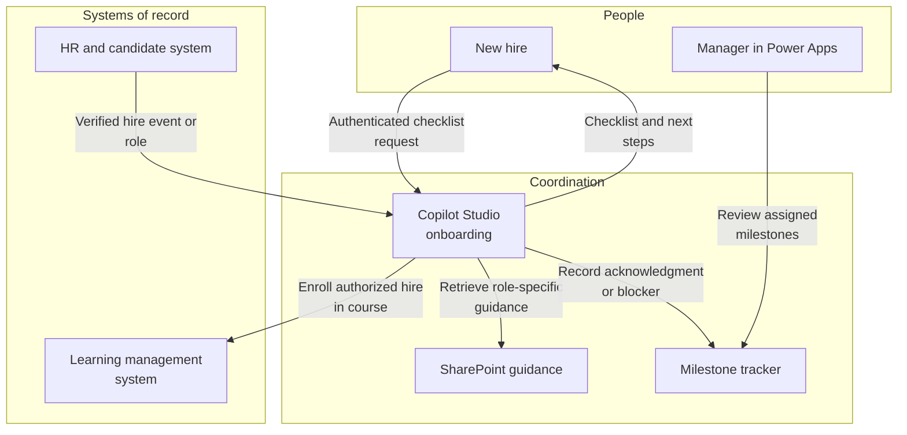
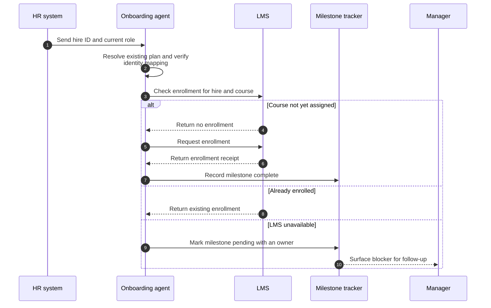

# Coordinate new-hire tasks across HR and learning systems

**Class:** Microsoft solution idea. **Intent:** Give each new hire a visible checklist and make blocked tasks visible to the people able to resolve them.

## Architecture

**Review decision:** Make the HR system authoritative for role and start date, and the LMS authoritative for enrollment. A learning-plan draft must not mark a milestone complete.

## Technical flow

## Copilot Studio components

**Recommended build ([harness](../COMPONENTS.md#the-harness-is-the-first-decision)):** Standard harness, with an optional HR event trigger and connectors to HR and learning systems. Microsoft Copilot harness memory could hold a new hire's preferences, but the HR system remains authoritative for role and start date.

| Component | Use in this pattern | Harness alternative |
| --- | --- | --- |
| [Trigger](../COMPONENTS.md#triggers-and-autonomous-agents): HR system event | Starts the plan for a new hire. *(Optional.)* | Copilot: workflow trigger. |
| [Authentication](../COMPONENTS.md#authentication-and-tool-credentials): Entra ID | Identifies the hire in an authenticated conversation. | All harnesses. |
| [Knowledge](../COMPONENTS.md#knowledge-sources): SharePoint onboarding guidance | Answers questions from current guidance. | All harnesses. |
| [Connector tool](../COMPONENTS.md#connector-tools): HR system and LMS connectors | Read role and start date; enroll required training. | All harnesses. |
| [Memory](../COMPONENTS.md#memory): New-hire preferences (Copilot harness) | Recalls stated preferences and open questions between sessions. Role and start date always come from HR. *(Optional.)* | Std: none; store progress in the HR system. |
| [Agent flow](../COMPONENTS.md#agent-flows): Milestone update flow | Marks a milestone complete only when the owning system acknowledges it. | Copilot: workflow. |

**Not the right component:** Collecting identity documents in chat. Use the candidate system.

**Copilot Credits drivers (medium):** New hires may not yet hold Microsoft 365 Copilot licenses, so plan for billed answers and agent actions. Event-triggered runs are billed as autonomous, and agent flow actions bill at 13 per 100. See [Copilot Credits guidance](../COPILOT-CREDITS.md).

## Components and flow

1. An HR-system event or authenticated conversation identifies the hire. Retrieve the approved start date, role and team from the HR information system. Use a stable hire identifier to create or locate the onboarding plan.
2. Copilot Studio answers questions from current SharePoint onboarding guidance. Collect documents through the candidate system, not chat. Map the verified role to required training, then use an authorized learning management system (LMS) connector for enrollment.
3. Record completion when the owning system acknowledges it. A manager uses Power Apps to view milestones, assign a blocker and follow up, without needing access to every candidate document.

**When to choose it:** Useful when onboarding spans systems and has role-specific variations. A checklist workflow alone is enough when there is no need for Q&A or personalization.

**Trust boundary:** Pre-hire and employee identities may differ; verify the mapping before revealing a checklist or connecting documents. A generated learning plan cannot override mandatory training or grant privileged access.

**Failure handling and acceptance:** If LMS enrollment fails, mark just that milestone pending and provide an owner. Reconcile by hire and course before retry. Test a changed start date and a repeated HR event; neither should create duplicate tasks or enrollments.

**Source:** [Microsoft Learn: Improve the new hire experience with a smart onboarding agent](https://learn.microsoft.com/en-us/power-platform/architecture/solution-ideas/onboarding-agent).
