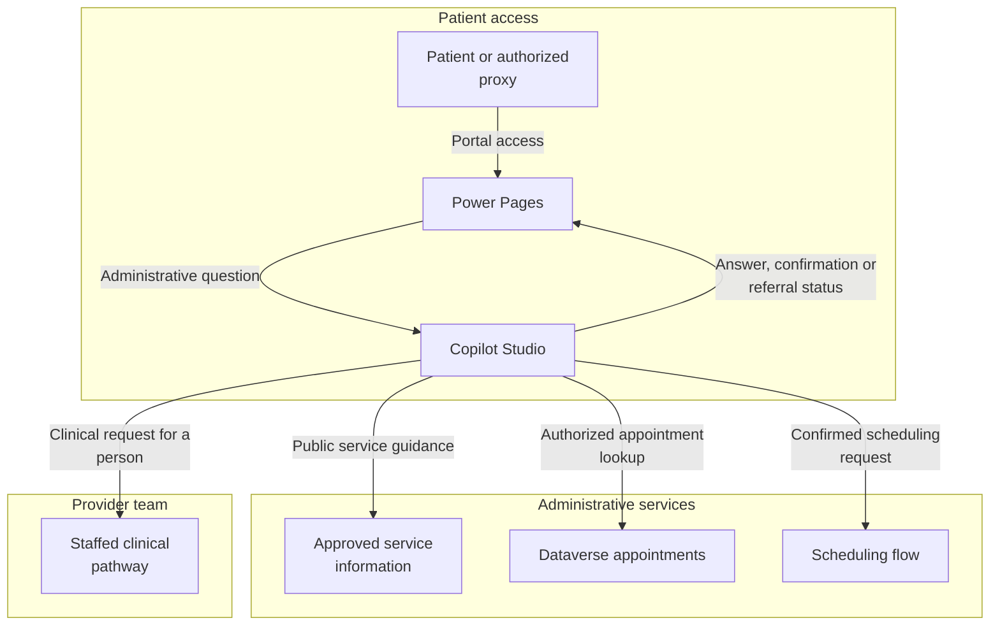
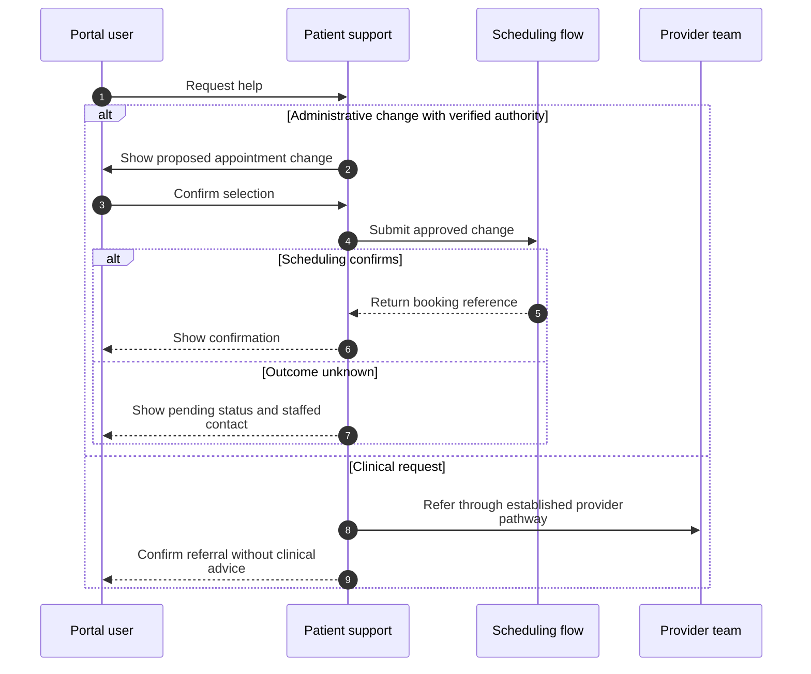

# Patient portal for administrative support

**Class:** Microsoft solution idea. **Intent:** Help patients find service information, manage appointments and reach a staffed team. This design deliberately leaves clinical questions and decisions to qualified clinicians.

## Architecture

**Review decision:** Approve the portal for administrative requests only. Personal appointment access requires verified patient or proxy authority; clinical requests go to a staffed pathway.

## Technical flow

## Components and flow

1. A Copilot Studio agent in Power Pages answers general questions from approved patient-service information. For a personal appointment, the portal authenticates the patient or verifies an authorized proxy.
2. Read the permitted appointment from Dataverse. Present the requested change and let a Power Automate flow submit it to scheduling and send the confirmation. Hand clinical requests to the provider's established staffed pathway; the agent does not assess them.
3. Keep service improvement separate from the encounter: approved, minimized feedback can be analyzed with AI Builder and aggregated through Azure Data Lake, Synapse and Power BI. A response to a survey is not an entry on a clinical worklist.

**When to choose it:** Useful for repetitive administrative contacts. A simple portal form is preferable for a single predictable change. Do not present chat as a monitored emergency service.

**Trust boundary:** Enforce patient/proxy access on the appointment lookup, not just at portal sign-in. Keep sensitive details out of reminders, telemetry and dashboards.

**Failure handling and acceptance:** On a scheduling timeout, show a pending reference and a staffed contact, not a confirmed appointment. Test a revoked proxy and a failed notification independently of booking success.

**Source:** [Microsoft Learn: Healthcare Patient Support Agent](https://learn.microsoft.com/en-us/power-platform/architecture/solution-ideas/agent-healthcare-patient-support).
