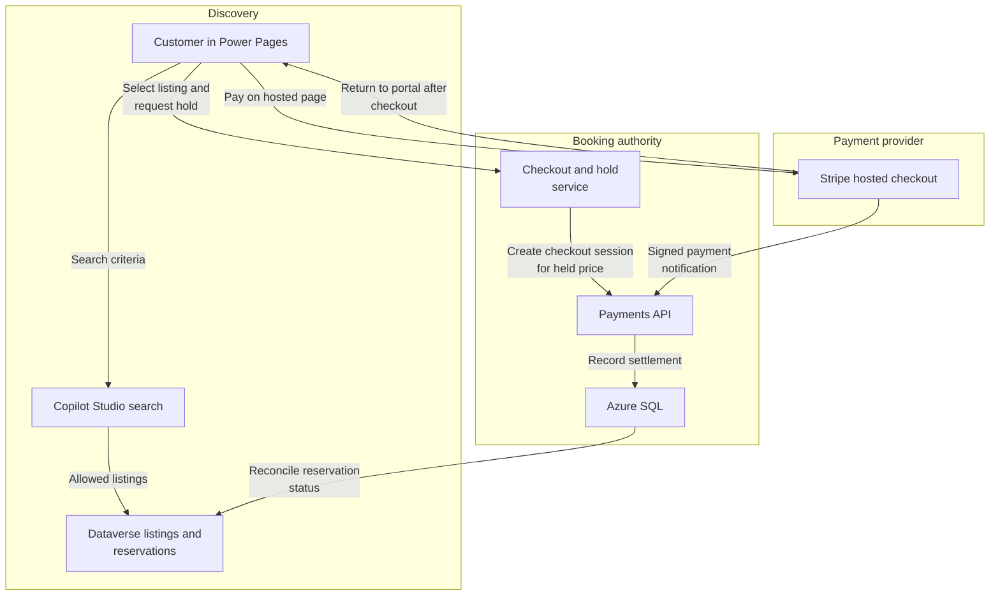
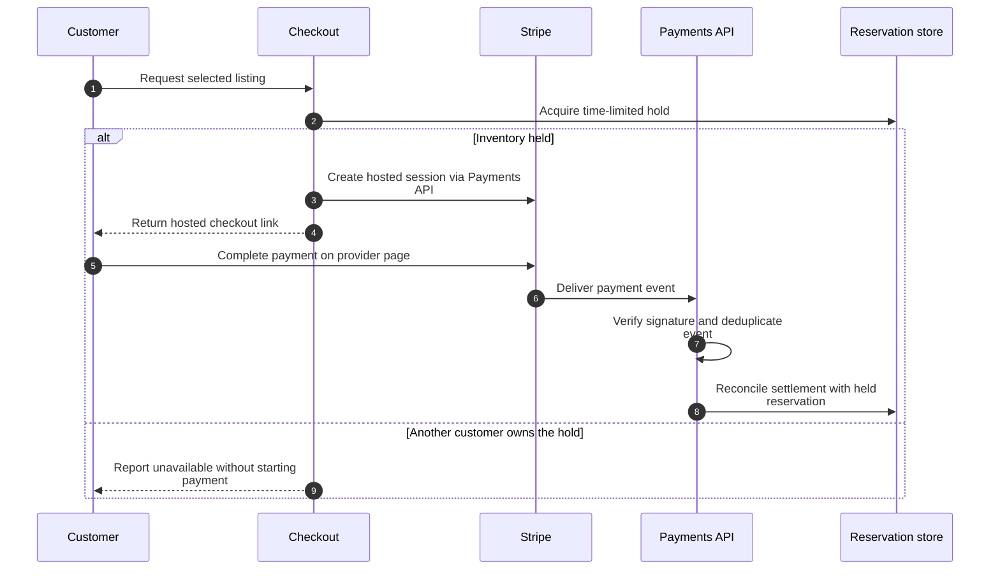

# Rental discovery with a separate reservation and payment path

**Class:** Microsoft solution idea. **Intent:** Let a customer describe the rental they want in ordinary language while keeping availability, pricing and payment under transactional control.

## Architecture

**Review decision:** Approve chat for discovery, not settlement. A verified payment notification and a reconciled reservation, not the browser redirect, establish a completed booking.

## Technical flow

## Components and flow

1. In Power Pages, Copilot Studio and AI Builder turn the customer's terms into listing filters. Query Dataverse and return cards linking to canonical listings; the portal's normal search remains available.
2. The customer selects a listing. Checkout rechecks availability, places a time-limited reservation under a lock, and creates a Stripe-hosted checkout session through the Payments API. No card details pass through the agent.
3. The Payments API verifies the provider notification and records the outcome in Azure SQL. Reconcile this state to the Dataverse reservation shown in the portal and model-driven admin app. A browser redirect is not proof of settlement.

**When to choose it:** Good for exploratory searches whose results lead to scarce inventory. Ordinary faceted search is easier to validate for exact criteria. Keep the two paths so a chat outage need not stop booking.

**Trust boundary:** Publish only customer-visible listing fields; bind the hold to the authenticated customer and price it server-side. Restrict payment/refund operations separately from listing edits.

**Failure handling and acceptance:** Deduplicate webhook deliveries by provider event ID. Expire unpaid holds; route a late successful payment for reconciliation rather than double-booking. Test two customers selecting the final available unit.

**Source:** [Microsoft Learn: Property rental portal with AI-driven search and payment processing](https://learn.microsoft.com/en-us/power-platform/architecture/solution-ideas/agent-rental-portal).
