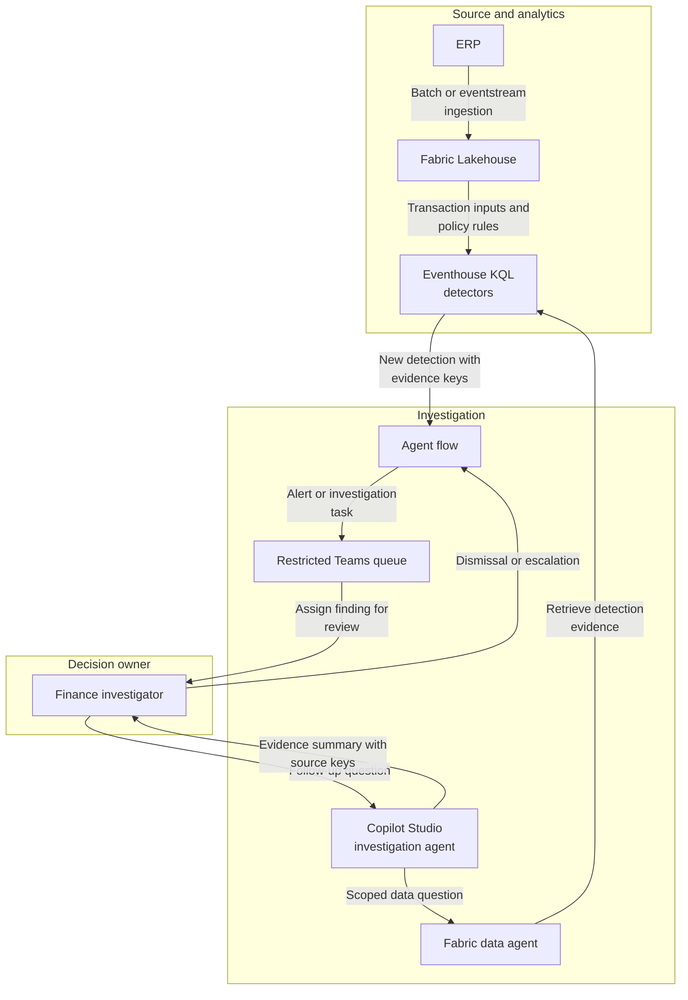
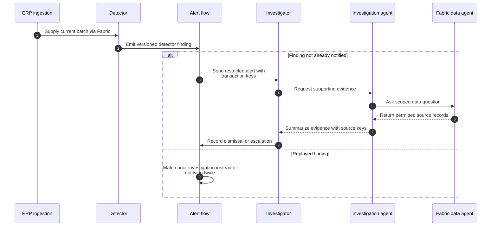

# Detect spend anomalies in Fabric and investigate them in chat

**Class:** Microsoft solution idea. **Intent:** Give investigators a reproducible reason an invoice was flagged and a place to record their decision. An alert is not a finding of fraud.

## Architecture

**Review decision:** Approve anomaly detection as a read-and-investigate path. Freezing a payment is a separate finance decision, not a side effect of a high detector score.

## Technical flow

## Components and flow

1. Batch pipelines or eventstreams bring ERP invoices, vendors and policy reference data into Fabric. Store transactions in a Lakehouse; run versioned KQL detection functions in Eventhouse for duplicate, unusual-activity or threshold checks.
2. An agent flow retrieves new detections, posts a restricted Teams alert and optionally creates a Planner investigation task. Persist the detector version and the transaction keys behind each alert.
3. An investigator asks the Copilot Studio agent for evidence. A Fabric data agent queries the Lakehouse/Eventhouse; the investigator classifies, dismisses or escalates. Keep a payment hold as a separate, authorized finance operation.

**When to choose it:** Use when repeated, testable detectors narrow a large transaction population. A scheduled exception report is simpler if investigators never need follow-up queries. Calibrate for false positives, not just alert volume.

**Trust boundary:** Separate read access for investigation from ERP payment authority. Restrict vendor evidence in Teams and validate connected-agent availability and identity in the intended environment.

**Failure handling and acceptance:** Track ingestion watermarks; no alerts from a stalled pipeline does not mean clean spend. Deduplicate by detector and transaction group. Test a replayed invoice batch and a cleared false positive.

**Source:** [Microsoft Learn: Build anomaly detection with Copilot Studio and Fabric](https://learn.microsoft.com/en-us/power-platform/architecture/solution-ideas/agent-anomaly-detection).
