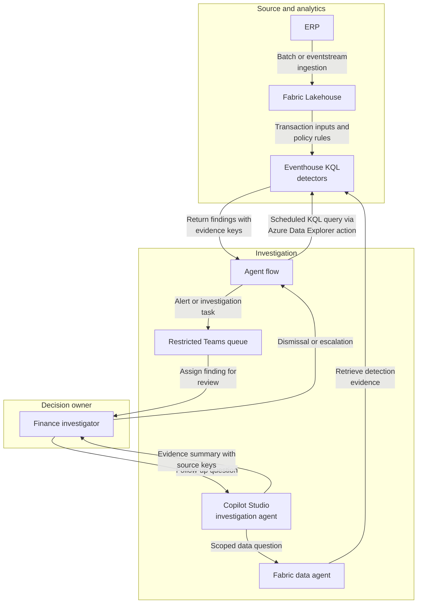
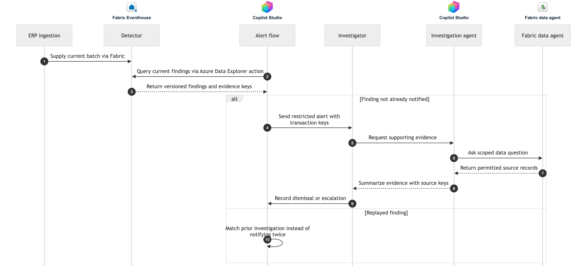
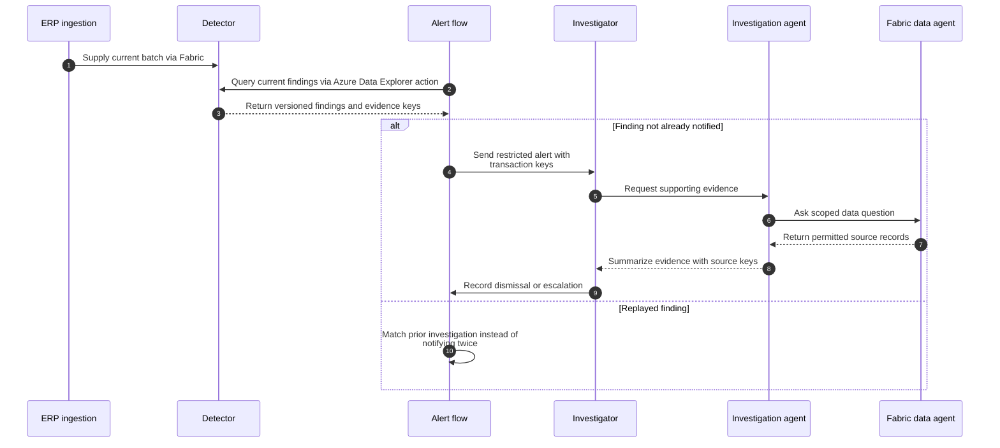

# Detect spend anomalies in Fabric and investigate them in chat

**Class:** Microsoft solution idea. **Intent:** Give investigators a reproducible reason an invoice was flagged and a place to record their decision. An alert is not a finding of fraud.

## Architecture

**Review decision:** Approve anomaly detection as a read-and-investigate path. Freezing a payment is a separate finance decision, not a side effect of a high detector score.

## Technical flow

Text and editable Mermaid sequence

## Copilot Studio components

**Recommended build ([harness](../COMPONENTS.md#the-harness-is-the-first-decision)):** Standard harness: a scheduled agent flow sends alerts; a separate investigation agent uses the [documented Fabric connection (preview)](../decision-patterns/fabric-connected.md). A Copilot-harness workflow can replace the alert flow without moving the investigator to that harness.

| Component | Use in this pattern | Harness alternative |
| --- | --- | --- |
| [Agent flow](../COMPONENTS.md#agent-flows): Scheduled detection run | Calls Eventhouse through the Azure Data Explorer action, reads the findings, posts restricted Teams alerts and optionally creates Planner tasks. | Copilot: scheduled workflow. |
| [Connected agent](../COMPONENTS.md#connected-agents): Fabric data agent (preview) | Queries the Lakehouse and Eventhouse for evidence behind an alert. | Keep the standard investigation agent unless the target harness documents this Fabric connection. |
| [Connector tool](../COMPONENTS.md#connector-tools): Teams and Planner | Delivers alerts and investigation tasks. | All harnesses. |
| [Human gate](../COMPONENTS.md#human-in-the-loop-gates): Investigator decision | Classifies, dismisses or escalates the alert. A payment hold is a separate finance operation. | Copilot: approvals node. |

**Not the right component:** An agent tool that freezes payments on a detector score.

**Copilot Credits drivers (medium):** Budget each scheduled agent-flow trigger execution and the actions that run (13 credits per 100 units), even when there are no new detections. The employee inclusion can apply to interactive standard-harness investigation, not the scheduled scan. The data agent draws on Fabric capacity. See [Copilot Credits guidance](../COPILOT-CREDITS.md).

## Components and flow

1. Batch pipelines or eventstreams bring ERP invoices, vendors and policy reference data into Fabric. Store transactions in a Lakehouse; run versioned KQL detection functions in Eventhouse for duplicate, unusual-activity or threshold checks.
2. The scheduled agent flow uses the Azure Data Explorer action to run the KQL checks and retrieve findings from Eventhouse. It posts a restricted Teams alert and optionally creates a Planner investigation task. Persist the detector version and the transaction keys behind each alert.
3. An investigator asks the Copilot Studio agent for evidence. A Fabric data agent queries the Lakehouse/Eventhouse; the investigator classifies, dismisses or escalates. Keep a payment hold as a separate, authorized finance operation.

**When to choose it:** Use when repeated, testable detectors narrow a large transaction population. A scheduled exception report is simpler if investigators never need follow-up queries. Calibrate for false positives, not just alert volume.

**Trust boundary:** Separate read access for investigation from ERP payment authority. Restrict vendor evidence in Teams and validate connected-agent availability and identity in the intended environment.

**Failure handling and acceptance:** Track ingestion watermarks; no alerts from a stalled pipeline does not mean clean spend. Deduplicate by detector and transaction group. Test a replayed invoice batch and a cleared false positive.

**Source:** [Microsoft Learn: Build anomaly detection with Copilot Studio and Fabric](https://learn.microsoft.com/en-us/power-platform/architecture/solution-ideas/agent-anomaly-detection).
