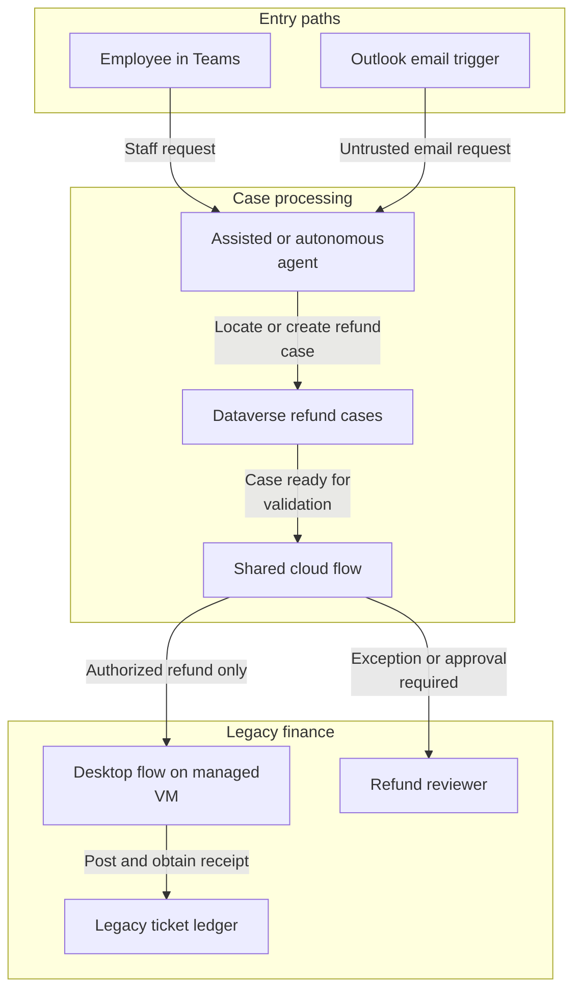
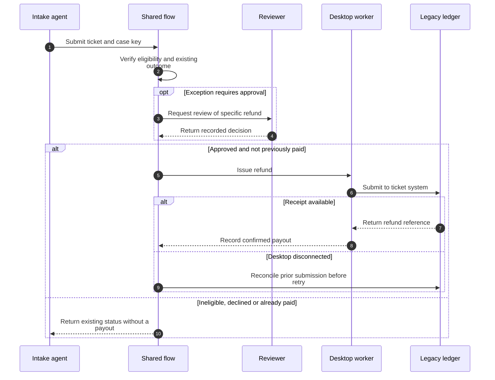

# Assisted and email-driven refunds on a shared legacy workflow

**Class:** Microsoft solution idea. **Intent:** Give guest-services staff a Teams entry point and process eligible email requests without duplicating integrations to a ticketing system that lacks a suitable API.

## Architecture

**Review decision:** Both agents must share one refund identity check and one case key. An uncertain desktop result must be reconciled in the ledger before another payment attempt.

## Technical flow

## Components and flow

1. The assisted agent gathers a request from an employee; the autonomous agent receives an Outlook event. Normalize both into the same Dataverse refund case, retaining origin, ticket reference and status.
2. A shared Power Automate cloud flow validates the request against the sale and refund policy. Send ambiguous, high-value or unauthorized cases to a reviewer. An email requests work; it does not approve payment.
3. A desktop flow on a managed VM performs the permitted legacy operation. Record the legacy transaction receipt on the case before either channel tells the requester the refund completed.

**When to choose it:** A practical bridge where only a legacy UI can issue the refund. Prefer an API when one exists: screen changes, desktop sessions and unattended licensing add ongoing cost.

**Trust boundary:** Separate mailbox access from refund authority. Restrict the robot identity and protect credentials (the reference uses Azure Key Vault). Confirm ownership and eligibility in the backend, irrespective of entry channel.

**Failure handling and acceptance:** If the desktop disconnects after submission, mark the outcome unknown and reconcile with the ledger before replay. Test one refund arriving through both email and Teams; there must be a single payout.

**Source:** [Microsoft Learn: Ticket management system with Copilot Studio agents](https://learn.microsoft.com/en-us/power-platform/architecture/solution-ideas/agent-ticket-and-refund).
