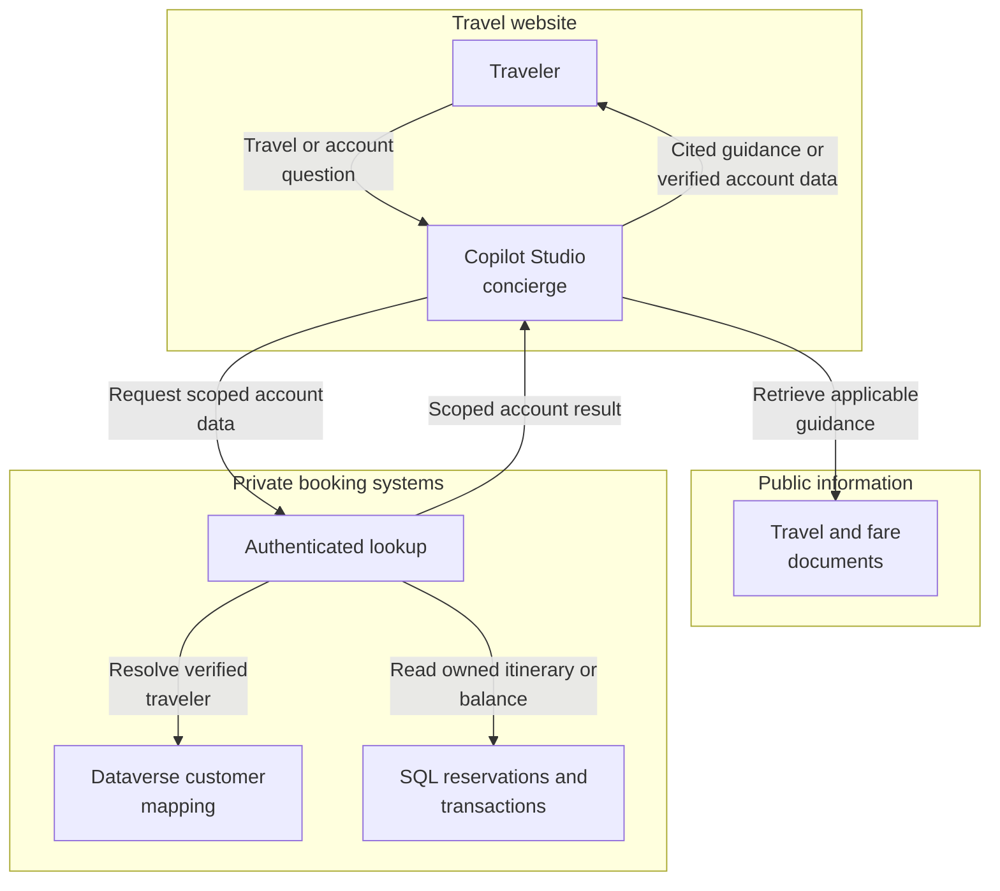
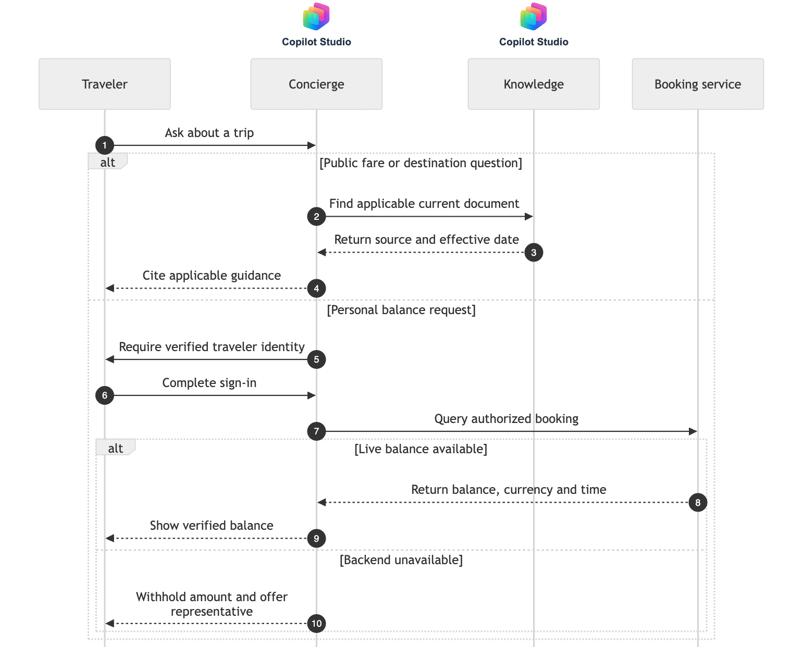
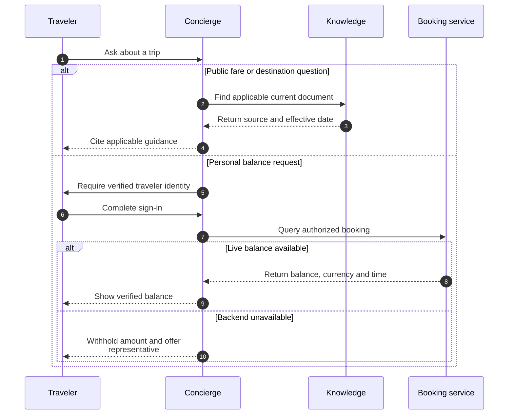

# Travel concierge with public guidance and private booking lookup

**Class:** Microsoft solution idea. **Intent:** Answer “what does my fare include?” and “what balance remains?” in one website conversation without treating a knowledge document as a booking ledger.

## Architecture

**Review decision:** Decide exactly where a public conversation becomes a private lookup. A booking reference helps locate a record but cannot establish ownership.

## Technical flow

Text and editable Mermaid sequence

## Copilot Studio components

**Recommended build ([harness](../COMPONENTS.md#the-harness-is-the-first-decision)):** Standard harness on a website, with a switch to authenticated lookup. This design needs one verified reservation read, not a reasoning loop; compare another harness only if the itinerary task becomes more complex.

| Component | Use in this pattern | Harness alternative |
| --- | --- | --- |
| [Knowledge](../COMPONENTS.md#knowledge-sources): Travel, fare and rescheduling documents | Return cited policy with its effective date. | All harnesses. |
| [Authentication](../COMPONENTS.md#authentication-and-tool-credentials): Website sign-in | Required before any itinerary or balance lookup. | All harnesses. |
| [Topics](../COMPONENTS.md#topics-and-system-topics): Authenticated lookup topic | Marks where the public conversation becomes a private lookup. | Copilot: workflow tool. |
| [Connector tool](../COMPONENTS.md#connector-tools): Dataverse and SQL reservations | Return the permitted booking, currency and lookup time. | All harnesses. |
| [Escalation and handoff](../COMPONENTS.md#escalation-and-handoff): Travel representative | Handles exceptions and transactions outside the agent's scope. | All harnesses. |

**Not the right component:** A booking reference as proof of ownership.

**Copilot Credits drivers (medium):** Travelers are not covered by Microsoft 365 Copilot licenses. Answers bill at 1 or 2 and lookup steps at 5 each. Authored topics for frequent questions reduce generative answers. See [Copilot Credits guidance](../COPILOT-CREDITS.md).

## Components and flow

1. Copilot Studio clarifies the destination, operator or fare type. Retrieve the applicable travel, airport or rescheduling document and show its source and effective date.
2. Switch to authenticated lookup for itineraries or balances. Resolve the traveler's permitted booking against Dataverse customer/location records and the reservation and transaction system in SQL. Return the currency and time of the lookup.
3. Distinguish an explanation of the change policy from a change to an actual reservation. Direct exceptions or transactions outside the agent's approved scope to a travel representative.

**When to choose it:** Useful when public content and live reservations change at different rates. If customers only need opening hours or directions, do not introduce a connection to the reservation system.

**Trust boundary:** A booking reference or surname alone must not unlock an itinerary. Scope database operations to the verified traveler and booking; do not copy private balances into the searchable travel corpus.

**Failure handling and acceptance:** On stale or conflicting travel guidance, link to the current authority rather than guaranteeing eligibility. If SQL is unavailable, continue public Q&A but explicitly withhold the balance. Test two travelers with the same surname.

**Source:** [Microsoft Learn: Travel concierge using generative AI with Copilot Studio](https://learn.microsoft.com/en-us/power-platform/architecture/solution-ideas/agent-travel-customer).
