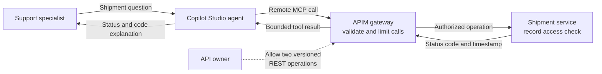
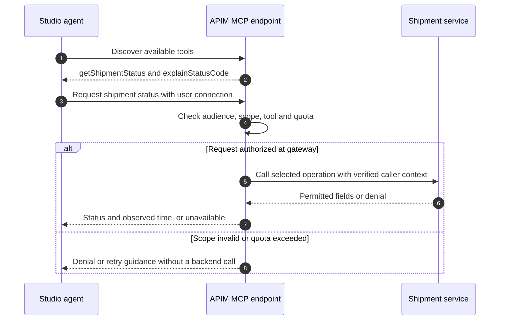

# Publish selected API operations as MCP tools through Azure API Management

**Class:** Synthesized technical pattern. **Intent:** Let a support agent explain a parcel delay using the carrier's latest status codes. The API owner publishes two read operations through Azure API Management (APIM), not the carrier's entire REST API. Neither the agent nor the gateway offers a shipment-change tool.

## Architecture

**Review decision:** Use this when multiple agents need the same contract and a team already owns the API gateway. For one stable action consumed by one agent, a [connector](connector-action.md) removes a network hop and is easier to support.

## Technical flow

## Copilot Studio components

**Recommended build:** Standard harness with a [remote MCP server tool](../COMPONENTS.md#mcp-servers) and an authenticated connection. Configure the agent for the intended tools only. APIM exposes selected operations from a managed HTTP API and applies gateway policy; the domain service still authorizes each shipment. This is the producer side of [MCP tool discovery](mcp-tools.md), not a new retrieval index. Confirm transport and authentication for other harnesses before reuse.

| Component | Use in this pattern | Harness alternative |
| --- | --- | --- |
| [MCP tool](../COMPONENTS.md#mcp-servers) | Discover and invoke only the approved status operations. | MCP is also documented on the Microsoft Copilot and Customer Conversation harnesses; validate the connection on the intended channel. |
| [Tool credentials](../COMPONENTS.md#authentication-and-tool-credentials) | Bind the request to the caller; enforce record access at the parcel service. | A different harness or a managed gateway does not make a shared account equivalent to the caller. |

**Copilot Credits drivers (medium):** One status lookup may trigger a second tool call to explain an unfamiliar code. Measure Studio actions and answers separately from APIM tier, backend traffic and telemetry. Return the status and timestamp, not a shipping history on every call. See [Copilot Credits guidance](../COPILOT-CREDITS.md).

## Design notes

- **Integration choice:** APIM can expose selected REST operations as MCP **tools**; this export does not create MCP resources or prompts. Check the supported APIM tier and workspace limitations. If the owner already operates an MCP server, proxy that server instead of re-exporting its APIs.
- **Trust boundary:** Verify the inbound token's issuer, audience and scopes. Treat gateway-to-backend authentication as a separate decision: either carry delegated authority correctly or have the domain service enforce a verified caller-to-shipment entitlement. An APIM subscription key, tool description or model-supplied user ID is not a person's authority. Never put access tokens in tool results.
- **Failure handling and acceptance:** If a status code is unknown, return it with its timestamp rather than inventing a delivery date. Respect rate-limit retry guidance. Test an out-of-scope shipment and a carrier release that adds a reroute operation: neither may become accessible. Record operation, outcome and correlation ID, not response bodies; buffering a response can also break MCP streaming.

**Sources:** [Expose REST operations as an MCP server in APIM](https://learn.microsoft.com/en-us/azure/api-management/export-rest-mcp-server) · [Secure inbound and outbound MCP access](https://learn.microsoft.com/en-us/azure/api-management/secure-mcp-servers) · [MCP versus connectors in Copilot Studio](https://learn.microsoft.com/en-us/microsoft-copilot-studio/guidance/extend-with-model-context-protocol).
