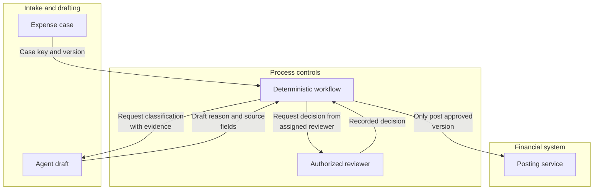
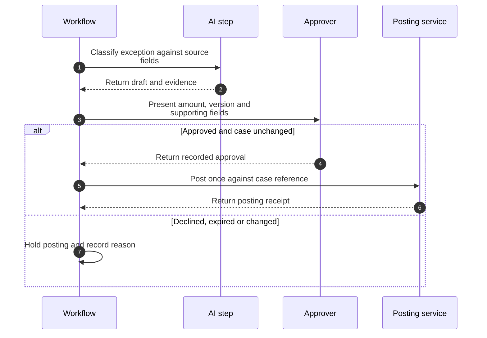

# Let a workflow own approvals and an agent own the draft

**Class:** Synthesized technical pattern. **Intent:** Use AI for an uncertain input while keeping a predictable, auditable path for a consequential action.

## Architecture

**Review decision:** Only a recorded decision for the exact version and amount may release posting. The AI step prepares evidence; it does not select its own approver or authorize the transaction.

## Technical flow

## Copilot Studio components

**Recommended build ([harness](../COMPONENTS.md#the-harness-is-the-first-decision)):** A Microsoft Copilot harness workflow, or a Standard harness agent flow with a Power Automate approval. On the standard harness, use an agent flow, a prompt tool for the draft and a Power Automate approval.

| Component | Use in this pattern | Harness alternative |
| --- | --- | --- |
| [Workflow](../COMPONENTS.md#workflows): Expense exception workflow | Owns the sequence from intake to posting. | Std: agent flow. |
| [Workflow nodes](../COMPONENTS.md#workflow-nodes): Inline agent node | Proposes a reason category and cites supporting fields. | Std: prompt tool. |
| [Workflow nodes](../COMPONENTS.md#workflow-nodes): Condition and lookup | Validate fields and look up the designated reviewer outside the model. | Std: flow condition and connector. |
| [Human gate](../COMPONENTS.md#human-in-the-loop-gates): Approvals or request-for-information node | Records the reviewer's decision for the exact version and amount. | Std: Power Automate approval. |
| [Connector tool](../COMPONENTS.md#connector-tools): Posting connector | Posts only after a recorded approval. | All harnesses. |

**Not the right component:** Letting the inline agent choose the approver or post the transaction.

**Copilot Credits drivers (medium):** Each workflow action costs 0.13 credits, and the inline agent adds usage-based charges. Its instructions are resent on every turn. Failed runs still pay for completed steps, so validate early. See [Copilot Credits guidance](../COPILOT-CREDITS.md).

## Design notes

**Flow:** A workflow receives an expense exception and records its key. An AI step proposes a reason category and cites supporting fields; the workflow validates those fields and looks up the designated reviewer outside the model. The reviewer sees the proposal and source evidence. Only a recorded approval releases the deterministic posting step. The initiating agent, if any, can report the pending case reference.

**Choose it when** branches and approvals are known in advance. Use Power Automate cloud flows where they already meet the need; consider Copilot Studio workflows when native AI and human-review steps add value. Compare with an [event-driven agent](event-worker.md), where the agent decides the next step at runtime.

**Trust boundary:** The approver must be authorized and distinct from the requester where policy requires. Bind the decision to the exact record version and amount. A chat message saying “approved” or a model classification cannot authorize the post.

**Failure handling:** Expire unanswered approvals and route them to a named owner. If input changes after approval, request a new decision. Test rejection, duplicate callbacks and a posting timeout; retain the receipt separately from the approval.

**Sources:** [Design AI-powered automations](https://learn.microsoft.com/en-us/microsoft-copilot-studio/guidance/ai-powered-automation) · [Microsoft public human-in-the-loop sample](https://github.com/microsoft/CopilotStudioSamples/tree/main/extensibility/human-in-the-loop).
