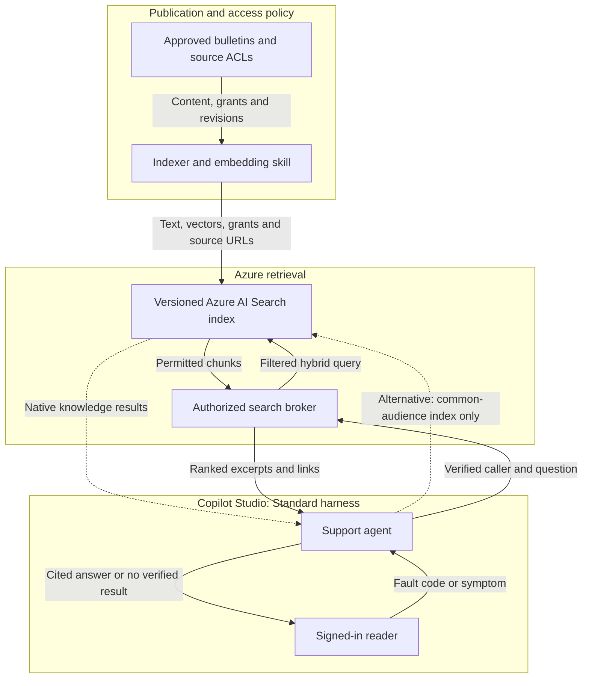
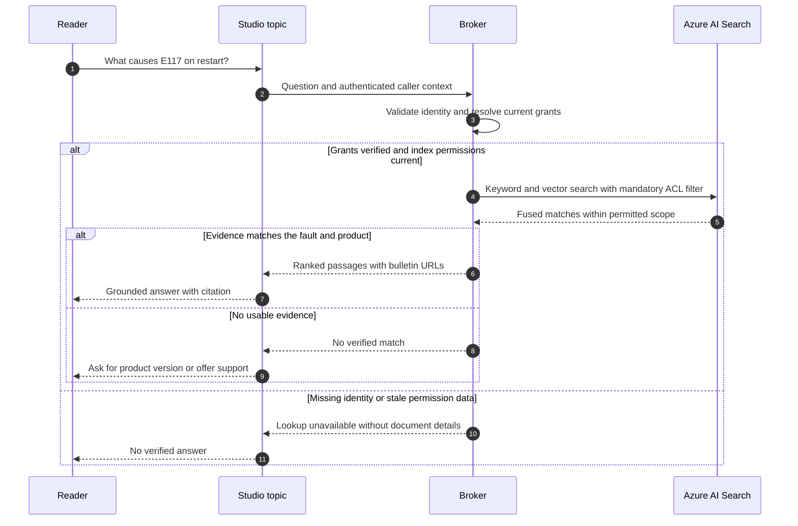

# Ground a support answer in one hybrid search index

**Class:** Synthesized technical pattern. **Intent:** Find the right support bulletin whether the reader supplies an exact fault code or describes the symptom in their own words. Return a passage the reader is allowed to see, with a link to the current bulletin.

## Architecture

**Review decision:** Can every intended reader see every passage in the selected index? If so, use native knowledge. If access differs by document, or ranking must follow a particular query contract, use the broker. Do not leave the restricted index attached as a second, unfiltered knowledge source.

## Technical flow

## Copilot Studio components

**Recommended build ([harness](../COMPONENTS.md#the-harness-is-the-first-decision)):** Standard harness with a topic and user-authenticated connector to a search broker. Use this path to control ranking for the fault code and enforce bulletin entitlements. For a common-audience index that does not need a custom query plan, use the [native knowledge path](search-index-lifecycle.md) **instead**, not alongside the broker. The native connection is not a query editor.

| Component | Use in this pattern | Alternative |
| --- | --- | --- |
| [Topic nodes](../COMPONENTS.md#topic-nodes) and [connector tool](../COMPONENTS.md#connector-tools) | Call the broker under a verifiable caller identity. Pass permitted results to the generative answers node's **Classic data → Custom data** input. | An agent flow can wrap the call if it preserves caller authority. See the [custom retrieval contract](custom-retrieval.md) for field mapping and the first-three-record limit. |
| [Knowledge](../COMPONENTS.md#knowledge-sources): alternative for a common audience | **Add knowledge → Azure AI Search**; select one vector index and wait for **Ready**. Configure semantic ranker in Search if needed. | On the Microsoft Copilot harness, a [Foundry IQ tool](foundry-iq-knowledge-base.md) targets a knowledge base, not this index picker. |

**Copilot Credits drivers (medium):** A metered Standard turn incurs a generative answer; the broker path can add actions or agent-flow steps. Search capacity, optional semantic ranking and model calls for embeddings are Azure costs, not Studio actions. Include reindexing and evaluation queries in the Azure estimate. See [Copilot Credits guidance](../COPILOT-CREDITS.md).

## Design notes

- **Index lifecycle:** Give each chunk a stable key, parent bulletin ID, searchable text, vector, revision and canonical citation URL (`metadata_storage_path` or a complete document URL for Studio). Use the same embedding model and dimensions at ingestion and query time. Schedule incremental updates; propagate deletions, superseded versions and permission changes to **every** child chunk. For a schema or embedding change, build alongside the old index, replay changes and test before switching the connection. Roll back only to a permission-current index.
- **Retrieval:** A brokered hybrid query searches text (BM25) and vectors in parallel. Reciprocal rank fusion merges their ranked lists; an optional semantic ranker reranks the candidates. The code match helps distinguish E117 from E171; the vector match helps when the reader only says “restarts after warming up.” Return supporting text, not vectors or just the top score.
- **Trust:** The Search connection authorizes the service call, not the reader's access to a bulletin. For application-managed trimming, bind tenant and allowed principals to each chunk from the authoritative policy for **that** document, not from editable content or enrichment output. The broker derives principals from verified identity and directory data, never prompt text or client-supplied group IDs. Apply a server-owned tenant and grant filter to every query, including retries, before excerpts reach Studio or logs. Deny direct access around the broker.
- **Failure and evaluation:** If entitlements cannot be verified or Search times out, stop rather than broadening the search. Compare keyword-only, vector-only and hybrid top-three results on exact codes and paraphrases; check whether the cited revision supports the answer. Repeat as a non-reader, then revoke a reader and delete a bulletin. No restricted text, title or link should survive in answers, cached results or fallback responses.

**Sources:** [Studio: add Azure AI Search knowledge](https://learn.microsoft.com/en-us/microsoft-copilot-studio/knowledge-azure-ai-search) · [Hybrid search and reciprocal rank fusion](https://learn.microsoft.com/en-us/azure/search/hybrid-search-overview) · [Integrated vectorization](https://learn.microsoft.com/en-us/azure/search/vector-search-integrated-vectorization) · [Update or rebuild an index](https://learn.microsoft.com/en-us/azure/search/search-howto-reindex) · [Application-managed security filters](https://learn.microsoft.com/en-us/azure/search/search-security-trimming-for-azure-search).
