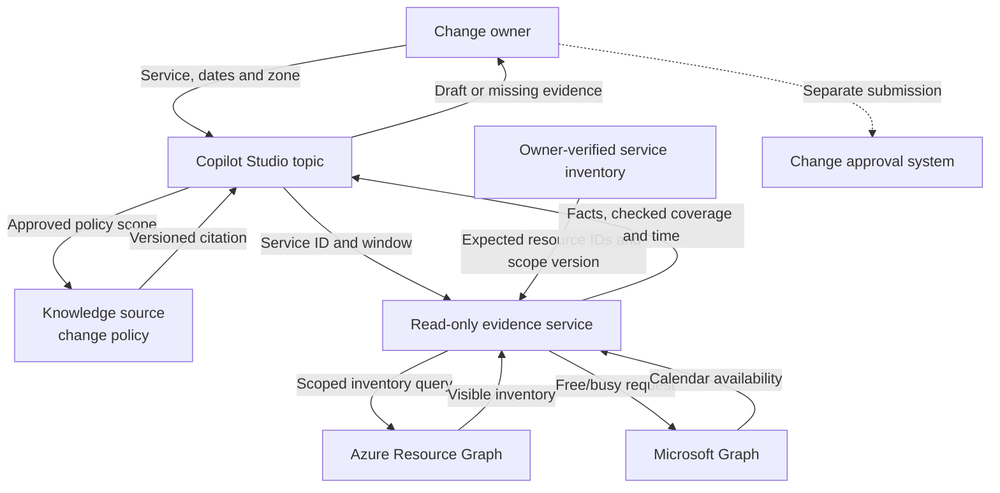
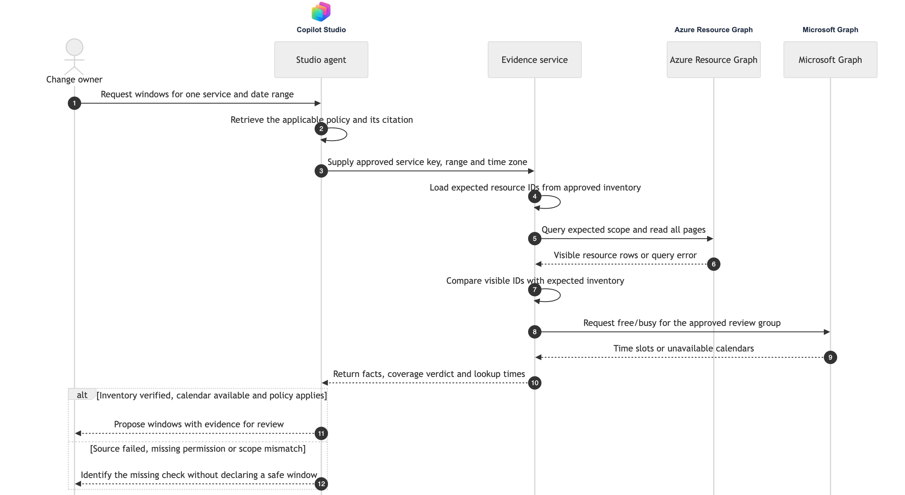
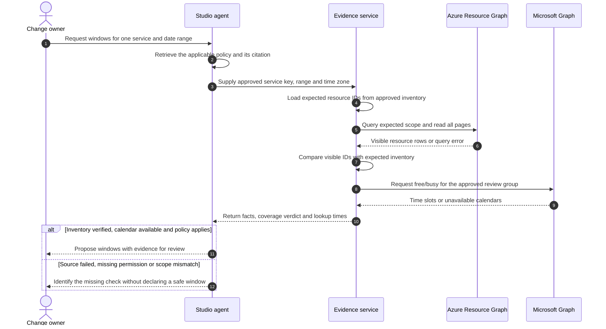

# Combine policy evidence, Microsoft Graph and Azure inventory in a change brief

**Class:** Synthesized technical pattern. **Intent:** Answer “Which maintenance window can I propose for the orders service?” A policy passage explains the rule; Azure Resource Graph identifies the visible resources; Microsoft Graph supplies free/busy slots. The output is a proposal, not a calendar booking or an Azure change.

## Architecture

**Review decision:** Assign an authority to each claim. A calendar can say a reviewer appears available; it cannot grant change approval. Inventory can identify resources visible in a subscription; it cannot prove the absence of dependencies.

## Technical flow

Text and editable Mermaid sequence

## Copilot Studio components

**Recommended build:** Standard harness. A [topic](../COMPONENTS.md#topics-and-system-topics) collects the service and time zone; a [knowledge source](../COMPONENTS.md#knowledge-sources) grounds the policy; one user-authenticated [connector tool](../COMPONENTS.md#connector-tools) calls the team's read-only evidence service. If that service already serves several agents, [expose the reads through MCP](apim-rest-to-mcp.md) instead. For a curated policy corpus spanning repositories, [Foundry IQ](foundry-iq-knowledge-base.md) is a retrieval alternative, not a replacement for either live lookup.

| Component | Use in this pattern | Harness alternative |
| --- | --- | --- |
| [Topic nodes](../COMPONENTS.md#topic-nodes) | Ask for service and dates; use a condition to withhold a proposal if required evidence is missing. | On the Microsoft Copilot harness use a workflow if this check must always run in order. |
| Knowledge + connector tool | Cite a policy passage and return independently sourced inventory and calendar facts. | Keep the three sources distinguishable even if one MCP server exposes both live reads. |
| [Human gate](../COMPONENTS.md#human-in-the-loop-gates) | The change owner takes the draft to the existing approval process; the agent has no write tool. | The external approval remains authoritative on any harness. |

**Copilot Credits drivers (medium):** Count policy grounding and billable agent actions on the selected harness. Two downstream API requests behind one tool are not automatically two Studio agent actions. Estimate service hosting, any gateway, and any alternative knowledge-base/model usage separately. See [Copilot Credits guidance](../COPILOT-CREDITS.md).

## Design notes

- **Define what “covered” means.** The service owner supplies a versioned inventory of the required resource IDs and subscriptions, independent of the querying principal's view. The evidence service reads every page of a fixed query and compares IDs, not counts. Mark coverage **verified for that inventory version** only if it is current and every required ID was observed. Mark a known gap **incomplete**; mark coverage **unknown** if the baseline is missing, stale or not known to be exhaustive, or the query did not finish. An HTTP success, an empty page or one visible resource per subscription does not establish coverage. Return the verdict, permitted scope, inventory version and observation time alongside the policy citation and time-zoned free/busy result.
- **Trust boundary:** Call the Azure Resource Graph `Resources` API with Azure RBAC read access and Microsoft Graph `getSchedule` with an independently authorized, delegated work-account connection (`Calendars.ReadBasic` is the documented least privilege). A middle tier needs tokens for the correct audiences. Return only free/busy intervals, not event subjects; do not treat a partially visible subscription as a complete service inventory.
- **Failure handling and acceptance:** Resource Graph can silently omit resources the principal cannot read. Test a successful response with one required subscription hidden, a missing resource within a visible subscription, and a stale inventory baseline. Also test missing free/busy data and an ambiguous daylight-saving transition. Withhold the window if any required fact cannot be verified; explain the gap without disclosing inaccessible resource identifiers. Resource Graph is eventually consistent: if an authoritative last-minute check is mandatory, require it in the change system. The agent cannot deploy a change or send an invitation.

**Sources:** [Azure Resource Graph Resources REST API](https://learn.microsoft.com/en-us/rest/api/azureresourcegraph/resourcegraph/resources/resources?view=rest-azureresourcegraph-resourcegraph-2024-04-01) · [Resource Graph permissions and consistency](https://learn.microsoft.com/en-us/azure/governance/resource-graph/overview) · [Microsoft Graph calendar getSchedule](https://learn.microsoft.com/en-us/graph/api/calendar-getschedule?view=graph-rest-1.0).
