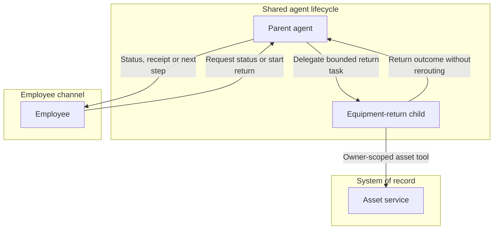
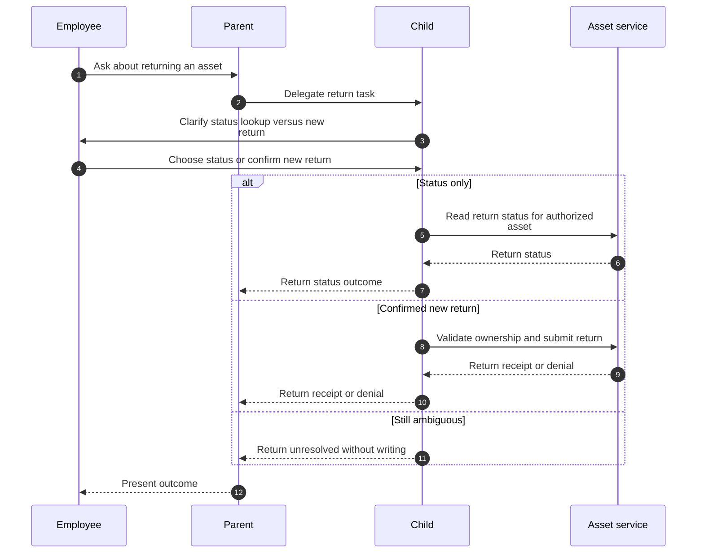

# Group one specialist task inside a parent agent

**Class:** Synthesized technical pattern. **Intent:** Keep a task's instructions, tools and knowledge together without creating another independently published service.

## Architecture

**Review decision:** Use a child when one team owns the whole release. A separate set of instructions is useful for routing but is not an independent authorization boundary.

## Technical flow

## Copilot Studio components

**Recommended build ([harness](../COMPONENTS.md#the-harness-is-the-first-decision)):** Standard harness, generative orchestration. The Microsoft Copilot harness has no child agents: use a skill for a procedure or a connected agent for a separate owner. The Customer Conversation harness uses sub-agents.

| Component | Use in this pattern | Harness alternative |
| --- | --- | --- |
| [Orchestration](../COMPONENTS.md#orchestration-modes): Generative orchestration | Routes the bounded task to the child by description. | Copilot: reasoning loop. |
| [Child agent](../COMPONENTS.md#child-agents-and-sub-agents): Equipment-return child | Holds the task's instructions, tools and knowledge in the parent's release. | Copilot: skill or connected agent; Customer Conversation: sub-agent. |
| [Knowledge](../COMPONENTS.md#knowledge-sources): Return guidance | Scoped to the child. | All harnesses. |
| [Connector tool](../COMPONENTS.md#connector-tools): Asset service | Records the return. | All harnesses. |

**Not the right component:** A child agent as a security boundary. It shares the parent's lifecycle and identity configuration.

**Copilot Credits drivers (medium):** Child invocations and their tool steps appear as agent actions. With a reasoning model, the premium token meter includes the child's tokens. Distinct descriptions avoid duplicate planning steps. See [Copilot Credits guidance](../COPILOT-CREDITS.md).

## Design notes

**Flow:** On the standard harness with generative orchestration, the parent recognizes a bounded task such as equipment return and invokes its child agent. The child gathers the return identifier, consults return guidance, calls the appropriate tool and finishes that task. Give parent and child distinct descriptions so a direct tool and a child do not compete for the same intent.

**Choose it when** one team owns the experience and wants one release lifecycle. Use a topic for a rigid script. Use a [connected agent](connected-agent.md) instead if the specialist must serve other parents, have separate configuration or release independently.

**Trust boundary:** Logical separation is not a separate security principal. The backend must enforce the user's right to return the specific asset, even when only the child can select the tool.

**Failure handling:** Give the parent an explicit unresolved outcome rather than letting it route the same request back indefinitely. Test ambiguous “return status” versus “start a return” requests and verify that no write occurs on the lookup path.

**Source:** [Add a child agent](https://learn.microsoft.com/en-us/microsoft-copilot-studio/add-agent-child-agent).
