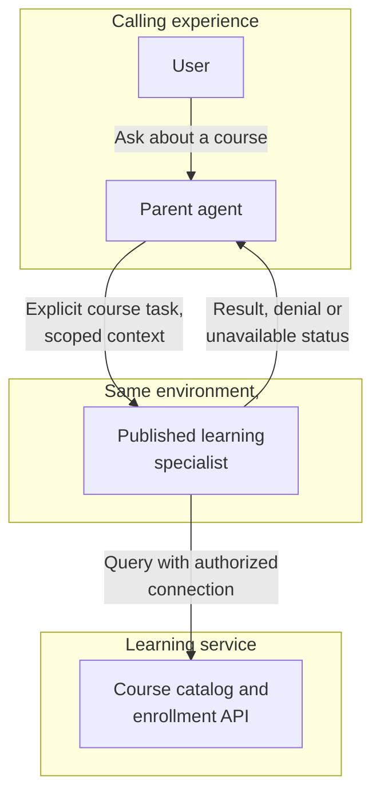
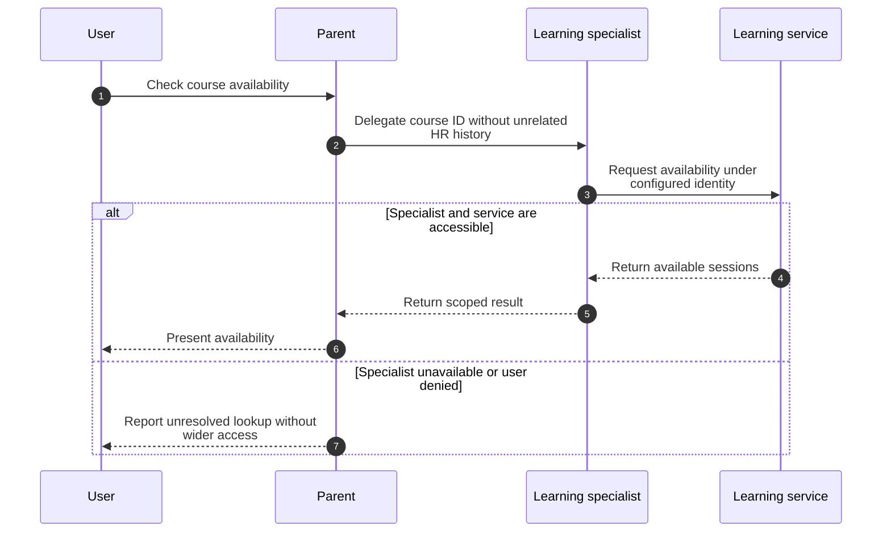

# Delegate to an independently published specialist

**Class:** Synthesized technical pattern. **Intent:** Reuse an agent owned by another team without copying its instructions and integrations into every front door.

## Architecture

**Review decision:** Choose a connected agent when the specialist needs an independent owner or release cycle. Agree on the delegated task and whether any conversation history may cross that boundary.

## Technical flow

## Design notes

**Flow:** A standard-harness parent routes a bounded request to an existing, published Copilot Studio agent in the same environment that permits connections. For example, pass “check availability for course X” to the learning specialist, not an entire HR conversation. The specialist queries the learning system and returns the status; the parent presents the result.

**Choose it when** release cycles or ownership genuinely differ. Extra hops increase latency, and independent updates can change behavior without a parent release. Prefer a [child agent](child-agent.md) when reuse and separate lifecycle are unnecessary.

**Trust boundary:** Review the history-sharing setting and disable it unless needed. Confirm end-user access to the specialist and its tools, not merely maker access to connect it. External agent types have different prerequisites and preview status.

**Failure handling:** Agree on responses for unavailable, denied and not found; test them in each calling agent. Re-evaluate the parent when the specialist publishes changes, including changes to the routing description, which the parent maintains locally.

**Sources:** [Connect to a Copilot Studio agent](https://learn.microsoft.com/en-us/microsoft-copilot-studio/add-agent-copilot-studio-agent) · [Connected and child agent design considerations](https://learn.microsoft.com/en-us/microsoft-copilot-studio/authoring-add-other-agents).
