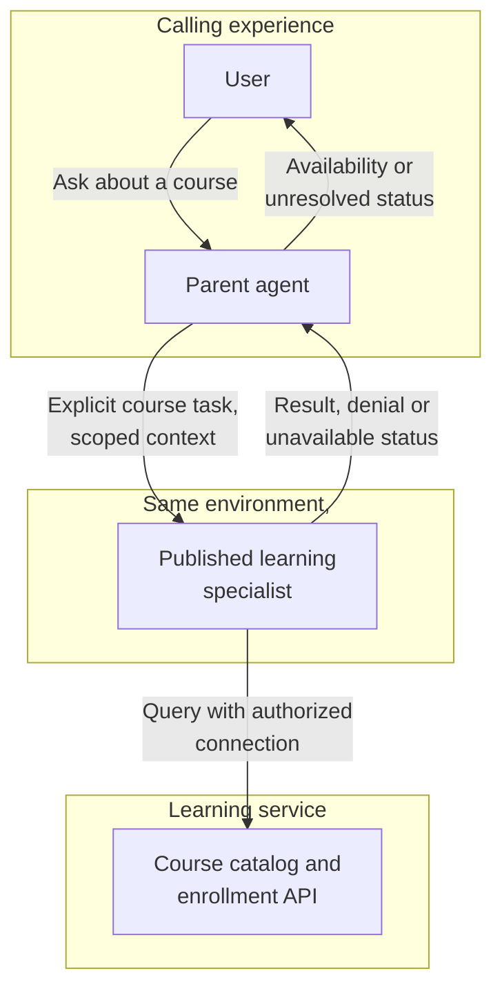
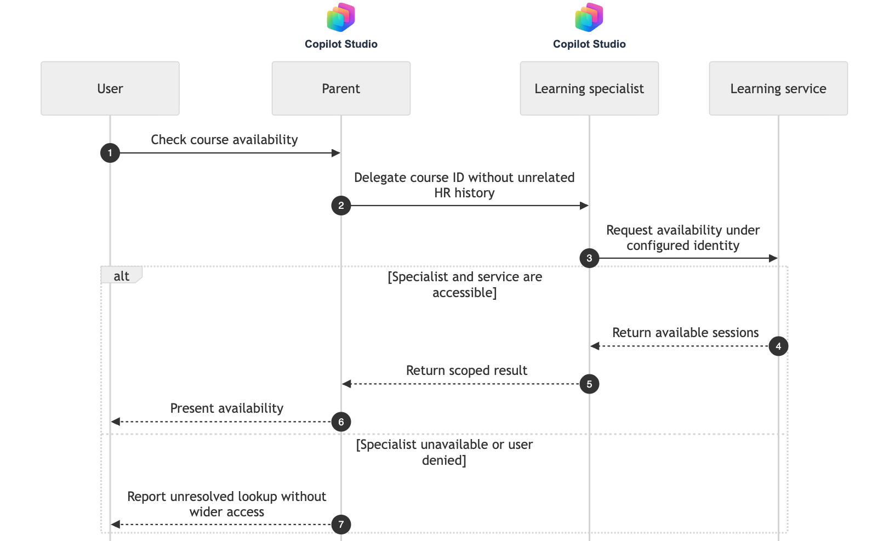
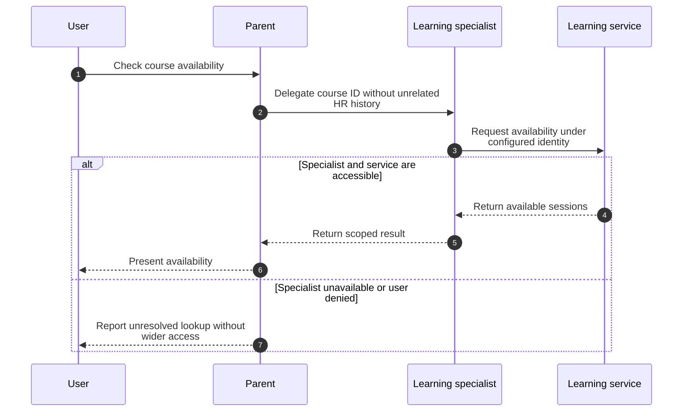

# Delegate to an independently published specialist

**Class:** Synthesized technical pattern. **Intent:** Reuse an agent owned by another team without copying its instructions and integrations into every front door.

## Architecture

**Review decision:** Choose a connected agent when the specialist needs an independent owner or release cycle. Agree on the delegated task and whether any conversation history may cross that boundary.

## Technical flow

Text and editable Mermaid sequence

## Copilot Studio components

**Recommended build ([harness](../COMPONENTS.md#the-harness-is-the-first-decision)):** Standard harness or Microsoft Copilot harness. On the Microsoft Copilot harness, sharing the parent agent lets it invoke a connected Copilot Studio agent for those users. On the standard harness, you may need to share the specialist separately.

| Component | Use in this pattern | Harness alternative |
| --- | --- | --- |
| [Connected agent](../COMPONENTS.md#connected-agents): Published learning specialist | Handles the course query in its own release. | All harnesses. |
| [Instructions](../COMPONENTS.md#instructions): Delegation description | Pass a bounded task, not the whole conversation. | All harnesses. |
| [Connector tool](../COMPONENTS.md#connector-tools): Learning service in the specialist | Queries the catalog and enrollment API. | All harnesses. |
| [Authentication](../COMPONENTS.md#authentication-and-tool-credentials): User authentication on specialist tools | Trims results to the caller. | Copilot: author-authenticated tools return data through the parent. |
| [Solutions and ALM](../COMPONENTS.md#solutions-and-alm): Independent solution | Gives the specialist its own release cycle. | All harnesses. |

**Not the right component:** A connected agent for a small task the parent can do directly.

**Copilot Credits drivers (medium):** Both agents incur billed events: the parent's routing and the specialist's answers and tools. On the Microsoft Copilot harness, both consume usage-based credits. Delegate only where independent ownership pays for the extra hop. See [Copilot Credits guidance](../COPILOT-CREDITS.md).

## Design notes

**Flow:** A standard-harness parent routes a bounded request to an existing, published Copilot Studio agent in the same environment that permits connections. For example, pass “check availability for course X” to the learning specialist, not an entire HR conversation. The specialist queries the learning system and returns the status; the parent presents the result.

**Choose it when** release cycles or ownership genuinely differ. Extra hops increase latency, and independent updates can change behavior without a parent release. Prefer a [child agent](child-agent.md) when reuse and separate lifecycle are unnecessary.

If the specialist is maintained in Microsoft Foundry rather than Copilot Studio, use the [Foundry specialist integration](foundry-agent-specialist.md); its publication, identity and billing boundaries differ.

**Trust boundary:** On standard, review the history-sharing setting and disable it unless needed. On the Microsoft Copilot harness, [delegation sends relevant conversation history and may rephrase the request](https://learn.microsoft.com/en-us/microsoft-copilot-studio/agents-experience/authoring-add-other-agents). A short task description is not a data filter. Confirm which context the specialist receives and whose credentials its tools use; do not allow a second delegation hop on that harness.

**Failure handling:** Agree on responses for unavailable, denied and not found; test them in each calling agent. Re-evaluate the parent when the specialist publishes changes, including changes to the routing description, which the parent maintains locally.

**Sources:** [Connect to a Copilot Studio agent](https://learn.microsoft.com/en-us/microsoft-copilot-studio/add-agent-copilot-studio-agent) · [Connected and child agent design considerations](https://learn.microsoft.com/en-us/microsoft-copilot-studio/authoring-add-other-agents).
