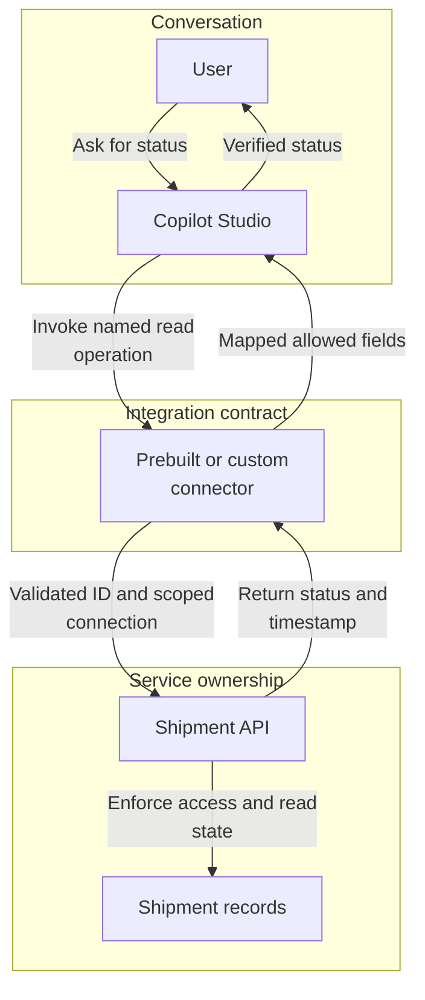
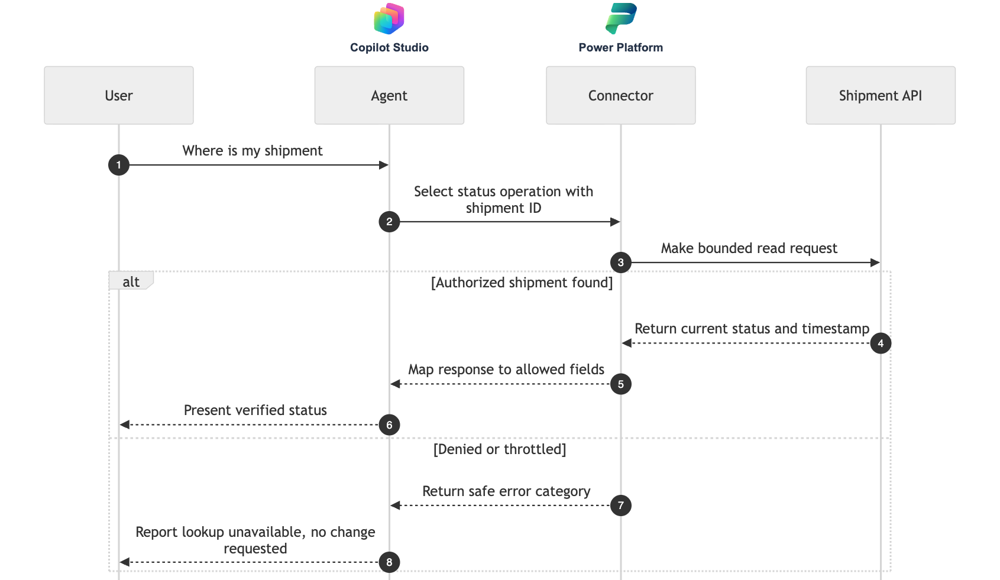
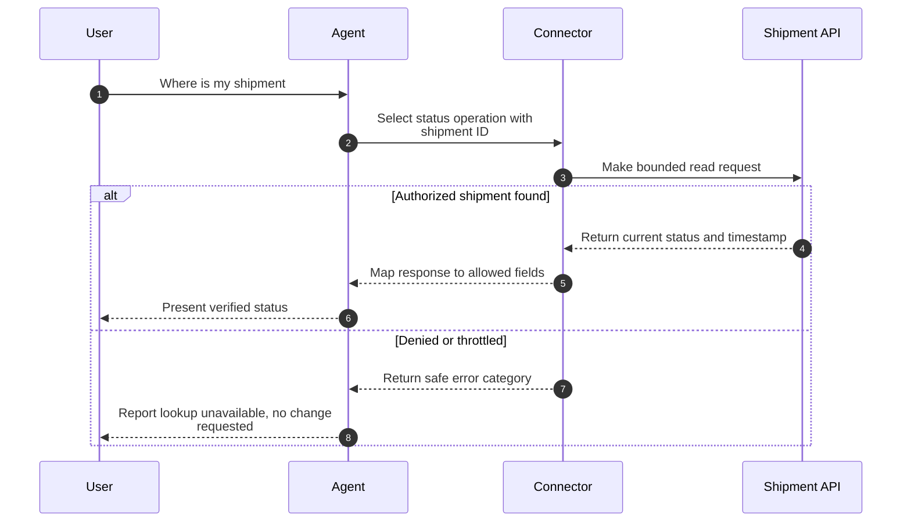

# Expose a narrow business operation through a connector

**Class:** Synthesized technical pattern. **Intent:** Let an agent use a business API through a reusable operation rather than inventing arbitrary requests.

## Architecture

**Review decision:** Approve specific business operations and scopes, not broad API reach. A shipment status question should have no route to a write unless a separate change is explicitly authorized.

## Technical flow

Text and editable Mermaid sequence

## Copilot Studio components

**Recommended build ([harness](../COMPONENTS.md#the-harness-is-the-first-decision)):** Any harness. MCP servers and workflows are alternatives when the API owner maintains a catalog or several calls must run in order.

| Component | Use in this pattern | Harness alternative |
| --- | --- | --- |
| [Connector tool](../COMPONENTS.md#connector-tools): Prebuilt or custom connector | Exposes one named operation, such as **read shipment status**. | All harnesses. |
| [Authentication](../COMPONENTS.md#authentication-and-tool-credentials): Connection authentication | Choose user or maker credentials deliberately. | All harnesses. |
| [Instructions](../COMPONENTS.md#instructions): Distinct tool description | Keeps a read operation separate from a change request. | All harnesses. |
| [Environments and data policies](../COMPONENTS.md#environments-and-data-policies): DLP connector policy | Controls which connectors the environment may combine. | All harnesses. |

**Not the right component:** One connector operation that exposes the API's full read-write surface.

**Copilot Credits drivers (low):** On the standard harness, the tool step appears as an agent action. On usage-based harnesses, the tool and its response size consume credits. Return bounded fields. See [Copilot Credits guidance](../COPILOT-CREDITS.md).

## Design notes

**Flow:** Start with a supported prebuilt Power Platform connector. If none meets the need, define a custom connector around an owned REST API. Expose a specific operation such as “read shipment status,” with required identifiers, a bounded response and a description distinct from “request shipment change.” Return the system's status and timestamp, not its full raw object.

**Choose it when** several agents or flows need a stable service contract. A custom connector requires someone to own API versioning and authentication. A [direct REST tool](direct-rest-tool.md) may suit a one-agent prototype; [MCP](mcp-tools.md) may suit a centrally changing catalog.

**Trust boundary:** Configure which identity the connection uses. Validate record access, fields and business rules at the service. Put endpoint selection under maker/admin control, not a user-provided URL.

**Failure handling:** Map not found, permission denied and temporarily unavailable to distinct safe outcomes. Respect throttling; replay writes only with an idempotency key and reconciliation. Test that a status question cannot accidentally call the change operation.

**Source:** [Plan and design integration strategies for Copilot Studio](https://learn.microsoft.com/en-us/microsoft-copilot-studio/guidance/integrations).
