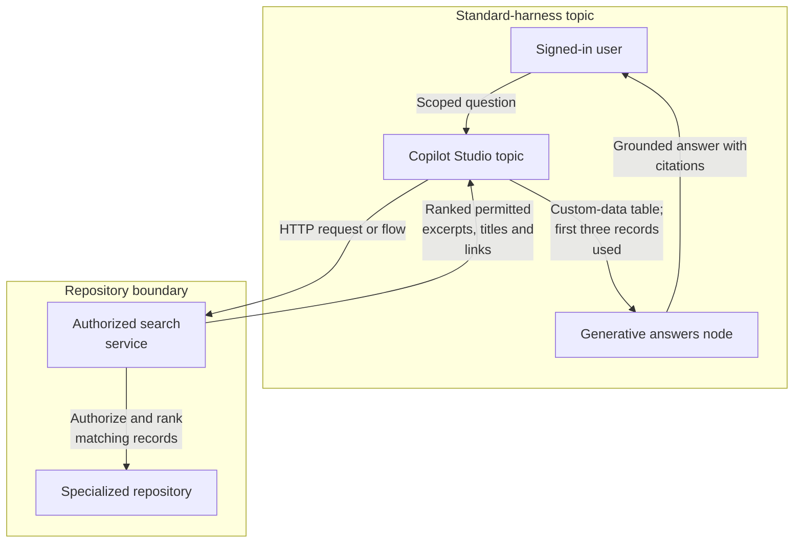
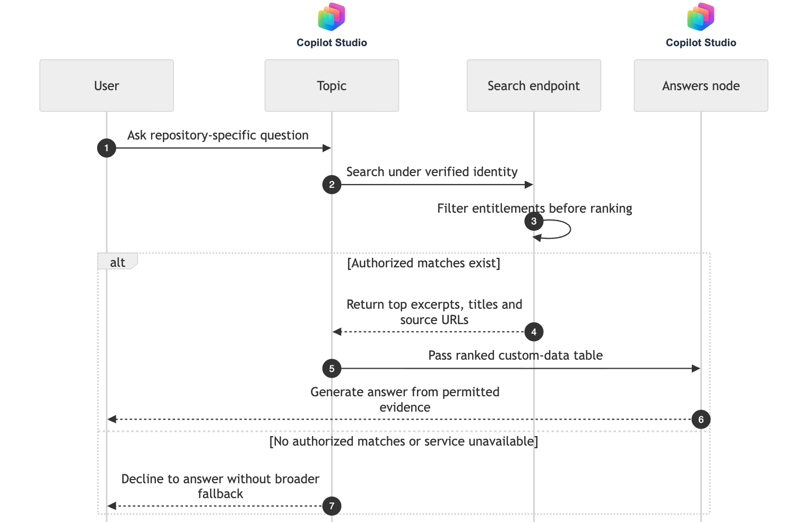
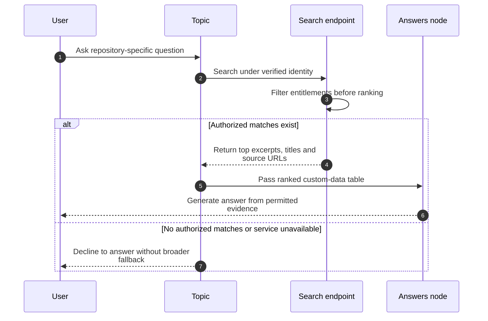

# Bring authorized search results to a generative answers node

**Class:** Synthesized technical pattern. **Intent:** Ground answers in a repository with specialized ranking or entitlements that native knowledge sources cannot represent.

## Architecture

**Review decision:** The search service must filter results before the agent sees them. A protected citation URL does not prevent disclosure of an unauthorized excerpt.

## Technical flow

Text and editable Mermaid sequence

## Copilot Studio components

**Recommended build ([harness](../COMPONENTS.md#the-harness-is-the-first-decision)):** Standard harness: a topic with a generative answers node using custom data. The Microsoft Copilot harness does not list Azure AI Search knowledge or this node. Expose the search service as an MCP server or tool.

| Component | Use in this pattern | Harness alternative |
| --- | --- | --- |
| [Topics](../COMPONENTS.md#topics-and-system-topics): Retrieval topic | Owns the call sequence. | Copilot: tool. |
| [Topic nodes](../COMPONENTS.md#topic-nodes): HTTP request or agent flow | Calls the authorized search service. | Copilot: workflow or MCP. |
| [Topic nodes](../COMPONENTS.md#topic-nodes): Generative answers node (custom data) | Grounds on `Content`, `Title` and `ContentLocation`. The documented node uses the first three records. | Copilot: no equivalent node. |
| [Authentication](../COMPONENTS.md#authentication-and-tool-credentials): Caller identity to search | The search service filters results before the agent sees them. | All harnesses. |
| [Knowledge](../COMPONENTS.md#knowledge-sources): Native Azure AI Search knowledge | Simpler alternative when entitlements fit. *(Optional.)* | Not listed for Copilot. |

**Not the right component:** Filtering unauthorized excerpts after retrieval.

**Copilot Credits drivers (medium):** Each answer bills a generative answer (2). Topic transitions and tool steps bill as agent actions, and an agent flow adds actions at 13 per 100. Return three small excerpts. See [Copilot Credits guidance](../COPILOT-CREDITS.md).

## Design notes

**Flow:** A standard-harness topic calls an approved search endpoint using an HTTP request or Power Automate flow. The service authorizes the caller, ranks permitted matches and returns small excerpts. Map them into a table for the generative answers node's **Classic data / Custom data** option: `Content`, plus `Title` and `ContentLocation` for usable citations. The documented node uses only the first three records.

**Choose it when** you need to own search quality, freshness or source-specific filtering. For an ordinary SharePoint library use [native grounding](sharepoint-grounding.md) instead: a custom service adds availability, relevance and authorization work.

For an index you operate, compare [hybrid query control](azure-search-hybrid-rag.md) with the [native knowledge ingestion lifecycle](search-index-lifecycle.md). If the content should stay in Microsoft 365, the [Copilot Retrieval API](m365-retrieval-api.md) can return delegated extracts instead.

**Trust boundary:** Filter at retrieval time, before the model or logs see any excerpt. A link that requires sign-in does not protect text already returned to a user. Never grant a broad service identity unrestricted search solely to improve recall.

**Failure handling:** Distinguish no authorized matches from a backend outage internally; avoid revealing inaccessible records to the user. For restricted intents, do not allow a broader agent-level fallback to invent an answer. Test a revoked document and a timeout.

**Source:** [Use custom data in generative answers nodes](https://learn.microsoft.com/en-us/microsoft-copilot-studio/nlu-generative-answers-custom-data).
