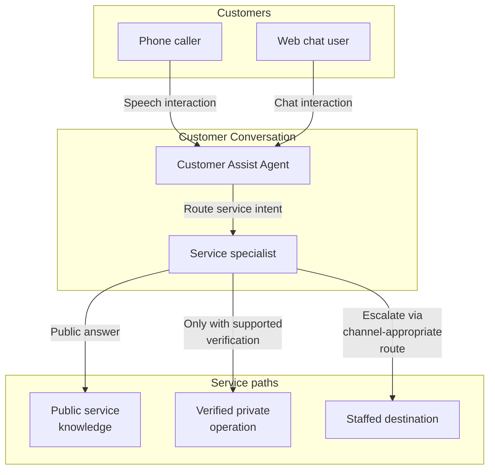
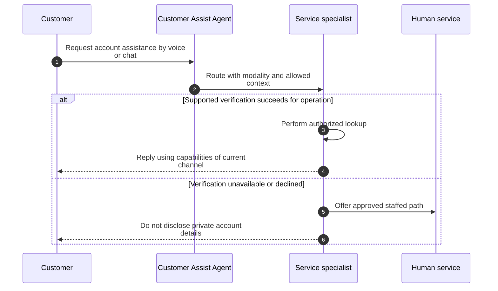

# Design distinct voice and chat paths for one customer service

**Class:** Synthesized technical pattern. **Intent:** Offer the same service by phone and web chat without assuming a caller can sign in or click the controls available in chat.

## Architecture

**Review decision:** Approve each private action per modality. A caller who cannot use end-user sign-in must not acquire an employee's access through a shared connection.

## Technical flow

## Design notes

**Flow:** A Customer Assist Agent on the Customer Conversation harness receives a call or chat. Shared domain guidance defines the service; modality-specific instructions govern what the customer hears or sees. Route focused intents to a specialist, verify the customer before private actions, and escalate to a staffed destination supported in that modality.

**Choose it when** speech and chat both need a natural conversation with predictable service boundaries. For a policy assistant in Teams this introduces unnecessary verification, telephony and routing decisions. Confirm channel, licensing and language availability for the intended service.

**Trust boundary:** The documented speech channel does not support end-user sign-in for knowledge sources requiring those credentials. Do not reuse a broad maker credential to simulate a signed-in caller. Use appropriately verified operations, publicly approved knowledge or human transfer.

**Failure handling:** On uncertain speech recognition, read back non-sensitive choices. If verification or transfer fails, give a staffed alternative without disclosing account details. Test a phone caller who cannot use a link and a chat user who declines verification.

**Source:** [Customer Conversation harness: modalities, knowledge, verification and escalation](https://learn.microsoft.com/en-us/microsoft-copilot-studio/agents-experience/overview-customer-conversation).
