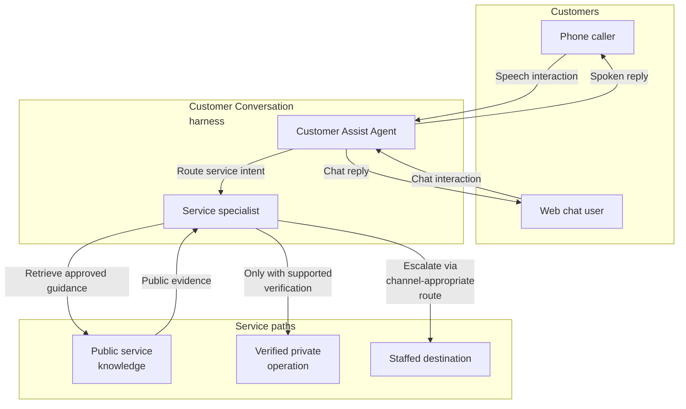
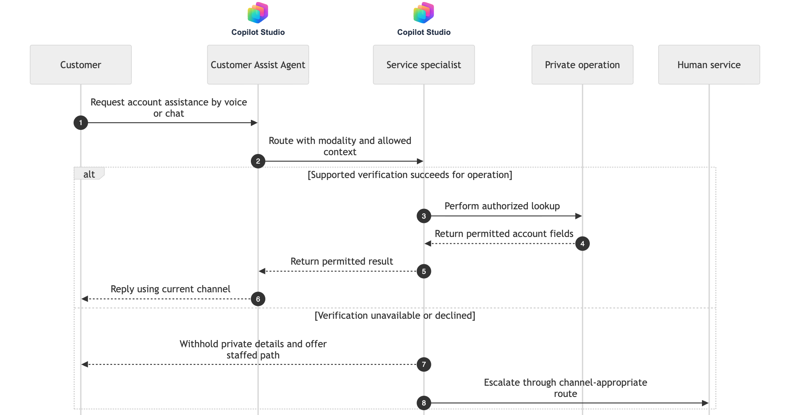
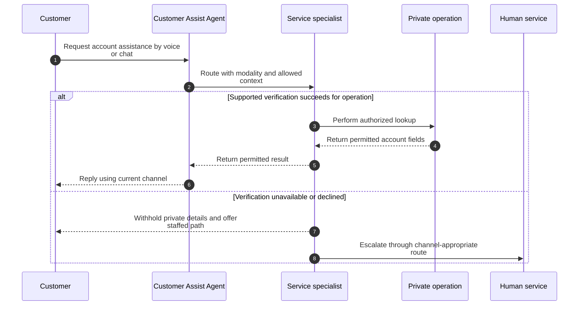

# Design distinct voice and chat paths for one customer service

**Class:** Synthesized technical pattern. **Intent:** Offer the same service by phone and web chat without assuming a caller can sign in or click the controls available in chat.

## Architecture

**Review decision:** Approve each private action per modality. A caller who cannot use end-user sign-in must not acquire an employee's access through a shared connection.

## Technical flow

Text and editable Mermaid sequence

## Copilot Studio components

**Recommended build ([harness](../COMPONENTS.md#the-harness-is-the-first-decision)):** Customer Conversation harness when a service needs one primary agent with distinct speech and chat behavior. Verify each private operation separately for callers and signed-in chat users.

| Component | Use in this pattern | Harness alternative |
| --- | --- | --- |
| [Instructions](../COMPONENTS.md#instructions): Primary agent with Speech and Chat tabs | Holds modality-specific guidance. | Std: separate topics per modality. |
| [Sub-agents](../COMPONENTS.md#child-agents-and-sub-agents): Service specialists | Handle focused intents, each with an escalation path. | Std: child agents. |
| [Knowledge](../COMPONENTS.md#knowledge-sources): Public service knowledge | Sources that need end-user credentials work in chat only. | All harnesses. |
| [Authentication](../COMPONENTS.md#authentication-and-tool-credentials): Voice authentication | Enable caller verification under voice capabilities, not as a connector. It does not sign the caller in to SharePoint or Dataverse. | Std: use a supported identity path for that channel. |
| [Connector tool](../COMPONENTS.md#connector-tools): Private lookup | Check the verified identity's entitlement in the backend before returning account fields. | With no supported identity path, offer staffed service. |
| [Escalation and handoff](../COMPONENTS.md#escalation-and-handoff): Escalate tool | Transfers to Teams Phone, email or a live representative. | Std: **Transfer conversation**. |
| Built-in CC events: Conversation Start, End of Conversation, On Error | Enable the responses needed for these conversation moments; these are not user-intent topics. | Std: system topics. |
| [Skill](../COMPONENTS.md#skills): Topic skill | Optionally author a fixed sequence for collecting a service reference before lookup. | Std: authored topic. |

**Not the right component:** A shared employee connection for callers who cannot sign in.

**Copilot Credits drivers (high):** Benchmark light, medium and heavy conversations separately for digital, GenAI voice and premium voice. Do not apply the standard harness's fixed voice-minute rates to Customer Conversation. See [Copilot Credits guidance](../COPILOT-CREDITS.md).

## Design notes

**Flow:** A Customer Assist Agent on the Customer Conversation harness receives a call or chat. Shared domain guidance defines the service; modality-specific instructions govern what the customer hears or sees. Route focused intents to a specialist, verify the customer before private actions, and escalate to a staffed destination supported in that modality.

**Choose it when** speech and chat both need a natural conversation with predictable service boundaries. For a policy assistant in Teams this introduces unnecessary verification, telephony and routing decisions. Confirm channel, licensing and language availability for the intended service.

**Trust boundary:** The documented speech channel does not support end-user sign-in for knowledge sources requiring those credentials. Do not reuse a broad maker credential to simulate a signed-in caller. Use appropriately verified operations, publicly approved knowledge or human transfer.

**Failure handling:** On uncertain speech recognition, read back non-sensitive choices. If verification or transfer fails, give a staffed alternative without disclosing account details. Test a phone caller who cannot use a link and a chat user who declines verification.

**Sources:** [Customer Conversation harness: modalities, knowledge and escalation](https://learn.microsoft.com/en-us/microsoft-copilot-studio/agents-experience/overview-customer-conversation) · [Caller verification and voice settings](https://learn.microsoft.com/en-us/microsoft-copilot-studio/agents-experience/settings-details-security-customer-conversation#configure-security).
